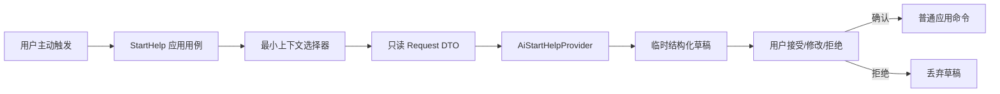
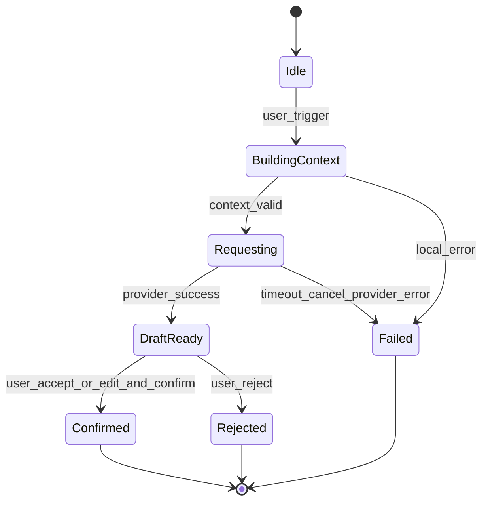

# MyTracer v0.1 AI 边界

> 文档状态：v0.1 最终架构基线（工程决策已批准）  
> 冻结职责：用户主动触发的温和启动帮助  
> 已批准边界：Electron Main 请求、safeStorage 凭据、最近 5 条相关 Record、1～3 条建议；厂商/模型保持未绑定

## 1. 目标与非目标

AI 只帮助用户：

- 恢复当前 Goal/Action 的必要上下文；
- 识别或询问当前阻力；
- 缩小为少量、具体、可拒绝的下一步；
- 提出候选 Understanding，但不得宣称用户已掌握。

AI 不负责：

- 自动规划整日或整周；
- 主动弹出、后台监督、通知或提醒；
- 直接创建、修改或重新安排 Goal、Action、Routine；
- 读取无关 Goal 数据；
- 建立跨会话长期记忆或自动画像；
- 依据时间、次数或对话判断掌握度；
- 把休息一律归因为拖延。

## 2. 信任边界



关键隔离：

- Provider 只有请求 DTO，没有 RepositoryPort、UnitOfWork、文件系统或导出访问权；
- Provider 返回值没有直接写入能力；
- UI 不把 Provider 返回文本解释成已发生事实；
- 只有应用层普通命令可以写核心数据。

## 3. 触发与会话状态机



刷新、关闭或离开流程后临时 AI 会话可以丢弃。v0.1 不保存对话历史。

## 4. 最小上下文契约

### 4.1 允许字段

```text
StartHelpRequest
  requestId
  userInput
  goal
    id
    name
    description?          // 直接相关且在文本预算内才发送
    currentNextAction?
  action?
    id
    title
    description?
    status
  recentRelevantRecords[]
    occurredOn
    outcome
    durationMinutes?
    confirmedUnderstandings[]
    openConfusions[]
    nextStepCandidate?
  currentOpenConfusions[]
  locale
```

最多选择最近 5 条直接相关 Record。Provider 适配器必须配置总字符/令牌预算；具体数值随首个 Provider 批准，但只能进一步截断，不能突破 5 条或扩大字段范围。

### 4.2 选择规则

- 必须先锁定用户当前请求指向的 Goal；没有 Goal 时不执行远程请求，提示用户先选择上下文。
- 只选择该 Goal 当前 Action/下一步及直接关联 Record。
- 近期记录按 `occurredOn`、创建时间稳定倒序截取前 5 条；不得为了凑数量加入其他 Goal。
- 只发送用户已确认的 Understanding；AI 候选和撤销内容不发送。
- 只发送当前仍开放且与当前 Goal/Action 相关的 Confusion。
- 不发送完整导出、全部数据库、其他 Goal 标题、技术日志或密钥。
- 每次请求由纯函数式选择器产生可测试 manifest，测试可以证明未选择对象不在 DTO 中。

### 4.3 数据最小化

若字段对本次“恢复上下文、识别阻力、缩小下一步”没有必要，默认不发送。Provider 适配器可以进一步转换字段名和格式，但不能扩大数据集合。

## 5. Provider 端口

```text
AiStartHelpProvider
  capabilities() -> ProviderCapabilities
  requestStartHelp(request, cancellation) -> StartHelpDraft

ProviderCapabilities
  configured
  available
  modelLabel?             // 仅诊断/界面说明，不进入领域

StartHelpDraft
  acknowledgement
  clarifyingQuestion?
  suggestions[]           // 少量，具体，可执行
  understandingCandidates[]?
  safetyNotes[]?
  providerRequestId?
```

Provider 输出必须经过结构、长度和允许字段验证。解析失败按 Provider 失败处理，不能把原始不可控输出直接执行。

结构校验要求建议数量为 1～3 条。0 条或超过 3 条的响应不能直接成为可确认草稿；适配器可以安全截取到 3 条，但不能补造建议。

## 6. 用户确认边界

### 6.1 建议处理

| 用户选择 | 数据结果 |
|---|---|
| 拒绝 | 丢弃临时草稿，无核心写入 |
| 修改但未确认 | 只保存在当前表单内，无核心写入 |
| 接受并确认 | 将选中建议转换为明确的普通应用命令 |
| 修改后确认 | 只写入用户最终编辑的内容，并标记为用户确认 |

接受启动建议时，确认表单把最终文本作为新的 pending Action 关联当前 Goal，并在同一事务中设为 `currentNextActionId`；原 Action 和历史 Record 不被自动完成、取消或删除。Understanding 候选逐项使用独立确认命令。Provider 无权选择命令或参数。

### 6.2 Understanding

- AI 只能返回 `understandingCandidates`；
- 用户逐项确认后才创建 Understanding；
- 文案不得使用“你已经掌握”，除非用户自己将其作为自然语言确认内容；
- 后续允许用户修改或撤销，不受 Provider 状态影响。

## 7. 失败与降级

| 场景 | 用户结果 | 核心数据 |
|---|---|---|
| AI 未配置/关闭 | 显示当前不可用及手工缩小下一步入口 | 可正常读写 |
| 网络不可用 | 非阻塞错误，可重试 | 不变 |
| 超时 | 取消请求，保留用户输入供本次重试 | 不变 |
| 用户取消 | 终止请求或忽略迟到响应 | 不变 |
| Provider 认证/配额错误 | 中性说明，不要求改变核心数据 | 不变 |
| 输出解析失败 | 不显示为可确认建议，记录最小诊断 | 不变 |
| 应用保存确认结果失败 | 明确显示未保存，可再次确认 | 原子回滚 |

基础降级入口不是另一个 AI：用户始终可以手工编辑 Action、当前下一步和 Record。

## 8. 数据隔离和敏感信息

- AI 密钥属于运行配置，不属于 Goal/Action/Routine/Record 数据。
- 密钥不得进入核心存储、导出、领域 DTO、普通日志或测试 fixture。
- 远程请求只在 Electron Main Process 执行，Renderer/Preload 不返回或记录明文密钥。
- 打包后的用户配置使用 Electron `safeStorage` 异步 API 加密，密文保存于 `userData` 下独立配置文件；它不进入 SQLite 或完整导出。
- 开发环境允许使用环境变量覆盖用户配置；环境变量名及 Provider SDK 随首个 Provider 批准。
- safeStorage 不可用或解密失败时将 AI 视为未配置，基础功能继续运行。
- 诊断默认只记录请求 ID、Provider 类别、耗时和错误分类；不记录完整 prompt/response。
- 测试默认使用 fake provider，自动化测试不得调用真实付费服务。

## 9. Provider 可替换性

可替换接口只隔离当前启动帮助，不建设通用 Agent 平台。Provider 适配器负责：

- 厂商认证与请求格式；
- 超时、取消和错误归类；
- 将厂商响应转换为 StartHelpDraft；
- 遵守应用给定的上下文，不自行读取更多数据。

领域和应用测试不引用厂商模型名。厂商契约测试可在明确配置、非默认命令下单独运行。

## 10. 测试契约

- 未主动触发时 Provider 调用次数为零；
- 请求 DTO 不含其他 Goal 或其 Record 的任何字段；
- 上下文上限、排序和截断确定且可复现；
- 未确认/拒绝/解析失败均产生零核心写入；
- 修改后确认只写用户最终文本；
- AI 关闭、超时、异常时 Goal/Action/Routine/Record CRUD 和导出仍通过；
- fake provider 返回休息建议时，系统不改写为拖延或失败；
- fake provider 虚构事实时，输出验证/界面不得把它自动保存为 Record 或 Understanding。

## 11. 已批准边界与实现期选择

已批准：

1. Electron Main 独占 AI 网络请求；
2. safeStorage 加密用户密钥，开发环境变量可覆盖；
3. 最近 5 条直接相关 Record，建议数量 1～3；
4. 接受建议创建关联当前 Goal 的 pending Action 并设为当前下一步；
5. 本次会话可在内存保留重试输入，关闭流程即丢弃；
6. 不保存对话历史、不建立长期记忆、不扩大 Provider 写权限。

实现期仍需批准首个 Provider、模型、SDK 依赖、环境变量名及其总文本预算。它们只能实现本接口，不能改变上述边界，因此不阻塞 Goal—Action—Record 基础切片。
