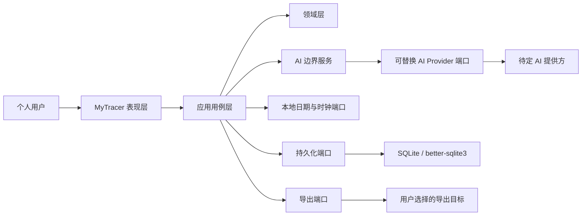

# MyTracer v0.1 总体架构

> 文档状态：v0.1 最终架构基线（工程决策已批准）  
> 适用范围：Demo v0.1 设计、工程初始化、任务拆分与验收  
> 基线日期：2026-08-07  
> 已批准组合：Electron + React + TypeScript + Vite + SQLite；AI Provider 保持可替换，已批准首个 LiteLLM Gateway 适配器

## 1. 依据与状态

本文以以下文件为唯一产品语义依据：

1. `docs/PRODUCT_REQUIREMENTS_V0.1.md`；
2. `docs/DECISIONS.md`；
3. `docs/REQUIREMENTS_CHANGE_POLICY.md`。

`user/` 中的文件只面向项目所有者或产品用户，用于解释流程和使用方式，不属于架构或实现依赖。若其内容与上述基线或本架构不一致，应修正用户文档，而不是据此改变设计。

解释优先级遵循 PRD。本文使用三种设计状态：

| 状态 | 含义 |
|---|---|
| 冻结语义 | 直接来自 FR、AC 或 D，v0.1 不得由实现改变 |
| 已批准工程决定 | 项目所有者已确认的 v0.1 实现边界；变更时需同步架构与计划 |
| 延期排除 | 不进入 v0.1，也不得成为当前接口或模块的必需依赖 |

当前未发现两条 MUST 无法同时满足的冲突。已批准工程决定记录在 `ENGINEERING_DECISIONS_V0.1.md`；S0 工具链、测试框架及 T062 首个 LiteLLM Gateway 已批准并实施，见工程决定 §6；后续新增/升级或替换仍须批准，不改变分层边界。

## 2. 架构目标

- 形成“目标 → 可开始行动或例行 → 用户选择今天内容 → 真实记录 → 进展/恢复/复盘”的本地闭环。
- 把五种例行语义、部分行动、非强制意向和未知状态保留到领域与统计层，防止 UI 或存储将它们合并。
- 使 AI 成为可关闭、可失败、可替换的外围能力；核心数据不依赖 AI 才能读取和修改。
- 让日期、修改、删除、数据版本和完整导出具有单一、可测试的应用层入口。
- 只为 v0.1 建立必要边界，不建设账号、同步、插件、通用工作流或长期 AI 记忆平台。

## 3. 系统上下文



用户是唯一业务操作者。v0.1 没有账号、服务端共享状态、团队或跨设备同步。

## 4. 模块边界与依赖方向

### 4.1 Electron Renderer：表现层

负责 Today、Progress、Review 及 Goal/Action/Routine/Record 的编辑入口、渐进披露、空状态和错误状态。

表现层只能：

- 发送应用命令和读取查询模型；
- 显示用户可编辑的 AI 临时建议；
- 请求导出目标；
- 展示中性事实，不自行计算失败率、掌握度或人格评价。

Renderer 不启用 Node integration，不直接写 SQLite、访问文件系统、读取 AI 密钥、调用厂商 SDK 或自行合并领域状态。

### 4.2 Electron Main：应用用例层

按一次用户意图组织事务和权限边界，负责：

- Goal、Action、Routine、Record 的创建、修改、状态转换和删除；
- 今日选择与非强制意向；
- 快速记录和可选深入记录；
- Progress、恢复和 Review 查询；
- AI 上下文组装、临时建议确认；
- 完整导出快照。

应用用例层运行在 Electron Main Process，依赖领域层和端口接口，不依赖具体 UI 或 AI 厂商。Main 是唯一可以打开 SQLite、写导出文件和发起 AI 网络请求的进程。

### 4.3 Electron Main：领域层

负责状态转换、关系约束和统计事实，包括：

- Goal、Action、Routine 的生命周期；
- ActionRecord 与 RoutineRecord 的有效结果；
- “未记录”作为缺少事实而非失败记录；
- 真实行动次数、达到目标次数、投入时间等事实聚合；
- 用户确认的理解成果与未解决困惑；
- 日期范围和周一至周日周期规则。

领域层不得访问网络、文件系统、系统时间或具体数据库 API。

### 4.4 Preload、端口与适配器

Preload 通过 `contextBridge` 暴露意图级、类型化 Command/Query API。它不得暴露任意 IPC channel、`ipcRenderer.send`、SQL、文件路径或 Electron 原生对象。Main 必须校验 IPC sender 和输入 DTO。

| 端口 | 责任 | 禁止事项 |
|---|---|---|
| `RepositoryPort` | 通过 better-sqlite3 原子读取/保存领域状态，提供关联查询 | 不解释产品统计语义 |
| `UnitOfWorkPort` | 保证单个应用命令的原子性 | 不跨用户交互保持事务 |
| `ClockPort` | 提供当前瞬时值、当前本地日期和时区信息 | 不重算既有历史发生日 |
| `ExportPort` | 将完整核心快照写到用户选择的位置 | 不把“导出”描述成“已恢复” |
| `AiStartHelpProvider` | 接收最小 DTO 并返回结构化临时建议 | 不获得仓库或写入能力 |
| `DiagnosticsPort` | 记录技术错误和关联 ID | 不记录核心数据全文、密钥或 AI 敏感上下文 |

Electron Main 的组合根装配端口。端口不是未来插件平台，只服务于测试隔离、AI Provider 替换和核心能力与基础设施解耦。

## 5. 技术无关接口草案

以下是 TypeScript 逻辑契约；实际 IPC DTO 必须只包含可结构化克隆的数据：

```text
CommandHandler<C, R>
QueryHandler<Q, R>

RepositoryPort
  loadGoal(goalId)
  loadAction(actionId)
  loadRoutine(routineId)
  loadRecord(recordId)
  queryToday(localDate)
  queryProgress(filter)
  queryRecoveryContext(goalId)
  save(transactionChanges)
  readCompleteCoreSnapshot()

ClockPort
  nowInstant()
  currentLocalDate()
  currentTimeZone()

AiStartHelpProvider
  requestStartHelp(minimalContext, cancellation)

ExportPort
  writeCompleteExport(versionedSnapshot, destination)
```

所有修改操作通过命令完成；查询模型是只读投影。AI 确认后也必须转化为普通应用命令，不存在 AI 专用写入口。

## 6. 主要视图的职责

| 视图/流程 | 聚合数据 | 主要写操作 | 需求依据 |
|---|---|---|---|
| Today | 用户选入当日的行动、当日计划例行、非强制意向、待决定候选 | 选入/移出今天、记录行动或例行、主动请求 AI | FR-T*、AC-02～AC-04 |
| Progress | 时间、真实行动次数、已确认理解、未解决困惑、简单周期事实 | 修改/撤销理解，进入关联 Goal | FR-P*、FR-C*、AC-01 |
| Review | 周期事实摘要 | 确认进展、记录阻力、决定一个调整、可选更新下一步 | FR-RV*、AC-06 |
| Recovery | 历史成果、最近困惑、当前下一步、过时内容 | 暂停/结束/清理、重新选择小行动 | FR-REC*、AC-05 |
| Data control | 完整核心数据状态 | 修改、删除、导出 | FR-D*、AC-07 |

Recovery 是查询和交互编排，不新增第四个主要视图。是否自动识别“返回”延期；v0.1 必须允许用户通过现有入口完成恢复流程。

## 7. 已批准运行架构

```text
Electron Renderer
  React + TypeScript + Vite
  页面、表单、只读查询模型、临时 UI 状态
        │
        ▼ typed contextBridge API
Electron Preload
  白名单 Command/Query 方法、参数复制和返回值转发
        │
        ▼ validated IPC
Electron Main
  Application + Domain
  SQLite Repository + migrations
  Export writer
  AI context selector + Provider adapter
  safeStorage credential adapter
```

安全基线：`nodeIntegration: false`、`contextIsolation: true`、Renderer sandbox 开启、只加载本地打包内容、限制性 CSP、禁止任意导航/新窗口、校验 IPC sender。v0.1 不增加独立本地服务、Rust 宿主或 utility process。

## 8. AI 降级路径

```text
用户主动触发
  → 应用层构造最小上下文
  → Provider 可用：返回临时建议
  → 用户接受/修改/拒绝
  → 仅确认结果进入普通应用命令

Provider 未配置/超时/失败/被关闭
  → 显示非阻塞状态
  → 保留手工缩小下一步、编辑行动和记录入口
  → 不影响核心数据读取、修改、删除和导出
```

AI 不可用不是应用启动失败条件，也不是数据迁移或读取前置条件。

## 9. 横切约束

- **日期**：历史事实绑定创建时明确选择或捕获的本地发生日；跨日不静默移动。
- **事务**：一次状态转换及其关联修改必须原子完成；失败时不得留下部分写入。
- **删除**：硬删除前显示关联影响并二次确认；Action/Routine 级联各自 Record，Goal 级联其 Action/ActionRecord并解除 Routine 关联；pause/end 与删除严格区分。
- **导出**：从一致性快照生成，覆盖全部核心状态及必要关联；自动导入延期。
- **诊断**：面向本地排错，默认不记录用户正文、AI 密钥或完整上下文。
- **文案**：事实性、中性、无断签惩罚，不从时间和次数推断掌握度。
- **测试隔离**：测试使用独立数据位置、固定时钟和 fake AI，不接触真实使用数据。

## 10. 架构阶段门

架构 G1 已满足：产品形态、技术栈、存储、进程职责、领域关系、删除、AI 密钥路径和数据默认值均已由项目所有者确认，需求追踪编号核验通过，未发现 MUST 冲突或延期依赖。

进入工程初始化仍须单独批准具体依赖及版本、打包工具、测试框架和首个 AI Provider。该批准只允许建立工程基础，不改变本架构或冻结产品语义。
