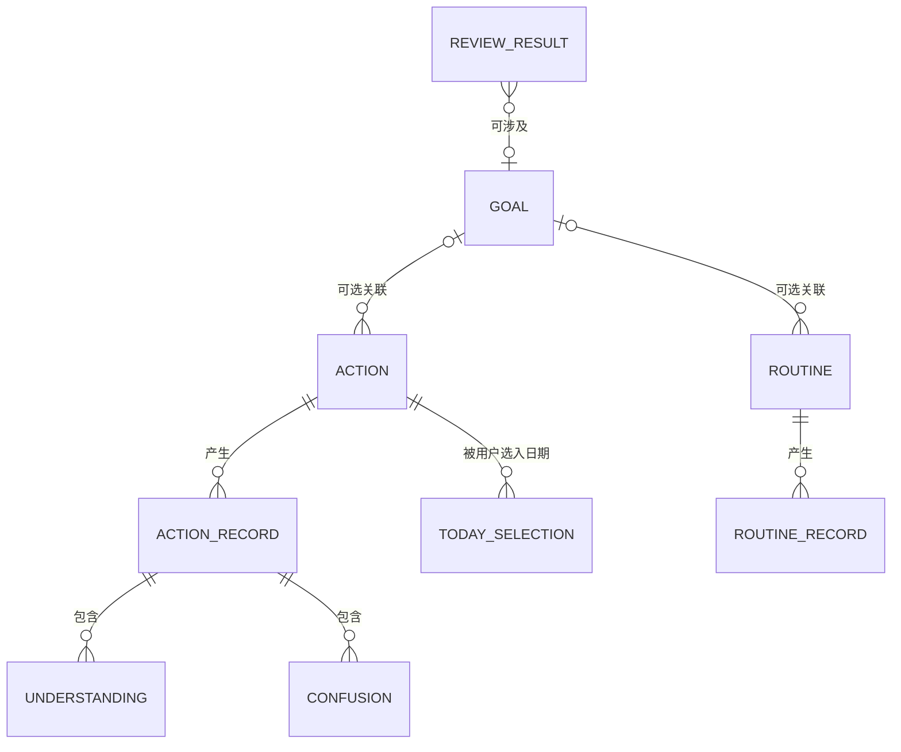
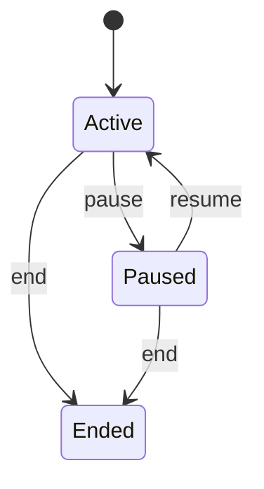
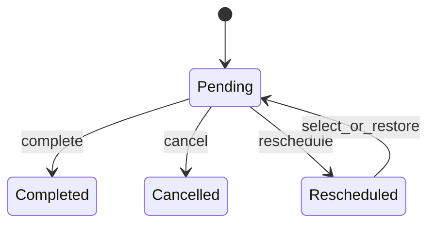

# MyTracer v0.1 领域模型

> 文档状态：v0.1 最终架构基线（工程决策已批准）  
> 设计目标：无损表达冻结状态语义，并为实现和领域测试提供契约  
> 已批准关系：Goal 当前下一步引用 Action；Action/Routine 可选关联 Goal

## 1. 建模原则

- 用户可见核心概念只包含 Goal、Action、Routine、Record（D-003）。
- Today selection、理解成果、困惑、下一步和 Review result 可以作为内部实体或值对象，但不成为用户需要独立管理的新一级概念。
- 状态转换保留历史；“修改当前状态”不得重写既有 Record 的发生日或事实。
- 统计只从已保存事实派生，不从缺失数据推断行为。
- AI 草稿不属于领域事实；只有用户确认后的普通命令结果进入领域状态。

## 2. 领域关系



Record 在领域接口中是判别联合 `ActionRecord | RoutineRecord`。关系图将两种分支展开只是为了表达各自不变量。

## 3. Goal

### 3.1 属性

| 属性 | 语义 |
|---|---|
| `id` | 稳定标识 |
| `name` | 用户可修改名称，非空 |
| `description` | 可选说明/关注原因 |
| `status` | `active | paused | ended` |
| `currentNextActionId` | 可空；引用同一 Goal 下处于 pending 的 Action |
| `createdAt/updatedAt` | 技术审计瞬时值，不用于行为评价 |

### 3.2 状态转换



Ended 在 v0.1 是终态，且不区分完成和主动放弃。误操作通过确认提示降低风险；如未来需要恢复，必须先走需求变更流程，不能增加新的用户可见状态。

### 3.3 不变量

- pause/end 不删除关联 Action、Routine 或 Record（FR-G04）。
- ended Goal 不再被自动候选为今日重点；历史查询和导出仍可见。
- active Goal 可以没有当前下一步；存在时 `currentNextActionId` 必须引用同一 Goal 下的 pending Action（FR-G05）。
- 更新当前下一步必须是用户命令；AI 只能提供未确认候选。
- Goal 关联查询返回 `goalId` 指向该 Goal 的 Action、Routine 及其 Record。
- 当前下一步完成、取消或重新安排时，必须在同一事务中由用户确认替代 Action，或清空引用；系统不自动选择替代项。

## 4. Action

### 4.1 属性

| 属性 | 语义 |
|---|---|
| `id` | 稳定标识 |
| `goalId` | 可空；非空时关联一个 Goal |
| `title/description` | 当前可直接开始的小行动及可选说明 |
| `status` | `pending | completed | cancelled | rescheduled` |
| `createdAt/updatedAt` | 技术审计时间 |

“今日重点”和“非强制意向”不是 Action 类型或状态，由 TodaySelection 表达。

### 4.2 状态转换



重新安排复用原 Action：用户执行后将状态设为 `rescheduled` 并删除当前日 TodaySelection；用户之后再次明确选入 Today 时恢复为 `pending`。不创建替代 Action或未来日程。该行为必须满足：

- 旧 Record 不被移动或重写；
- 行动仍有价值但不自动属于今天；
- 新安排仍由用户最终决定；
- 不引入截止日期、逾期或通用日程流。

### 4.3 部分行动

部分完成不是 Action 状态。用户保存 `ActionRecord.outcome = partial` 后，可以：

- 保持 Action 为 pending；
- 明确标记 Action completed；
- 明确 reschedule/cancel；
- 确认一个新的 Goal 当前下一步。

应用不能根据 `partial` 自动选择其中任何结果。

### 4.4 不变量

- Action 的 TodaySelection 只能由用户命令创建或更改（FR-T04）。
- 未发生的非强制意向不生成失败 Record。
- completed/cancelled Action 不自动重新进入 Today。
- Record 保留保存时关联的 Action 和发生日；后续修改 Action 标题不改变历史事实的身份。

## 5. Routine

### 5.1 属性

| 属性 | 语义 |
|---|---|
| `id` | 稳定标识 |
| `goalId` | 可空；非空时关联一个 Goal |
| `name/description` | 例行名称与可选说明 |
| `status` | `active | paused | ended` |
| `schedule` | 通常发生日期或节奏；v0.1 仅支持经批准的最小表达 |
| `minimumAction` | 用户定义的最低行动，非空自然语言 |

### 5.2 状态转换

与 Goal 相同：active 可 pause/end，paused 可 resume/end。pause/end 不删除历史 RoutineRecord。

### 5.3 计划发生判断

`isPlannedOn(routine, localDate)` 只回答该日期是否符合用户定义的例行节奏，不创建 Record。具体 schedule 语法待技术决策，但不得演变为月历、提醒、自动排程或通用规则引擎。

### 5.4 非计划日

非计划日允许保存真实发生的 RoutineRecord。记录必须保存 `plannedForDate = false` 或等价可验证事实；统计计入真实行动次数，但不得计入计划日达到目标次数（FR-R09、D-107）。

## 6. Record

### 6.1 ActionRecord

```text
ActionRecord
  id
  actionId
  goalIdSnapshot?          // 是否需要快照随关联决定确认
  occurredOn              // 权威本地发生日
  durationMinutes         // 大致时长，允许补记和修改
  outcome                 // completed | partial | stopped
  understandings[]        // 可选，用户确认
  confusions[]            // 可选
  nextStepCandidate?      // 可选；是否应用到 Goal 需独立确认
  note?                   // SHOULD
  createdAt/updatedAt
```

`durationMinutes` 与 `outcome` 构成快速记录最低层。`durationMinutes` 是非负整数；0 表示少于一分钟但确有行动，UI 显示“少于 1 分钟”。深入字段均可缺省。

### 6.2 RoutineRecord

```text
RoutineRecord
  id
  routineId
  occurredOn
  outcome                 // target_met | acted | intentional_rest | not_done
  plannedForDate          // 保存时或按版本化规则计算的计划事实
  durationMinutes?        // acted/target_met 时可选
  note?
  createdAt/updatedAt
```

### 6.3 “未记录”的表达

`unrecorded` 不是可保存的 RoutineRecord outcome。对计划日期查询时：

```text
if isPlannedOn(date) and no RoutineRecord exists for date
then display Unknown/Unrecorded
```

因此不会出现把缺行批量补成 `not_done` 的迁移、后台任务或统计逻辑。

### 6.4 Record 不变量

- `durationMinutes` 必须是非负整数分钟；是否真实行动只由 Record outcome 决定，不能由时长是否为零推断。
- `intentional_rest` 和 `not_done` 不计入真实行动次数。
- `target_met` 与 `acted` 都计入真实行动次数，但只有前者计入达到目标次数。
- ActionRecord 的 `partial` 是有效真实行动，计入行动发生次数。
- 时间与次数不生成或提升理解成果，不生成掌握度。
- 修改 Record 不改变其身份；修改发生日必须是显式用户操作并触发相关投影重算。
- 删除错误 Record 后，所有聚合从剩余事实重新计算，不保存不可解释的累计数。

## 7. 内部子实体和值对象

### 7.1 Understanding

- 自然语言文本；
- `confirmedByUser = true` 才属于核心数据；
- 可保留来源 `manual | ai_candidate_confirmed`，但来源不代表掌握度；
- SHOULD 支持修改和撤销；撤销方式待数据删除策略确认。

### 7.2 Confusion

- 自然语言文本；
- 至少支持 `open | resolved` 内部状态，以便查询“仍未解决”的困惑；
- 不建立精细分类体系；
- 解决状态只能由用户操作或明确业务命令改变。

### 7.3 TodaySelection

```text
TodaySelection
  actionId
  selectedFor             // 本地日
  commitment              // focus | intention
  selectedBy              // 固定为 user
```

同一 Action 在同一日期最多有一个有效选择。未完成选择不会自动滚动到下一天，也不会自动生成 Record。

### 7.4 ReviewResult

Review 是流程而非一级管理模块，但需要保存用户确认结果：

```text
ReviewResult
  periodStart/periodEnd
  confirmedProgress
  mainObstacle
  nextAdjustment
  relatedGoalId?
  createdAt/updatedAt
```

事实摘要由查询生成，不复制进 ReviewResult；因此用户无需手工重录已有统计。

## 8. 领域服务与统计定义

| 服务 | 输入 | 输出/约束 |
|---|---|---|
| `TodayPlanner` | 本地日、用户选择、例行节奏 | 只组合事实，不自动加入全部历史 Action |
| `ProgressCalculator` | Record 集合、周期/Goal 过滤 | 总时长、真实行动次数、达到目标次数、确认理解、开放困惑 |
| `RecoveryContextBuilder` | Goal、关联 Action/Record | 上次事实、开放困惑、当前下一步；不要求补齐空白日 |
| `ReviewSummaryBuilder` | 周一至周日范围内事实 | 中性事实摘要，不生成评分 |
| `AiContextSelector` | 当前 Goal/Action、本次输入、相关记录 | 当前对象加最近 5 条直接相关 Record 的最小 DTO |

`realActionCount` 的最小定义：

```text
count(ActionRecord)
+ count(RoutineRecord where outcome in [target_met, acted])
```

同一 Action 同日存在多条有效 ActionRecord 时，每条都代表一次真实投入并分别计次；Progress 文案使用“记录到的行动次数”。

## 9. 删除与历史

采用显式硬删除，不建立软删除或回收站：

- 删除 Record：二次确认后删除该事实并重算投影；
- 删除 Action：预览并级联 ActionRecord、TodaySelection，同时清除 Goal 当前下一步引用；
- 删除 Routine：预览并级联 RoutineRecord；
- 删除 Goal：优先提供 pause/end；永久删除时预览并级联其 Action/ActionRecord，关联 Routine 解除 `goalId` 后保留；
- 所有级联在单事务内完成，取消确认或任何写入失败均产生零变化；
- 被硬删除的数据不进入普通查询或后续导出。

## 10. 已批准工程不变量

1. Goal 当前下一步使用 `currentNextActionId`；
2. Action 和 Routine 均可独立存在或关联一个 Goal；
3. rescheduled 复用原 Action，不创建未来日程；
4. 删除采用影响预览、二次确认和事务性硬删除；
5. 时间使用非负整数分钟，0 表示少于一分钟；
6. 每条有效 ActionRecord 分别计为一次记录到的行动；
7. Routine 节奏只使用周一至周日集合及每日/工作日快捷选择。
