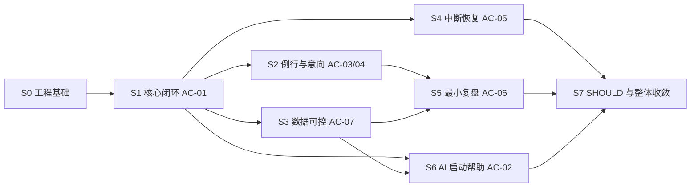

# MyTracer v0.1 实施计划

> 文档状态：v0.1 最终架构基线（工程决策已批准）
>
> 当前执行状态：以任务索引为唯一账本；截至 2026-08-13，T011～T013 已完成，T014 为 `review`，等待独立 review 与文档收口 head CI；G3/S1 尚未通过
>
> 实施原则：纵向切片、需求编号追踪、每个切片独立验证和留证

## 1. 开始条件

架构决定和仓库级流程已经完成。现有实施入口为：

- 根 [`AGENTS.md`](../../AGENTS.md)：Agent 行为、架构不变量和权限；
- [`TASK_INDEX_V0.1.md`](../implementation/TASK_INDEX_V0.1.md)：任务状态的唯一账本；
- [`TASK_TEMPLATE.md`](../implementation/TASK_TEMPLATE.md)：单任务合同；
- [`ACCEPTANCE_EVIDENCE_V0.1.md`](../implementation/ACCEPTANCE_EVIDENCE_V0.1.md)：验证证据；
- [`GITHUB_WORKFLOW_V0.1.md`](../implementation/GITHUB_WORKFLOW_V0.1.md)：GW-001～GW-010 分支和 PR 门禁。

启动每个后续工程任务前仍必须完成：

- 确认允许新增的依赖及其版本范围；
- 确认工程目录、验证命令和真实/测试数据路径；
- 再次核对没有 MUST 冲突或延期依赖。

工程任务必须遵循 `ENGINEERING_DECISIONS_V0.1.md` 和任务索引的实时状态；计划中的顺序不替代独立合同、依赖批准、实现启动或 Git/GitHub 授权。当前 T014 处于 `review`；不得据此启动 T021、通过 G3/S1 或执行任何合并/发布动作。

## 2. 切片依赖

AI 放在核心数据和确认命令稳定后；存储基础在 S0 建立，但完整用户数据控制在 S3 形成可验收切片。

## 3. S0 工程基础（等待依赖批准）

### E0-01 项目骨架与边界

- 需求：D-001、D-003、D-015～017。
- 建立 Electron Renderer/Preload/Main、应用层、领域层、端口/适配器和组合根的最小目录。
- 只创建可运行空壳、Today/Progress/Review 导航候选和错误边界，不实现业务功能。
- 完成标准：Renderer sandbox、context isolation、CSP 和 IPC sender 校验生效；应用在 AI 未配置时可启动；依赖方向可由静态规则或评审验证。

### E0-02 验证工具链

- 建立格式检查、lint、类型检查、单元、集成、E2E、build 和聚合 verify 命令。
- 固定 FakeClock、FakeAiProvider 和临时数据根约定。
- 按 GW-008 建立始终报告明确状态的 Windows required gate；稳定 check 名称存在后再配置远端 branch protection。
- 同步 README、`AGENTS.md`、任务模板和 CI 中的精确命令，禁止出现多份不一致命令。
- 完成标准：新环境按文档运行；测试不会触及真实数据。

### E0-03 持久化与迁移入口

- 需求：FR-D01、D-103、D-106、D-111、ED-003/018。
- 在 Electron Main 实现 better-sqlite3 适配器、初始 schemaVersion、参数化 SQL、事务和 Repository 契约套件。
- 只建立 v0.1 当前集合，不预建账号、同步、插件或未来任务字段。

### E0-04 日期、诊断和配置

- 建立 ClockPort、本地日类型、周一至周日周期和最小诊断。
- 建立 safeStorage 凭据适配器空实现；AI 配置独立于核心数据，未配置不影响启动。
- 验证开发运行和 Windows 打包产物均能加载原生 SQLite 模块。

阶段门 G2：固定命令稳定、重开测试成立、AI 零配置可启动、无延期功能。

## 4. S1 Goal—Action—Record—Progress 核心闭环

### E1-01 Goal 生命周期

- 需求：FR-G01～G06、D-002、D-101、AC-01。
- 创建/修改 Goal，保存当前下一步，pause/end 保留历史，显示关联 Action/Record。
- 测试：状态机、历史守恒、重开。

### E1-02 Action 与 Today focus

- 需求：FR-A01～A06、FR-T01/04/05/08、D-004、D-016。
- 创建/修改/取消/完成/重新安排 Action；由用户选入今天；不自动搬运历史 Action。
- Action/Goal 可选关联；rescheduled 复用原 Action，并在再次选入 Today 时恢复 pending。
- 后续交付状态：T012 已由 `EV-T012-001` 证明完成；仅贡献 AC-01 步骤 3，并只完成 FR-A05 的 Action 状态解耦部分。

### E1-03 快速与深入 Record

- 需求：FR-A05、FR-A08 的 T013 部分、FR-L01～L06/L08、FR-C01、D-006、D-103～D-106；FR-L07 属于 E3-01/T031，FR-L09 属于 E1-04/T014。
- 快速层只需时长和完成程度；Understanding、Confusion、下一步和 note 渐进展开。
- partial 保存为真实 Record，不自动改变 Action 状态。
- 后续交付状态：T013 已由 `EV-T013-001` 证明完成；与 T012 合并完成 FR-A05，仅贡献 AC-01 步骤 4～5，不声明 FR-L07、FR-L09 或完整 AC-01。

### E1-04 基础 Progress

- 需求：FR-P01～P04、P07/08、FR-C03、D-007。
- 展示累计时长、真实行动次数、确认理解和开放困惑；不提供连续天数主指标或评价分数。
- 后续交付状态：T014 实现候选已由 `EV-T014-001` 记录；ActionRecord 分支的事实投影、SQLite 一致性读取、窄 IPC、最小 Renderer、关闭重开及完整自动/人工 AC-01 已通过。独立 review 尚缺，任务保持 `review`；RoutineRecord 统一计次仍属于 T022。

切片验收：完整执行 AC-01，关闭并重开后数据仍存在。

## 5. S2 Routine 与非惩罚状态

### E2-01 Routine 生命周期和节奏

- 需求：FR-R01～R03、FR-T02、D-016。
- 创建/修改/pause/end，定义经批准的最小节奏和最低行动，Today 显示计划例行。

### E2-02 四种显式记录与未知

- 需求：FR-R04～R09、D-008～010、D-107、AC-03。
- 实现 target_met、acted、intentional_rest、not_done；无 Record 查询为 unknown。
- 非计划日真实行动计入事实但不计计划达成。

### E2-03 非强制意向

- 需求：FR-A07、FR-T03/08、D-011、AC-04。
- TodaySelection 表达 intention；未发生不生成失败或专属兴趣统计。

切片验收：AC-03、AC-04；领域统计矩阵全通过。

## 6. S3 数据可控与完整导出

### E3-01 修改、补记与删除

- 需求：FR-L07、FR-R08、FR-D02、UX-05。
- 实现显式修改发生日/时长/outcome、补记和经批准删除策略；所有投影重算。
- 按 ED-008 实现影响预览、二次确认、硬删除、级联和解除关联。

### E3-02 版本化完整导出

- 需求：FR-D03/04、D-111、AC-07。
- 导出所有核心状态、必要关联和版本；排除凭证、AI 草稿和日志。
- 自动结构和引用检查；界面明确不支持自动导入。

### E3-03 AI 独立性回归

- 需求：FR-D05、FR-AI09、D-015。
- 无配置、关闭和模拟故障三种情况下重复核心 CRUD、Progress 和导出。

切片验收：AC-07；删除影响和导出结构有自动化证据。

## 7. S4 中断恢复

### E4-01 RecoveryContext 查询

- 需求：FR-REC01～REC03、D-002。
- 返回历史进展、最近开放困惑和当前下一步；不生成中断期 Record。

### E4-02 过时内容处理和重新开始

- 需求：FR-REC04～REC06、FR-P04、D-013。
- 从现有入口 pause/end/清理内容并选出一个小 Action；首屏不展示断签、失败率或大量逾期。
- 是否自动出现恢复提示延期，v0.1 提供显式可达入口。

切片验收：FakeClock 前进多日后完整执行 AC-05。

## 8. S5 最小周期 Review

### E5-01 周期事实摘要

- 需求：FR-RV01、RV06、D-106、AC-06。
- 按周一至周日复用 Progress 聚合，用户无需重录已有数据。

### E5-02 ReviewResult

- 需求：FR-RV02～RV05、D-105/110。
- 保存一个确认进展、一个主要阻力、一个下一阶段调整；可显式更新当前下一步。
- 不增加提醒、精细阻力分类或 AI 完整周计划。

切片验收：AC-06；ReviewResult 重开后存在，事实摘要没有复制漂移。

## 9. S6 AI 启动帮助

### E6-01 最小上下文选择器

- 需求：FR-AI01/03/08/10、D-108。
- 仅选当前 Goal、Action/下一步、经批准范围内的相关 Record 和本次输入。
- 使用唯一标记测试证明其他 Goal 数据未发送。

### E6-02 可替换 Provider 与失败降级

- 需求：FR-AI02～AI04、AI07/09、D-012/013/015。
- 实现端口、fake provider、超时/取消/错误分类；基础功能不依赖 Provider。
- 具体厂商适配器需另行确认依赖和密钥方式。

### E6-03 建议确认

- 需求：FR-AI05/06、FR-C02/03、D-014/109、AC-02。
- 建议保持临时；接受/修改/拒绝；确认后走普通应用命令；不保存对话历史。

切片验收：AC-02 的拒绝、修改、接受、超时和 AI 关闭分支。

## 10. S7 SHOULD 与整体收敛

### 10.1 SHOULD 处理结论

| SHOULD | 处理结论 | 切片 |
|---|---|---|
| FR-G07 | 实现软性数量提示，无硬上限 | S7 |
| FR-A08 | 完成/partial 后提供显式更新下一步 | S1 |
| FR-R08 | 实现补记和修正 | S3 |
| FR-T06 | 实现 Today 少量重点软提示 | S7 |
| FR-T07 | 显示距上次真实行动天数，不设自动阈值 | S7 |
| FR-L06 | 深入记录支持可选 note | S1 |
| FR-C04 | 支持修改/撤销确认理解 | S3 |
| FR-P05 | 显示距上次真实行动的事实，帮助用户识别停滞 | S7 |
| FR-P06 | 展示简单周期间事实变化，不生成评分 | S7 |
| FR-REC05 | Recovery 优先提供一个小行动入口 | S4 |
| FR-RV05 | Review 可显式更新下一步 | S5 |

全部 SHOULD 有设计落点；它们不允许阻塞或改变 MUST。若实际交付未完成，验收证据必须逐项报告，不得静默省略。

### 10.2 整体收敛任务

- 空状态、错误状态、渐进披露和中性文案；
- 跨日表单、补记、修改、删除和重开回归；
- 主要 Windows 屏幕、键盘、焦点和基础可访问性；
- AC-01～AC-07 在同一版本连续执行；
- 全量需求追踪和延期项扫描；
- 准备 7～14 天真实自用版本及已知限制。

## 11. 风险与控制

| 风险 | 影响 | 控制 |
|---|---|---|
| 依赖版本未批准 | 无法初始化或安装包 | 先提交最小依赖清单并逐项批准 |
| Electron 原生模块 ABI | 开发可用但打包失败 | S0 同时验证开发和 Windows 打包产物 |
| 重新安排定义模糊 | 历史或 Today 可能被错误移动 | 状态与 Record 不变量测试先行 |
| 删除误伤历史 | 硬删除不可恢复 | 影响预览、二次确认、事务和删除前主动导出入口 |
| 日期跨日错误 | 历史统计漂移 | LocalDate、FakeClock、边界测试 |
| AI 泄露无关上下文 | 数据隔离失败 | 纯选择器、manifest 和唯一标记测试 |
| AI 厂商不可用 | AC-02 不可验证 | fake provider 证明产品边界，真实厂商另做契约验证 |
| SHOULD 扩大核心范围 | 延迟自用 | 放在相应切片或 S7，不改变 G0/G1 语义 |
| 文档流程与 GitHub 实际配置不一致 | Agent 误以为保护或 CI 已生效 | 配置作为独立任务验证；文档明确区分目标状态和已验证状态 |
| 单人项目设置 required approval | 所有 PR 无人可批准 | 不要求他人 approval；由项目所有者执行 merge 并保留 required checks |

## 12. 明确非范围

本计划不实现：优先级、截止日期、标签、搜索、层级目标、依赖、复杂日历、通知、同步、账号、社交、排行榜、综合评分、计时器、概念图谱、掌握度、AI 自动计划/主动监督/长期记忆、自动数据导入或插件平台。

任何需要这些能力的任务必须停止并按需求变更规则处理。
