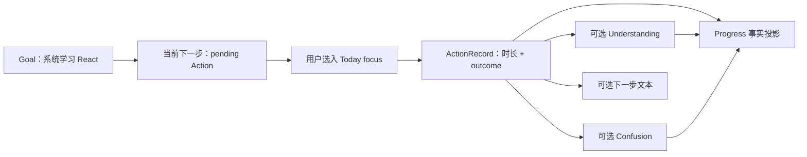
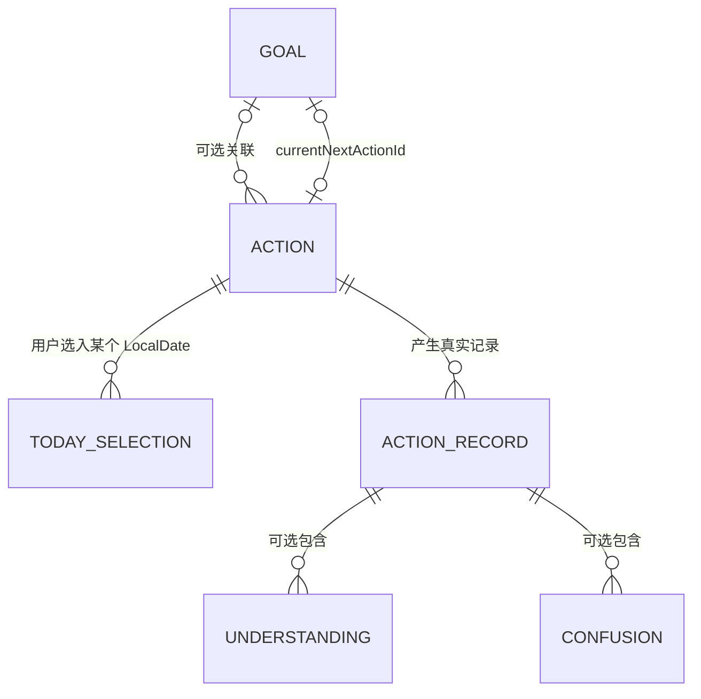
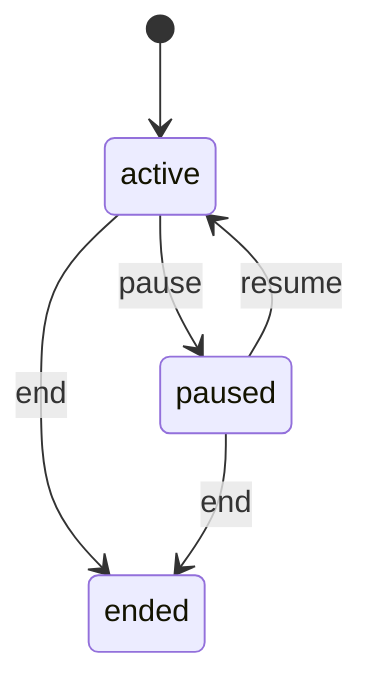
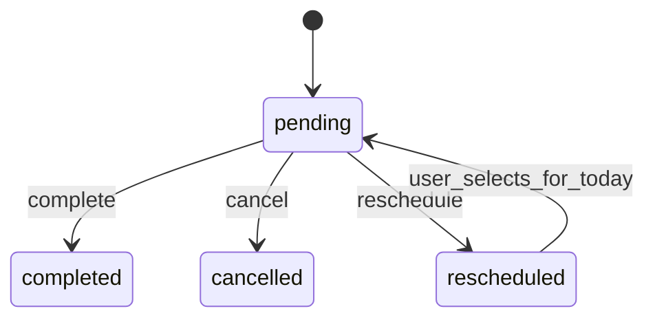

# MyTracer v0.1 S1 核心闭环整体设计

> 文档状态：已获项目所有者批准；批准不构成 T011～T014 实现授权。
>
> 后续交付状态：截至 2026-08-13，T011～T014/T801 已完成，单一归档候选已形成并等待当前分支到 `dev` 的 PR；最终 `dev@74ebe346a86cf431d87e02e8a1220b713b33901c` 的 AC-01、Windows package 和 G3/S1 自动化验收通过。任务实时状态以 `TASK_INDEX_V0.1.md` 为准。
>
> 审批结果：S1-Q01 = A；S1-Q02～S1-Q10 = 各自原推荐项。
>
> 适用范围：S1 / E1-01～E1-04 的任务合同、实现、测试与验收设计输入
>
> 提案及批准日期：2026-08-09
>
> 核心验收：AC-01 React 学习完整流程

## 0. 文档用途与权限边界

本文把已冻结产品语义和已批准工程决定收敛为 T011～T014 的整体设计，目的是让四个后续任务在同一闭环、同一状态语义和同一数据边界下编写独立任务合同。

本文依据以下规范，解释顺序保持不变：

1. [`PRODUCT_REQUIREMENTS_V0.1.md`](../PRODUCT_REQUIREMENTS_V0.1.md)；
2. [`DECISIONS.md`](../DECISIONS.md)；
3. [`REQUIREMENTS_CHANGE_POLICY.md`](../REQUIREMENTS_CHANGE_POLICY.md)；
4. 本目录的总体架构、领域、数据、测试、追踪、实施计划与工程决定；
5. [`TASK_INDEX_V0.1.md`](../implementation/TASK_INDEX_V0.1.md)、[`TASK_TEMPLATE.md`](../implementation/TASK_TEMPLATE.md) 和 [`GITHUB_WORKFLOW_V0.1.md`](../implementation/GITHUB_WORKFLOW_V0.1.md)。

`user/` 不属于本文依据，也不得成为后续开发依赖。

本文使用三类结论：

| 标记 | 含义 |
|---|---|
| **冻结/已批准** | 直接来自 FR、AC、D、ED 或现行仓库基线，后续任务不得改变 |
| **已批准设计** | 第 11 节记录项目所有者选择；可写入后续任务合同，但不等于实现授权 |
| **延期/非范围** | 不进入 S1，不得成为 T011～T014 的接口、数据或验收前置 |

本次批准允许以本文编写 T011～T014 的独立任务合同，并按 S1-Q01-A 同时确认 G2 通过、允许准备 T011。它仍不等于：

- 启动 T011 或任何实现；
- 批准依赖、migration、分支、commit、push、Draft PR、Ready、merge、tag 或 release；
- 通过 AC-01 人工验收。

## 1. 基线核对结论

### 1.1 设计审批时的基线事实

- 本文设计审批读取基线时，`TASK_INDEX_V0.1.md` 记录 T001～T004 `done`、T011～T014 `pending`，G2 为独立门禁；项目所有者当时通过 S1-Q01-A 明确确认 G2 通过。该段保留审批时事实，不代表页首所列后续交付状态。
- 设计审批时 SQLite `schemaVersion = 1` 已包含 S1 所需的 `goals`、`actions`、`today_selections`、`action_records`、`understandings` 和 `confusions` 表。
- 设计审批时 `RepositoryPort`、`UnitOfWorkPort`、`ClockPort`、安全 IPC sender/origin 校验和隔离测试根已经存在，但尚无 S1 业务命令、查询或 UI；T011 后续交付不改写这条历史基线。
- 已批准 S1-Q06-A：S1 不需要新增或升级依赖，也不需要新 migration；不得修改已执行的 `001_initial.sql`。
- 设计审批时识别到部分较早架构/工作流正文仍保留“等待工程初始化”之类状态性描述；后续实施状态始终以任务索引和实时只读核验为准。

### 1.2 冲突结论

未发现两条 MUST 或已批准 D/ED 无法同时满足的冲突，因此可以继续完成 S1 设计。

发现的缺口属于任务分配或实现级细化，不是产品语义冲突：

- FR-L07 同时被 T013 的 `FR-L01～L09` 范围和 T031 明确引用；
- FR-A05 同时出现在 T012 的 `FR-A01～A06` 范围和 T013 的记录范围，需要区分 Action 侧不变量与用户可见 Record 交付；
- FR-A08 被实施计划放入 S1，但任务索引未明确归属某个 Txxx；
- Action 改换 Goal 后的历史 Progress 归属尚未冻结；
- Goal pause/end 对当日 TodaySelection 的处理尚未冻结；
- ActionRecord 保存与 Action 状态/新下一步更新采用一个还是多个应用命令尚未冻结。

这些事项已由项目所有者按第 11 节完成审批；后续任务合同必须使用已批准结果，不得继续把其他选项当作开放决定。

## 2. S1 目标、范围与非范围

### 2.1 S1 可观察结果

S1 完成后，用户可以连续完成：

```text
Goal
  → 创建或取得一个 pending Action 作为当前下一步
  → 用户把该 Action 选入当前 LocalDate 的 Today focus
  → 进行真实行动
  → 保存一个 ActionRecord
  → 可选保存 Understanding、Confusion 和下一步文本
  → Progress 从已保存事实展示时间、行动次数、确认理解和开放困惑
  → 关闭并重新打开后，上述事实与关系仍然成立
```

这条路径完成 AC-01，但不代表 Routine、Recovery、Review、AI、删除或完整导出已经完成。

### 2.2 S1 包含

| 能力 | S1 处理 |
|---|---|
| Goal | 创建、修改、pause、resume、end、当前下一步、关联查询 |
| Action | 创建、修改、complete、cancel、reschedule、可选 Goal 关联 |
| Today | 仅用户主动选择的 `focus` Action；按当前 LocalDate 查询 |
| ActionRecord | 快速层：时长与完成程度；深入层：Understanding、Confusion、下一步、note |
| Progress | ActionRecord 分支的累计时长、真实行动次数、确认 Understanding、open Confusion |
| 持久性 | SQLite 真实写入、事务回滚、关闭连接/应用后重开 |
| 边界 | Application Commands/Queries、白名单 Preload API、Main 运行时验证和 sender/origin 校验 |

### 2.3 S1 明确不包含

- Routine、RoutineRecord、计划节奏和 Today 中的计划例行（T021～T022）；
- `intention` 非强制意向（T023）；S1 只能写入 `focus`，不得声明 FR-T03 或 AC-04 完成；
- ActionRecord 的常规补记、修改、删除，Understanding 撤销和 Confusion 解决（已批准归 T031）；
- 删除影响预览、二次确认和硬删除业务命令（T031）；
- 完整导出、自动导入或恢复（T032；自动导入仍延期）；
- RecoveryContext 和中断恢复流程（T041～T042）；
- Review（T051～T052）；
- AI Provider、AI 上下文、建议或确认写入（T061～T063）；
- FR-G07、FR-T06/T07、FR-P05/P06 等 S7 收敛项；
- 优先级、截止日期、标签、搜索、子任务、依赖、复杂日历、提醒、评分、掌握度、计时器、同步、账号、插件或其他延期能力。

S1 的 Today 只完成 Action focus 分支，不得因页面名为 Today 就声称 FR-T02、FR-T03 或整个 Today 需求组已完成。S1 的 Progress 只完成 ActionRecord 分支；S2 加入 Routine 后再扩展统一真实行动统计。

## 3. AC-01 连续流程



批准的同版本验收数据如下；具体文案只是 fixture，不属于产品写死内容：

1. FakeClock 固定为一个明确 LocalDate。
2. 创建 Goal“系统学习 React”，并在同一用户流程中填写下一步“运行一个 React 状态更新示例”。
3. Main 在一个事务中先创建 Goal，再创建关联的 pending Action，最后建立 `currentNextActionId`。
4. 用户把该 Action 明确选入当天 Today focus；系统不得自动选择。
5. 用户保存 `durationMinutes = 25`、`outcome = partial` 的 ActionRecord，并可选填写：
   - 一个用户确认的 Understanding；
   - 一个 open Confusion；
   - 一个下一步文本；
   - 可空 note。
6. ActionRecord 保存成功，但 `partial` 不自动完成、取消或 reschedule Action；已批准默认保持 pending。
7. Progress 显示 25 分钟、1 次“记录到的行动”、该 Understanding 和该 open Confusion；不显示掌握度、分数、失败率或连续天数主指标。
8. 完全关闭应用和 SQLite 连接后，使用同一隔离测试 `userData` 重开，Goal、当前下一步、TodaySelection、ActionRecord 和 Progress 结果保持一致。
9. FakeClock 前进到下一 LocalDate 后，旧 TodaySelection 不自动搬运到新一天；ActionRecord 和 Progress 历史仍然存在。

T011～T013 只能声明完成 AC-01 的相应步骤。只有 T014 结束后，在同一明确 revision 上执行完整 E2E、重开验证和项目所有者人工验收，才可以声明 AC-01 自动化通过或人工通过。

## 4. 领域对象与关系



Progress 不属于上述持久化实体关系；它由 `ProgressCalculator` 读取 ActionRecord、有效 Understanding 与 open Confusion 后生成只读投影。

| 对象 | 关系与职责 | 不得承担的职责 |
|---|---|---|
| Goal | 可有 0..n Action；可空 `currentNextActionId` 指向同 Goal 的 pending Action | 不拥有统计累计值；不因 pause/end 删除历史 |
| Action | 可空 `goalId`；可有 0..n TodaySelection 和 0..n ActionRecord | Today focus 不是 Action 状态；partial 不是 Action 状态 |
| TodaySelection | `actionId + selectedFor + focus + selectedBy=user`；同 Action/日期最多一条 | 不是用户一级对象；不代表行动发生；不自动滚动 |
| ActionRecord | 一次真实投入；权威 `occurredOn`、分钟和 outcome | 不根据 outcome 自动改变 Action 生命周期 |
| Understanding | ActionRecord 的用户确认自然语言子实体；S1 来源固定为 `manual` | 不代表掌握度；不由时间或系统推导 |
| Confusion | ActionRecord 的轻量自然语言子实体；S1 创建时为 `open` | 不做精细分类；不被新记录自动推断为 resolved |
| Progress | 从事实即时计算的只读查询投影 | 不建累计表；不写业务事实；不生成评价 |

Understanding、Confusion、TodaySelection 和 Progress 都是内部实体、子实体或视图，不增加 D-003 之外的用户一级概念。

## 5. 状态转换与不变量

### 5.1 Goal



必须保持的冻结约束及其已批准设计落点：

- 新 Goal 初始为 `active`；`ended` 在 v0.1 为终态，不区分完成与主动放弃。
- pause/end 对 Goal、关联 Action/Routine 及其 Record 历史只更新 Goal 状态；这些历史实体和关联（包括现有 schema 中尚未进入 S1 的 Routine/RoutineRecord fixture）不得被删除或改写。按已批准 S1-Q05-A，当前日 TodaySelection 也保留并继续展示状态。
- Goal 可以没有当前下一步。
- 非空 `currentNextActionId` 必须指向同一 Goal 下的 pending Action。
- 更新、清空或替换当前下一步只能来自明确用户命令；系统和未来 AI 不得自动挑选。
- 当前下一 Action 被 complete、cancel 或 reschedule 时，用户必须在同一状态转换事务中选择清空、引用另一个同 Goal pending Action，或创建并引用一个新 pending Action。
- 只允许 active Goal 执行 `SetGoalCurrentNextAction`、创建新的关联 Action 或接受“create/use current next”结果；按已批准 S1-Q05-A，pause/end 保留既有引用但不继续扩展当前上下文。
- pause/end 保留当日 TodaySelection；Today 继续显示 paused/ended Goal 下已选 Action 的状态和不可开始原因，不得改变历史 Record。

### 5.2 Action



必须保持的冻结约束及其已批准设计落点：

- 不增加 `in_progress`、blocked、overdue 或未来日期状态。
- reschedule 必须复用原 Action ID；不得自动创建替代 Action、截止日期或未来日程。
- `RescheduleAction` 使 Action 变为 `rescheduled`，并删除当前 LocalDate 的 TodaySelection；旧 ActionRecord 不移动、不改写。
- 用户以后再次明确选入 Today 时，`rescheduled → pending` 与当天 TodaySelection 写入在同一事务完成。
- 再次选入 Today 不自动把该 Action 设为 Goal 当前下一步。
- `completed`、`cancelled` Action 不得自动重新进入 Today。
- 按已批准 S1-Q07-A，complete/cancel 后保留当天 TodaySelection，显示终态并禁止再次开始；只有 reschedule 和用户显式移出才删除当天行。
- `partial` 是记录级结果，冻结语义明确禁止它自动改变 Action 状态。
- 按已批准 S1-Q04-B，`completed | partial | stopped` outcome 与 Action 状态保持解耦；任何 post-record 状态变化都来自用户显式选择，不从 outcome 自动推断。
- `partial` 和 `stopped` 都是真实行动，分别计为一条记录到的行动；0 分钟也不能被推断为未行动。

### 5.3 Today

- S1 的 `SelectActionForToday` 不接受 Renderer 指定的任意日期；Main 在命令开始时读取一次 `ClockPort.currentLocalDate()` 并写入 `selectedFor`。
- 只有用户命令可以创建或删除 TodaySelection，`selectedBy` 固定为 `user`。
- pending Action 可以选入 Today；rescheduled Action 只有在同一命令恢复为 pending 后才能选入。
- 已有当日 TodaySelection 不能在保留数据库行的同时被 Query 静默隐藏；按已批准 S1-Q05-A，pause/end 后保留并显示 Goal 状态与不可操作原因。
- 新的 Today focus 只允许关联 active Goal 或不关联 Goal 的 pending/rescheduled Action；paused/ended Goal 下已有 focus 保留展示，不得通过 Query 修改数据库。
- 查询新一天时只读取新 LocalDate 的选择；旧选择不生成新选择、不生成 ActionRecord、不生成失败事实。
- Action 不必先进入 Today 才能拥有记录；Today 是低成本入口，不是行动真实性的前置条件。

### 5.4 ActionRecord、Understanding 与 Confusion

- 快速层只有 `durationMinutes` 和 `outcome` 必填；所有深入字段均可缺省。
- `durationMinutes` 为非负整数；0 表示少于一分钟但确有行动。
- `occurredOn` 是权威 LocalDate；`createdAt/updatedAt` 是审计 Instant，不能替代发生日。
- 表单打开时由 Main 创建一个仅存内存的 `recordingContextId`，绑定受信 sender、actionId 和由 ClockPort 捕获的 `capturedOn`。同一 sender/action 只保留最新未消费 context，新 context 使旧 context 失效。Renderer 保存时只回传该 ID 和可选跨日选择，不能自行提交任意 `capturedOn`。
- Main 必须验证 recording context 存在、属于同一 sender/action 且尚未消费；成功提交、取消、被新 context 替换、窗口关闭或应用退出后清除/失效。若保存时已跨日，首次提交返回“需要确认”且零写入；Renderer 只能显式回传 `keep-captured-on` 或 `use-current-on` 后重试。未跨日时携带该选择、跨日时缺少/伪造选择都拒绝；不得静默移动。
- 一个记录命令内创建的 ActionRecord、Understanding、Confusion，以及用户明确选择的 Action/下一步后续变化必须遵循第 6.3 节事务边界。
- S1 创建的 Understanding 使用 `source = manual` 且视为用户确认；AI 来源留给 S6。
- S1 创建的 Confusion 初始为 `open`；不得根据后续时间、文本或新记录自动标记解决。
- `nextStep` 在 ActionRecord 中先是用户记录的文本；是否同时应用为 Goal 当前下一步必须是独立、显式选择。
- 按已批准 S1-Q10-A，`RecordAction` 只接受 pending Action；若有关联 Goal，该 Goal 必须 active。TodaySelection 不是记录前置条件。

### 5.5 Progress

S1 的基础计算定义为：

```text
totalDurationMinutes = sum(filtered ActionRecord.durationMinutes)
realActionCount      = count(filtered ActionRecord)
understandings       = children of filtered records where revokedAt is null
openConfusions       = children of filtered records where status = open
```

`ProgressView` 使用一个不重复事实的分层 DTO：顶层包含规范化 filter、`totalDurationMinutes`、`realActionCount` 和 `records[]`；每个 record fact 只包含 `recordId`、`actionId`、`goalId?`、用于展示的 Action 标题、`occurredOn`、分钟、outcome、`understandings[]` 与 `openConfusions[]`。Progress 不返回 note/下一步编辑入口，也不另外复制一套扁平子实体；UI 展示“确认理解/开放困惑”时从 `records[]` 投影。

约束：

- 每条有效、未删除 ActionRecord 分别计一次，包括 `completed`、`partial` 和 `stopped`；同一 Action 同日多条不合并。
- T014 不显示 Action 完成数、Goal 达成数或 Routine 达标数来替代真实行动次数。
- Progress 不保存累计值；每次从当前事实重新计算。
- 时间、次数和 ActionRecord outcome 都不得生成 Understanding、掌握度、学习质量或人格结论。
- 不以连续天数为主要指标，不生成综合分数、失败率、排名或“自律”评价。
- S1 只聚合 ActionRecord；S2 加入 RoutineRecord 后按既有领域公式扩展 `realActionCount`，不得改变 S1 记录的含义。

## 6. Application、IPC 与事务设计

以下方法名是已批准的设计级命名，不是冻结的公共 API。后续合同可以在语义不变时调整名称，但不得合并成任意 channel、raw SQL 或通用 CRUD 入口。

### 6.1 Commands

| Task | Application Command | 主要输入 | 原子结果 |
|---|---|---|---|
| T011 | `CreateGoal` | name、description?、initialNextAction? | 创建 active Goal；若有下一步，按“Goal(null pointer) → pending Action → Goal(pointer)”顺序同事务完成 |
| T011 | `UpdateGoalDetails` | goalId、name、description? | 只修改当前文本与 updatedAt |
| T011 | `PauseGoal` / `ResumeGoal` / `EndGoal` | goalId | 校验状态机并更新状态；按 S1-Q05-A 保留并展示 Today 选择 |
| T011 | `SetGoalCurrentNextAction` | goalId、actionId 或 null | 只允许 active Goal；校验同 Goal、pending 后设置或清空 |
| T012 | `CreateAction` | goalId?、title、description? | 非空 goalId 必须指向 active Goal；创建 pending Action；S1 不提供有记录后的 Goal 重分配 |
| T012 | `UpdateActionDetails` | actionId、title、description? | 不改变 ID、状态或历史 Record |
| T012 | `CompleteAction` / `CancelAction` / `RescheduleAction` | actionId、currentNextResolution? | 转换状态；若该 Action 是当前下一步，同事务清空/替换；reschedule 必须移出当天 Today，complete/cancel 按 S1-Q07-A 保留并显示终态 |
| T012 | `SelectActionForToday` | actionId | 使用 Main 当前 LocalDate；rescheduled 时同事务恢复 pending；写入 `focus/user` |
| T012 | `RemoveActionFromToday` | actionId | 只删除 Main 当前 LocalDate 的 focus，不改 Action 状态 |
| T013 | `BeginActionRecording` | actionId | 在 Main 内存中签发/替换绑定 sender、actionId、capturedOn 的 context；开始和保存时都复核 S1-Q10-A 状态 |
| T013 | `CancelActionRecording` | recordingContextId | 只使属于该 sender 的未消费 context 失效；不写 SQLite |
| T013 | `RecordAction` | actionId、recordingContextId、跨日选择?、分钟、outcome、可选深入字段、明确 post-record 选择 | Main 从受信内存 context 取得 capturedOn；按 S1-Q04-B 原子保存记录及用户已确认的后续变化 |

`currentNextResolution` 的已批准设计结构为：

```text
clear
use-existing(actionId)       // 必须是同 Goal pending Action
create-and-use(title, description?)
```

如果被转换的 Action 不是任何 Goal 的当前下一步，该字段必须省略；如果它正是当前下一步，该字段必须由用户明确给出。Main 不能默认挑选替代项。

若 Goal 为 active，`currentNextResolution` 可使用上述三种形式；若 Goal 已 paused/ended，只允许 `clear`，不得借状态转换新建或改挂下一步。记录中的下一步只有在原 Action 关联 active Goal 时才能显式应用；无 Goal Action 仍可保存 `nextStep` 文本，但不能创建悬空的 Goal 当前引用。

### 6.2 Queries

| Task | Application Query | 输出与约束 |
|---|---|---|
| T011 | `ListGoals` | 只读 Goal 摘要；状态过滤明确；不把 paused/ended 当作失败 |
| T011 | `GetGoalDetail` | Goal、当前下一 Action、关联 Action 与已有 Record 摘要；T011 可用持久化 fixture 验证读取，不实现 Record 创建 |
| T012 | `GetActionDetail` | Action、Goal 摘要、当前下一步关系和当天 focus 状态 |
| T012 | `GetToday` | Main 当前 LocalDate 与当天全部显式 focus Action，包含 Action/Goal 状态和可操作性；不隐藏仍保留的选择，不生成或搬运数据 |
| T014 | `GetProgress` | 可选 goalId、可选包含端点的 LocalDate 范围；返回事实投影，不返回评价字段 |

查询不得调用 save、迁移、状态恢复或 Today 自动补全。`GetProgress` 应在一个一致性只读快照中取得记录及子实体，避免总数和列表来自不同数据库状态。

### 6.3 事务边界

每个产生业务持久化且已经完成用户确认的 Command 使用一个 `UnitOfWorkPort.transaction`。`BeginActionRecording`/`CancelActionRecording` 只管理 Main 临时 context，不打开 SQLite 事务；等待用户选择、对话框停留或 Renderer 交互期间不得保持数据库事务。

必须原子的写入组：

1. 创建 Goal + 可选初始 Action + 当前下一步引用；
2. 按 S1-Q05-A，pause/end Goal 只更新 Goal 状态并保留当前日 TodaySelection；
3. complete/cancel/reschedule 当前下一 Action + 清空/替换引用；
4. reschedule + 删除当前日 TodaySelection；
5. 按 S1-Q07-A，complete/cancel 不写当前日 TodaySelection，保留该行供 Today 显示终态；
6. 重新选择 rescheduled Action + 恢复 pending + 写当天 TodaySelection；
7. ActionRecord + 同次输入的 Understanding/Confusion；
8. 按 S1-Q04-B：ActionRecord + 明确 post-record 状态转换 + 当前下一步处理；
9. 若用户明确把记录中的下一步应用到 Goal：创建新 pending Action + 更新 Goal 当前引用。

任何一步校验或持久化失败，整个组必须零变化。Progress 查询和其他 Query 不开启业务写事务。

### 6.4 IPC 与进程边界

- Renderer 只调用 `window.myTracer.goals/actions/today/records/progress` 下的具体方法；不得获得 `ipcRenderer`、channel 名称、SQL、数据库路径、文件系统或 Electron 对象。
- Preload 只转发可结构化克隆 DTO；API 对象保持冻结，方法按领域意图命名。
- Main 为每个方法注册固定 channel，先复用统一 sender/origin 校验，再执行该 DTO 的运行时校验；不得只依赖 TypeScript 类型。
- `BeginActionRecording`、`CancelActionRecording` 和 `RecordAction` 是三个固定 IPC 边界；Renderer reload/navigation、sender/window 销毁和应用退出都必须使对应 context 失效，不能保留可跨页面复用的 token。
- S1 不新增运行时校验依赖；若手写校验无法可靠完成，后续任务必须先单独申请依赖批准。
- ID、Instant、LocalDate、枚举、必填非空文本、整数分钟、可选字段和未知多余字段都必须有明确校验规则；`recordingContextId` 还必须校验 Main 内存中的 sender/action 绑定，不能只检查字符串格式。
- S1 不凭空增加用户可见文本长度上限，也不把“超长文本拒绝”列为验收条件；如实现确需防御性 IPC payload 上限，必须在具体任务合同中给出不会静默截断的方案并获得批准。
- 成功和失败使用可判别结果 DTO，或由 Preload 统一映射为同等窄化错误；Renderer 只能看到稳定错误码与中性消息，不得看到 SQL、堆栈、绝对路径或用户正文。
- 建议错误码至少区分：`validation`、`not-found`、`invalid-transition`、`invariant-violation`、`date-confirmation-required`、`persistence-failed`。
- IPC 测试必须覆盖受信 sender、伪造 sender/origin、缺字段、错误枚举、非法 LocalDate、负数/小数分钟、必填空白文本和多余参数。

RepositoryPort 应增加意图级读取/写入方法；`readSnapshot()` 保留给契约测试和后续完整导出，不直接暴露给 Renderer，也不成为任意查询接口。

## 7. S1 数据、外键、LocalDate、migration 与重开

### 7.1 表与任务归属

| 表 | S1 用途 | 关键字段/约束 | 首要任务 |
|---|---|---|---|
| `metadata` | 读取 `schemaVersion = 1` | key 主键；未知更高版本拒绝写入 | 全 S1 回归 |
| `goals` | Goal 生命周期与当前下一步 | status CHECK；`current_next_action_id` 可空 FK | T011 |
| `actions` | 当前下一步和通用 Action | `goal_id` 可空 FK；status CHECK | T011 最小创建，T012 生命周期 |
| `today_selections` | 当前日 focus | `(action_id, selected_for)` 主键；`kind=focus`、`selected_by=user` | T012 |
| `action_records` | 快速/深入记录父事实 | Action FK；LocalDate；分钟非负；outcome CHECK | T013 |
| `understandings` | 用户确认理解 | ActionRecord FK；非空文本；S1 `source=manual` | T013 |
| `confusions` | 开放困惑 | ActionRecord FK；非空文本；S1 `status=open` | T013 |

Progress 不建表。`routine_*` 和 `review_results` 已在 v1 schema 中存在，但不属于 S1 实现范围。

领域/UI 使用 `Goal.name`，现有 PersistenceRecord 和 SQLite 使用 `GoalPersistenceRecord.title` / `goals.title`；这是明确的适配器字段映射，不需要改列名或 migration。

### 7.2 外键与跨行不变量

- `actions.goal_id → goals.id ON DELETE CASCADE`；
- `goals.current_next_action_id → actions.id ON DELETE SET NULL`；
- `today_selections.action_id → actions.id ON DELETE CASCADE`；
- `action_records.action_id → actions.id ON DELETE CASCADE`；
- `understandings.action_record_id → action_records.id ON DELETE CASCADE`；
- `confusions.action_record_id → action_records.id ON DELETE CASCADE`。

SQLite 外键只负责防悬空。以下跨行规则必须由 Application/Domain 在同一事务校验：

- Goal 当前下一步与 Action 的 `goal_id` 相同；
- 当前下一 Action 状态为 pending；
- linked Goal 非 active 时不得新增 TodaySelection；按 S1-Q05-A，仅保留并展示 pause/end 前已有选择；
- 同一用户命令不会让 Action 状态、Goal 当前引用与 TodaySelection 相互矛盾。

`goals.current_next_action_id` 与 `actions.goal_id` 形成循环引用，因此 `CreateGoal` 不得先写带非空 pointer 的 Goal。正确的原子顺序是先写空 pointer Goal，再写 Action，最后更新 pointer。

### 7.3 LocalDate

- `selected_for` 和 `occurred_on` 使用现有 `LocalDate` 值对象的规范 `YYYY-MM-DD` 字符串。
- 每个 Command/Query 开始时只取一次 `ClockPort` snapshot，避免同一操作跨午夜得到两个“今天”。
- Today 只使用 Main 取得的当前 LocalDate；Renderer 不决定任意 Today 日期。
- 记录表单的 `capturedOn` 只保存在 Main 签发并持有的 recording context 中；Renderer 只持有 opaque ID，跨午夜必须显式选择。
- 重开、刷新、Action 改名或 Goal 状态变化不得改变既有 `occurredOn`。
- T013 不借跨午夜能力提前实现任意历史补记；常规补记按已批准 S1-Q03-B 留给 T031。

### 7.4 Migration

- 按已批准 S1-Q06-A 复用现有 v1 schema，不新增 migration；不得修改已经发布并可能执行过的 `001_initial.sql`。
- Repository 查询或命令方法的增加不需要 schema 版本变化。
- 若未来要改变已批准 S1-Q06-A，或实施发现现有约束确实无法满足，则必须停止受影响任务，按需求变更规则提出新的 `002_*` 非破坏性 migration 方案、fixture 守恒测试和独立审批；不得回改 `001_initial.sql` 冒充新库设计。
- 任何破坏性或不可逆 migration 仍需项目所有者单独批准和备份方案。

### 7.5 重开行为

集成和 E2E 必须真实关闭 SQLite 连接/应用，再从同一隔离临时数据库或 `userData` 重建实例；不得用同一内存对象模拟重开。

重开后必须证明：

- Goal 状态、当前下一步和关联 Action 一致；
- Action 状态与 ID 一致，reschedule 没有复制 Action；
- 同一 LocalDate 的 Today focus 仍可查询；跨到下一 LocalDate 时不自动出现；
- ActionRecord 的 `occurredOn`、分钟、outcome 和可选深入字段一致；
- Progress 重新计算结果相同；
- AI 保持未配置时，以上能力仍可使用。

所有自动化测试继续使用每 case/进程唯一临时数据根，禁止访问真实 Electron `userData`。

## 8. T011～T014 任务边界

### 8.1 T011 — Goal 生命周期和当前下一步

**范围**

- Goal 领域实体、状态机和不变量；
- 创建/修改/pause/resume/end；
- 可空当前下一步及同 Goal pending 校验；
- 按 ED-005 在创建 Goal 时支持一个最小的内联 pending Action；
- `ListGoals`、`GetGoalDetail` 和关联 Action/Record 只读查询；
- SQLite、Application、IPC、Renderer 的最小纵向路径；
- 状态机、历史守恒、事务回滚和重开测试。

**非范围**

- 通用 Action 编辑与状态流、Today、ActionRecord、Progress；
- Action 删除、Goal 硬删除或任何 S3 能力；
- 自动候选、软数量提示和 Recovery UI。

**依赖**

- 项目所有者已按 S1-Q01-A 确认 G2 通过并允许准备 T011；
- 依据本文形成独立 T011 合同；
- S1-Q02、S1-Q05 已确认并写入 T011 合同；
- 任务启动、文件范围、依赖和 Git/GitHub 权限另行明确。

**完成条件**

- FR-G01～G06 的 T011 可观察行为存在；
- Goal 创建带下一步时无循环外键半写入；
- pause/end 不改变关联历史；ended 终态；
- 当前下一步的同 Goal/pending 约束在领域、应用和集成层均有失败测试；
- 关闭并重开后查询一致；
- 不声称 AC-01 完整通过，只记录步骤 1～2 的贡献覆盖。

### 8.2 T012 — Action、Today focus 与重新安排

**范围**

- 通用 Action 创建、修改和 `pending → completed/cancelled/rescheduled`；
- FR-A05 的 Action 侧不变量：`partial` 不是 Action 状态，Action 不得因尚未实现的 Record outcome 自动转换；
- 可空 Goal 关联；S1 不暴露有记录后的 Goal 重分配；
- 当前下一步 Action 状态变化时的原子清空/替换；
- 用户选入/移出当前日 Today focus；
- rescheduled 复用同一 Action，再次选入时恢复 pending；
- Today 不自动搬运历史 Action；
- `GetActionDetail`、`GetToday`、IPC 和 UI 纵向路径。

**非范围**

- ActionRecord、Progress、Routine、intention；
- 未来日期、截止日期、逾期、自动滚动和复杂日程；
- Action 硬删除。

**依赖**

- T011 完成并有证据；
- S1-Q05、S1-Q06、S1-Q07 已确认并写入 T012 合同。

**完成条件**

- Action 状态机与非法转换均有测试；
- T012 只证明 FR-A05 的 Action 状态解耦；用户实际保存 partial 的可观察行为由 T013 完成；
- reschedule 前后 Action ID 相同，旧 Record 不变，当天 focus 被移除；
- 用户再次选择才恢复 pending，Query 不产生写入；
- 同一 Action/LocalDate 只有一个 focus；按已批准 S1-Q07-A，complete/cancel 后保留并显示不可开始的终态，且与 reschedule 的已批准移除行为保持清楚区分；
- 新一天为空，不自动搬运旧 focus；
- 当前下一步处理在故障时完整回滚；
- 不声称 AC-01 完整通过，只记录步骤 3 的贡献覆盖。

### 8.3 T013 — 快速/深入 ActionRecord

**范围**

- ActionRecord 创建；快速层仅分钟和 outcome 必填；
- 可选 Understanding、Confusion、下一步文本和 note；
- `completed | partial | stopped` 记录语义，0 分钟语义；
- partial 不自动改变 Action；
- `BeginActionRecording`、`CancelActionRecording`、`RecordAction` 及 Main 临时 context 的完整生命周期；
- 只对 S1-Q10-A 批准的 Action/Goal 状态开放记录入口：只允许无 Goal 或 active Goal 下的 pending Action；
- 用户已确认的 post-record 选择，具体按 S1-Q04；
- LocalDate 捕获与跨午夜确认；
- 一个事务保存父记录和子实体；
- 记录详情/列表所需查询、IPC、渐进披露 UI 和重开测试。

**非范围**

- 不实现常规补记、修改、删除、Understanding 撤销或 Confusion 解决；按已批准 S1-Q03-B/Q08-B 留给 T031；
- AI 候选 Understanding；
- Progress 聚合和评分类展示。

**依赖**

- T012 完成并有证据；
- S1-Q03、S1-Q04、S1-Q07、S1-Q08、S1-Q10 已确认。

**完成条件**

- 只填写快速层可成功保存；深入字段全部空也合法；
- 父记录或任一子实体失败时零变化；
- partial/stopped 各计为真实记录但不自动转 Action；
- pending/active 或无 Goal 的合法入口可记录；terminal、rescheduled、paused/ended Goal 下入口均被拒绝且零写入；
- 伪造、已失效（取消、替换、reload/navigation、窗口关闭）、已消费或 action/sender 不匹配的 recording context 不写入；跨午夜未选择时不写入，选择后发生日准确；
- 重开后记录及子实体一致；
- 不把 FR-L07 的修改/删除或 FR-C04 的撤销声称为已完成；
- 不声称 AC-01 完整通过，只记录步骤 4～5 的贡献覆盖。

### 8.4 T014 — 基础 Progress 投影与 S1 闭环

**范围**

- `GetProgress` 只读投影；
- 按可选 Goal 和/或包含端点的 LocalDate 范围聚合；
- 累计分钟、每条 ActionRecord 的真实行动次数、未撤销 Understanding、open Confusion；
- 稳定排序、空状态、中性文案；
- 单元、集成、IPC、E2E 和 AC-01 人工验收准备；
- 同一 revision 上的 AC-01 完整自动化与重开验证。

**非范围**

- 写入或修复事实；
- Routine 统计、长期未推进提示、周期对比；
- 完成数、达标数、连续天数主指标、评分、掌握度、失败率或人格评价；
- Review、Recovery、AI 或导出。

**依赖**

- T013 完成并有证据；
- S1-Q06、S1-Q08、S1-Q09 已确认。

**完成条件**

- 聚合公式在 Goal/日期过滤、0 分钟、多记录、partial/stopped、空数据下均正确；
- Progress 的记录顺序固定为 `occurredOn DESC, record.createdAt DESC, record.id ASC`；同一记录内子实体按 `child.createdAt ASC, child.id ASC`，不得依赖 SQLite 隐含行序；
- Query 只读，重复调用不改变数据库；
- 关闭重开后结果由事实重算且一致；
- E2E-AC-01 在最终 revision 连续通过；
- 人工 AC-01 未由项目所有者执行时明确为 `pending`；
- T011～T014 全部证据齐全后，只能形成 G3/S1 候选，不自动推进 `main` 或创建 tag。

## 9. 测试与 AC-01 验收矩阵

| 行为/风险 | 领域/应用单元 | SQLite/集成 | IPC | E2E | AC-01 人工 |
|---|---|---|---|---|---|
| Goal 状态与历史 | 合法/非法转换；pause/end 历史集合不变；ended 终态 | 事务失败回滚；重开状态一致 | 非法状态/ID 拒绝；受信 sender | 创建、修改、pause/resume/end 的最小路径 | 创建 Goal 不要求项目层级、优先级、截止日期 |
| 当前下一步 | 同 Goal + pending；清空/替换规则 | 循环 FK 插入顺序；故障零变化 | 伪造 actionId、跨 Goal 引用拒绝 | 创建 Goal 带下一步；状态转换后引用有效 | 下一步清晰、可直接开始 |
| Action 状态 | 状态机；partial 与状态独立 | 同一 ID reschedule/reopen；旧 Record 不改 | transition DTO 与错误映射 | complete/cancel/reschedule 分支 | 不出现逾期或强迫式文案 |
| Today focus | 用户选择；同日唯一；不搬运；终态展示规则 | 当前日写入/删除；complete/cancel 保留与 reschedule 删除；跨日查询；重开 | Renderer 不能传任意 Today 日期 | 选择后出现；complete/cancel 后终态仍显示；reschedule 移除；次日不自动出现 | 能清楚知道这是用户自己选的内容 |
| 快速记录 | 最小字段；分钟/枚举；0 分钟；partial/stopped | 父子原子保存；跨午夜；重开 | 负数/小数、缺字段、伪造/失效/已消费 context、sender/action 不匹配、缺少或非法跨日选择均拒绝 | 从 Today 保存快速记录 | 只填时长和完成程度即可结束，不被深入字段阻挡 |
| 深入记录 | Understanding/Confusion/下一步均可空；无推导 | 子实体 FK、失败回滚、重开 | 必填空白文本、错误类型和多余字段拒绝 | 可选填一个理解、困惑和下一步 | 字段渐进披露，文案中性 |
| Progress | 精确公式；过滤；稳定排序；无评分字段 | 从真实 SQLite 事实聚合；重开一致 | Query 输入校验；重复调用只读 | AC-01 步骤 6；重开复核 | 只看到时间、次数、确认理解和开放困惑 |
| 边界与降级 | Query 不写；错误不泄露正文 | AI 未配置仍可执行 S1 已批准 Commands/Queries | 未信任 sender/origin 全拒绝 | 隔离临时 `userData`，无 live AI | AI 未配置不阻塞核心流程 |
| 范围扫描 | 无新状态/延期概念 | 无 schema/migration 扩张 | 无通用 channel/SQL/路径 | 无 Routine/intention/AI 假完成 | 不出现评分、提醒、复杂任务概念 |

每个 Txxx 的任务合同都必须列出针对性测试，再执行受影响范围回归。现行最低命令为：

```powershell
npm.cmd run format:check
npm.cmd run lint
npm.cmd run typecheck
npm.cmd run test:unit
npm.cmd run test:integration
npm.cmd run test:e2e
npm.cmd run verify
```

`verify` 已包含 build 和 Electron E2E，但不证明 package、hosted CI、人工验收或未列入命令的行为。证据必须绑定最终 revision、Windows 环境、隔离数据根、命令结果和已知缺口。

## 10. FR / AC / D / ED → Txxx → 测试追踪

缩写：`U` 领域/应用单元，`I` SQLite/集成，`IPC` Main/Preload 契约，`E2E` 端到端，`M` 项目所有者人工，`SCOPE` 延期/边界扫描。

| 需求或决定 | Txxx 落点 | 测试层级 | 说明 |
|---|---|---|---|
| FR-G01～G06；D-002、D-101；ED-005/006 | T011 | U、I、IPC、E2E、M | Goal 生命周期、历史、当前下一步和关联查询 |
| FR-A01～A04、FR-A06；FR-T01/T04/T05/T08；D-004、D-016；ED-005/006/007 | T012 | U、I、IPC、E2E、M | Action、用户 Today focus、不搬运、同 Action reschedule |
| FR-A05 | T012 负责 Action 状态解耦；T013 负责 partial Record 的可观察交付 | U、I、IPC、E2E、M | 保留现有双重落点，不由任一任务单独吞并全部语义 |
| FR-L01～L06、FR-L08；FR-C01；D-006、D-104；ED-012/015/016/017 | T013 | U、I、IPC、E2E、M | 快速/深入记录、partial、分钟、LocalDate、逐 Record 计次 |
| FR-A08（SHOULD） | T012 命令能力 + T013 记录后入口（已批准） | U、I、E2E、M | 按 S1-Q04-B；不得升级为 MUST |
| FR-L07 | T031；T013 不声明完成 | U、I、IPC、E2E | 按 S1-Q03-B 消除任务索引/实施计划重叠 |
| D-005 | T012 | U、IPC、E2E、M、SCOPE | Today 可软性引导，但命令和存储不得设置硬上限 |
| D-103 | T013 完成估算、0 分钟与无计时器分支；T031 完成补记和修改 | U、I、IPC、E2E、SCOPE | S1 不把后续补记/修改声称为完成 |
| D-105 | T013 轻量创建；T031 显式解决/修改 | U、I、IPC、E2E、M、SCOPE | 不建立精细困惑原因分类 |
| D-106 | T012～T014 横切 | U、I、IPC、E2E、M | Today、发生日和周期筛选均以明确 LocalDate 为准；S1 不改变周一至周日定义 |
| FR-L09、FR-C03 的非 AI 部分；FR-P01/P03/P04/P07/P08；D-007、D-104；ED-012/016 | T014 | U、I、IPC、E2E、M | 事实 Progress、禁止质量/掌握度推导 |
| FR-P02 | T014 完成 ActionRecord 分支；T022 加入 RoutineRecord 分支 | U、I、IPC、E2E、M | S1 只能声明 Action 分支贡献；统一真实行动次数在 T022 后完整 |
| FR-D01 | T011～T014 完成 Goal/Action/ActionRecord 的 S1 子集；T021/T022 加入 Routine 分支 | I、E2E、SCOPE | T014 只完成 S1 重开闭环，不声称完整 FR-D01 或 AC-07 |
| AC-01 | T011～T014 | U、I、IPC、E2E、M | T014 后才可执行并声明完整路径 |
| D-001/003/015/016 | T011～T014 横切 | IPC、E2E、M、SCOPE | 低负担、四核心概念、AI 不阻塞、轻量路径 |
| ED-003/004/015/018/019 | T011～T014 横切 | I、IPC、E2E、SCOPE | SQLite、进程职责、UUID/排序、migration、安全边界 |
| FR-T02/T03、FR-A07、AC-03/04 | T021～T023，不在 S1 | SCOPE | Today 名称不能被用来冒充 Routine/intention 完成 |
| FR-REC01～REC06、FR-RV01～RV06、FR-AI01～AI10、FR-D02～D05、AC-02/05/06/07 | 后续既定任务 | SCOPE | S1 只保留兼容边界，不提前实现或声明通过 |
| FR-C05、FR-D06/D07、FR-AI11～AI13、FR-RV07 | 延期 | SCOPE | 不得形成 S1 接口、表、页面或依赖 |

## 11. 项目所有者审批结果与决定记录

项目所有者于 2026-08-09 批准：S1-Q01 选择 A，S1-Q02～S1-Q10 均选择原推荐项。批准结果汇总如下，详细选项与影响继续保留以便审计；改变任何结果必须重新走需求/设计变更与审批流程。

| 决定 | 批准结果 | 原推荐 |
|---|---|---|
| S1-Q01 | A | B |
| S1-Q02 | B | B |
| S1-Q03 | B | B |
| S1-Q04 | B | B |
| S1-Q05 | A | A |
| S1-Q06 | A | A |
| S1-Q07 | A | A |
| S1-Q08 | B | B |
| S1-Q09 | A | A |
| S1-Q10 | A | A |

### S1-Q01：G2 与本文批准是否分离

- **选项 A**：批准本文时同时视为 G2 通过并允许准备 T011。
- **选项 B**：本文只批准设计；另做一次 G2 证据核对和明确通过指令。
- **原推荐**：选项 B。
- **批准结果**：选项 A。
- **已批准影响**：本次批准同时构成 G2 通过并允许准备 T011 合同；仍不构成 T011 启动或实现授权，也不授予依赖、Git/GitHub 或发布权限。

### S1-Q02：T011 与 T012 的 Action 边界

- **选项 A**：T011 只实现 Goal，不创建初始 Action，把下一步全部推迟到 T012。
- **选项 B**：T011 仅实现 ED-005 所需的内联 pending Action 创建/关联；通用 Action 生命周期和 Today 由 T012 完成。
- **选项 C**：T011 吞并全部 Action CRUD。
- **原推荐**：选项 B。
- **批准结果**：选项 B。
- **影响**：T011 可独立满足当前下一步与循环外键事务，又不会吸收 T012 的主要目标；A 会削弱 T011/ED-005，C 会扩大任务。

### S1-Q03：FR-A05 与 FR-L07 的跨任务归属

FR-A05 已批准保持双重落点：T012 证明 `partial` 不是 Action 状态且不会触发状态转换；T013 交付用户可保存的 partial ActionRecord。两项证据齐全后才声明 FR-A05 完成。

- **选项 A**：T013 完整实现补记、修改、删除。
- **选项 B**：T013 只创建当前记录和处理跨午夜；T031 实现常规补记、修改、删除及投影重算。
- **选项 C**：拆分 T013 子任务并同步修改既有任务账本。
- **原推荐**：选项 B。
- **批准结果**：选项 B。
- **影响**：AC-01 不受影响，S1 保持聚焦；T013 不得声明 FR-L07 完成，FR-L07 直到 T031 才有完整证据。后续任务合同/账本协调必须反映该归属，本次不修改任务索引；如需改为 S1 具备记录纠错，必须重新审批范围变化。

### S1-Q04：记录后的 Action/下一步处理

- **选项 A**：`RecordAction` 只保存事实，Action 状态和 Goal 当前下一步必须由随后独立命令处理。
- **选项 B**：`RecordAction` 接收显式 `postRecord` 选择，在一个事务中保存事实并完成用户已确认的 Action 转换/下一步更新；默认 `keep-pending`，绝不从 outcome 自动推断。
- **选项 C**：用户选择 `outcome=completed` 本身同时构成完成 Action 的授权；partial/stopped 仍不改变 Action。
- **选项 D**：系统根据 completed/partial/stopped 自动推断所有 Action 后续状态。
- **原推荐**：选项 B。
- **批准结果**：选项 B。
- **影响**：B 保留低负担的一次提交和原子一致性，同时让“记录完成程度”和“完成 Action”在 DTO/UI 中保持两个明确选择；应用测试和失败回滚较复杂。A 更简单，但用户可能遇到记录成功而后续状态失败的分步结果。C 字段更少但会固定两种“completed”的耦合语义；D 至少会违反 partial 不自动完成的冻结语义，不可选。

按已批准 B，FR-A08 由 T012 提供底层当前下一步命令，由 T013 提供记录后的显式入口；记录中的下一步文本可选择“仅保存”或“创建同 Goal pending Action 并设为当前下一步”。

### S1-Q05：Goal pause/end 对当前上下文和 Today 的影响

- **选项 A**：保留 `currentNextActionId`、Action 状态、所有 Record 和带日期 TodaySelection；Today 继续显示当日已选 Action，并标明 Goal 为 paused/ended、当前不可开始及可采取的显式处理。paused Goal resume 同日后恢复可开始；ended Goal 保持终态。
- **选项 B**：保留当前下一步与历史，但用户确认 pause/end 时同事务删除当前日 TodaySelection。
- **选项 C**：自动 complete/cancel 关联 Action 或清空全部上下文。
- **原推荐**：选项 A。
- **批准结果**：选项 A。
- **影响**：最大限度保留用户上下文、不隐藏用户已选择内容且没有隐式 Action 变更；Today DTO/UI 需要携带 Goal 状态和可操作性。按已批准 A，paused/ended Goal 不允许新建关联 Action、设置/替换当前下一步或应用记录中的新下一步；必须先 resume paused Goal。若非 active Goal 的当前 Action 被显式 complete/cancel/reschedule，只允许同事务清空引用。B 更符合“暂停后清空今天”的直觉，但必须把删除作为 pause/end 确认的一部分；C 与历史保留及用户决定权冲突，不可选。

### S1-Q06：Action 改换 Goal 与历史 Progress 归属

- **选项 A**：S1 创建时确定 `goalId`，之后只允许修改 title/description，不提供 reassign；Goal Progress 按该稳定关联查询。
- **选项 B**：允许 reassign，并新增 `action_records.goal_id_snapshot` 或等价快照 migration，使历史归属不漂移。
- **选项 C**：允许 reassign，历史记录随 Action 当前 Goal 一起移动。
- **原推荐**：选项 A。
- **批准结果**：选项 A。
- **影响**：无需 migration，历史归属清晰且满足 AC-01；若真实使用证明需要移动 Action，再按变更流程设计快照。B 增加 migration、导出和测试范围；C 会让历史 Progress 漂移，不推荐。

### S1-Q07：TodaySelection 历史及 complete/cancel 行为

- **选项 A**：保留过去 LocalDate 的选择行；complete/cancel 后保留当日行并在 Today 显示最终状态；只有显式移出和已批准的 reschedule 删除当前日行；不做后台清理或滚动。
- **选项 B**：complete/cancel 与状态转换同事务删除当前日行；过去日期仍保留。
- **选项 C**：日期结束后自动删除，或把未完成选择自动复制到下一日。
- **原推荐**：选项 A。
- **批准结果**：选项 A。
- **影响**：最完整保留用户当天明确选择，并与 ED-007 仅对 reschedule 规定“移出 Today”一致；Today DTO/UI 必须显示 completed/cancelled 状态但不能再次开始。B 让 Today 更简洁，但新增了未冻结的隐式删除语义；C 丢失事实或违反 FR-T05，不可选。

### S1-Q08：Confusion 的解决能力归属

- **选项 A**：T013 同时实现 resolve/reopen Confusion。
- **选项 B**：T013 只创建 open Confusion，T014 只查询 open；T031 负责显式 resolve/reopen，保留历史。
- **原推荐**：选项 B。
- **批准结果**：选项 B。
- **影响**：S1 足以完成 AC-01 和 FR-P04 的开放困惑展示，但在 T031 前不能从 UI 标记解决；避免把一般修改能力提前塞入 T013。

### S1-Q09：T014 Progress 过滤契约

- **选项 A**：支持可选 `goalId` 与可选包含端点的 `from/through`，允许全局全时、单 Goal、单周期或组合查询。
- **选项 B**：只提供固定当前周。
- **选项 C**：在 S1 建立多个图表、预设和复杂比较。
- **原推荐**：选项 A。
- **批准结果**：选项 A；S1 UI 只需最小筛选和 AC-01 所需展示。
- **影响**：直接覆盖 FR-P01 的 Goal/周期维度，并为 S2/S5 复用；B 覆盖不足，C 会提前实现 FR-P06/S7 或复杂统计。

### S1-Q10：哪些 Action 可以新增 ActionRecord

- **选项 A**：只允许 pending Action；若关联 Goal，则 Goal 必须 active。TodaySelection 不是前置条件。
- **选项 B**：允许任意 Goal 状态下的 pending Action，但仍拒绝 completed/cancelled/rescheduled。
- **选项 C**：所有 Action 状态都可直接新增记录，以兼容补记。
- **原推荐**：选项 A。
- **批准结果**：选项 A。
- **影响**：状态含义和 S1 UI 最清楚；paused Goal 需先 resume，rescheduled Action 需先由用户恢复为 pending，ended/cancelled/completed 的历史补记留给 T031。B 更宽松但削弱 pause/end 的当前行为边界；C 实际提前引入 FR-L07 补记并扩大 T013。

## 12. 风险与控制

| 风险 | 影响 | 控制/停止条件 |
|---|---|---|
| 把 G2 通过或“允许准备 T011”误当成实现授权 | 权限边界失真 | S1-Q01-A 只批准 G2 和合同准备；T011 合同、启动、依赖和 Git/GitHub 权限继续分开确认 |
| T013/T031 范围重叠 | 重复实现、证据虚报 | 按 S1-Q03-B，T013 报告中明确未完成 FR-L07 |
| 循环外键或跨行约束处理错误 | Goal/Action 半写入或非法当前下一步 | 三步插入、单事务、故障注入、同 Goal/pending 测试 |
| partial 或 completed 被自动联动 | 改写真实行为语义 | 所有 post-record 变化必须显式；领域测试证明无推断 |
| Today 自动搬运或查询写入 | 违反用户决定权并制造压力 | Main 当前 LocalDate、Query 只读、跨日 E2E 与数据库快照比较 |
| Action reassign 导致历史归属漂移 | Goal Progress 不可解释 | 按 S1-Q06-A 不提供 reassign；任何快照方案重新走变更审批 |
| Progress 通过缓存累计而漂移 | 修改/后续删除后事实不一致 | T014 每次从 Record 事实计算；不建累计表 |
| 跨午夜静默移动记录 | 历史日期错误 | Main 捕获日期、显式选择、FakeClock 边界测试 |
| IPC 只做 TypeScript 类型检查 | 恶意/错误 DTO 穿透到 Main | 运行时校验、sender/origin 校验、错误映射和负面 IPC 测试 |
| S1 页面名导致误报 S2/S3 能力 | 需求追踪失真 | SCOPE 扫描；明确不声明 FR-T02/T03、FR-L07、AC-03/04/07 |
| G2 审批与任务账本尚未同步 | Agent 使用旧前置或错误声称 T011 active | 本文保留所有者审批事实；另行授权同步 TASK_INDEX，每个任务启动前实时只读核验 |
| 人工体验未执行却声称通过 | AC-01 证据不真实 | 项目所有者未执行时始终记录 `pending` |

若实施发现必须新增依赖、修改 schema、改变状态/日期/partial/Today/Progress 语义、引入延期能力或扩大文件/Git/外部写入权限，必须停止受影响任务并重新申请批准。

## 13. 本文审批完成记录

项目所有者已确认：

- [x] 接受第 2～7 节的 S1 闭环、领域、Application、IPC、事务和数据设计；
- [x] S1-Q01 选择 A；S1-Q02～S1-Q10 选择各自原推荐项；
- [x] 接受 T011～T014 的范围、非范围、依赖和完成条件；
- [x] 接受 FR-L07 在 T031 完整交付、T013 不提前声明完成；
- [x] 接受 AC-01 只有在 T014 后才进行完整自动化和人工验收；
- [x] 接受 S1-Q06-A：S1 不新增依赖或 migration，不实施 S2～S7；
- [x] 理解本次批准同时通过 G2、允许准备 T011，但不构成任何 Txxx 实现、Git/GitHub、合并或发布授权。

设计审批当时的下一步是依据本文准备 T011 的简洁任务合同/Prompt；T012～T014 仍按任务索引串行准备和启动。本文本身不能把任何任务从 `pending` 改为 `ready` 或 `active`。

以上审批记录保留当时的权限事实；后续独立授权与实际执行状态见本文页首交付状态、S1 合同归档候选、验收证据和任务索引。当前 T011～T014/T801 已完成，归档候选待当前分支 PR 合入 `dev`；G3/S1 自动化验收通过仍不构成 `dev → main`、tag 或 release 授权。
