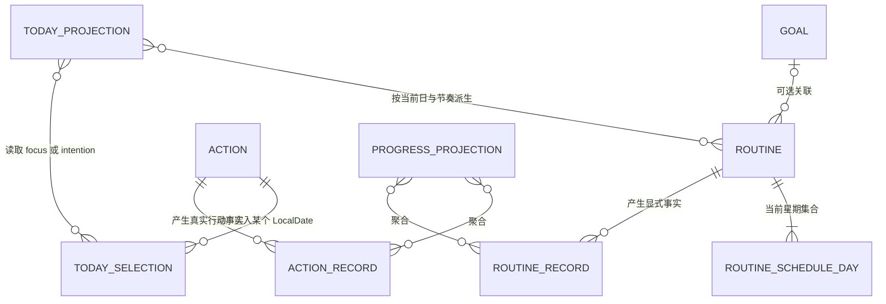
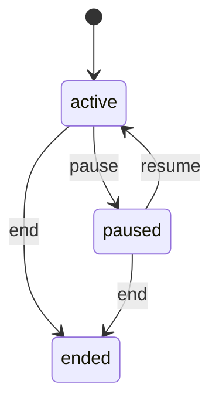

# MyTracer v0.1 S2 例行与非强制意向整体设计

> 文档状态：S1 最终验收后复核通过版；已于 2026-08-13 获项目所有者批准，并获得 T021～T023 按本文范围实施的阶段级实现授权。
>
> 后续交付结果：T021～T023/T802 已完成并由 PR #20 归档到 `dev`；里程碑 PR #22 合入 `main@581e443ea925715b1eb4f2343b735fce9e38e604`，并发布 `v0.1.0-alpha.3`。下文未完成门禁措辞均是设计批准时记录。
>
> 复核基线：S1 最终行为验收 revision `dev@74ebe346a86cf431d87e02e8a1220b713b33901c`（`EV-G3-S1-002`）；验收归档及状态收口后的当前开发基线 `dev@52de81ff6fc95df5ac53e998824ff07135e792b3`。
>
> 权限说明：本文不替代 T021、T022、T023 三个独立任务合同，不自动授予新增/升级依赖、migration 或具体 branch、commit、push、PR、merge、tag、release 权限，也不表示任一任务已经启动、完成或通过验收。
>
> 适用范围：S2 / E2-01～E2-03 的后续任务合同、实现、测试与验收设计输入。
>
> 核心验收：AC-03 每日轻量活动、AC-04 个人时间意向。

## 0. 文档用途、依据与权限边界

本文把冻结产品语义、已批准架构决定和已验收 S1 接口收敛为 T021～T023 的整体设计。本文是三个独立任务合同的已批准设计输入；项目所有者已经授予按本文范围实施 T021～T023 的阶段级权限。本次文档收口本身不创建任务合同，也不启动任一实现任务。

解释优先级保持为：

1. [`PRODUCT_REQUIREMENTS_V0.1.md`](../PRODUCT_REQUIREMENTS_V0.1.md)；
2. [`DECISIONS.md`](../DECISIONS.md)；
3. [`REQUIREMENTS_CHANGE_POLICY.md`](../REQUIREMENTS_CHANGE_POLICY.md)；
4. 本目录的总体架构、领域、数据、测试、追踪、实施计划、工程决定和已批准的 [`S1_CORE_LOOP_DESIGN_V0.1.md`](./S1_CORE_LOOP_DESIGN_V0.1.md)；
5. [`TASK_INDEX_V0.1.md`](../implementation/TASK_INDEX_V0.1.md)、[`TASK_TEMPLATE.md`](../implementation/TASK_TEMPLATE.md) 和 [`GITHUB_WORKFLOW_V0.1.md`](../implementation/GITHUB_WORKFLOW_V0.1.md)；
6. S1 最终验收后被项目所有者接受的实际接口、数据版本、归档和证据。

`user/` 不属于本文依据，不得成为后续设计、实现、测试或验收依赖。

本文使用以下标记：

| 标记 | 含义 |
|---|---|
| **冻结/已批准** | 直接来自 FR、AC、D、ED、GW 或已批准 S1 设计；后续任务不得自行改变 |
| **S1 已验收基线** | 已由 G3/S1 最终验收及第 11 节复核确认的接口和数据事实 |
| **S2 已批准设计** | 本文确定的 S2 设计边界和 S2-Q 结果；后续任务合同不得自行改变 |
| **延期/非范围** | 不进入 S2，不得成为 T021～T023 的必要接口、表、依赖或验收条件 |

项目所有者已批准本文设计，并授予 T021～T023 按本文范围实施的阶段级权限。该批准仍不自动：

- 把 T021、T022 或 T023 从 `pending` 改为 `ready`/`active`；
- 替代 `TASK_TEMPLATE.md` 形成的独立合同、允许文件、排除项、验证命令和完成条件；
- 授权新增/升级依赖、任何 migration 或破坏性数据操作；
- 授权具体 branch、commit、push、Draft PR、Ready、merge、`main`、tag 或 release；
- 声明 AC-03、AC-04 或任何 S2 需求已经实现或通过。

## 1. 基线核对与冲突结论

### 1.1 设计批准时的当前事实

- S1 已完成最终验收：T011～T014/T801 均为 `done`；自动化和项目所有者人工 AC-01 均通过；`EV-G3-S1-002` 在 `dev@74ebe346a86cf431d87e02e8a1220b713b33901c` 记录 G3/S1 最终通过，并保留 `EV-G3-S1-001` 的首轮失败历史。
- PR #13 已把 S1 合同统一归档到 `dev`，PR #15 已收口归档后状态；当前复核/合同准备基线为 `dev@52de81ff6fc95df5ac53e998824ff07135e792b3`。从最终行为验收 revision 到当前基线只有文档归档和状态文字变化，没有生产接口、测试、依赖、配置、schema 或 migration 变化。
- 已验收 S1 具有 Goal、Action、ActionRecord、Today focus 和 ActionRecord Progress 的纵向路径；S2 只能增量扩展 Routine、RoutineRecord 和 intention，不能改写 S1 的 Action/Today/Progress 语义。
- SQLite `schemaVersion = 1` 及唯一 `001_initial` migration 已复核确认预建 `routines`、`routine_schedule_days`、`routine_records`，并允许 `today_selections.kind = focus | intention`。
- `TASK_INDEX_V0.1.md` 已将 T021、T022、T023 分别映射到 E2-01、E2-02、E2-03，当前状态仍均为 `pending`。项目所有者的阶段级实现授权不替代三个独立合同，也不自动改变账本状态。本次整体设计没有独立 Txxx，不得虚构 T020。

### 1.2 冲突与文档张力

本轮复核未发现两条 MUST、已批准 D/ED、已验收 S1 契约或本次已批准 S2 决定之间存在不可调和冲突，因此没有阻塞 T021～T023 按独立合同实施的架构冲突。

发现两处需要显式处理的文档张力：

1. `TEST_STRATEGY_V0.1.md` 的 E2E-AC-03 骨架写有“Progress/Review 验证五种含义”，但 PRD 的 AC-03、追踪矩阵和任务索引只要求 S2 的 Routine、Today、Progress；Review 属于 S5。本文按更高权威和现行任务边界设计：S2 只通过 Today/Progress 验证，S5 再证明 Review 复用同一事实；不得为这句测试骨架措辞提前实现 Review。
2. `DOMAIN_MODEL_V0.1.md` 一处仍称 schedule 语法待技术决定，但同文档结论及已批准 ED-009 已固定“周一至周日集合，带每天/工作日快捷输入”。本文依 ED-009，不重新开放通用重复语法。

若 `dev@52de81ff...` 之后 S1 接口或数据基线再次变化，或实施发现实际基线与第 11 节复核结果不符，必须停止受影响任务、重新复核本文并按需求变更规则报告；不得在 S2 中静默倒改 S1。

## 2. S2 目标、范围与完整流程

### 2.1 可观察结果

S2 完成后，应能在同一已验收版本连续完成两条路径。

**Routine 路径（AC-03）**

```text
创建 Routine
  → 设置非空星期集合和非空 minimumAction
  → Today 按当前 LocalDate 展示当日计划的 active Routine
  → 用户明确保存一条 RoutineRecord
  → plannedForDate 在 Main/Domain 中按该发生日与节奏计算并保存
  → Progress 从 ActionRecord + RoutineRecord 展示事实
  → 关闭并重开后关系、结果、日期和统计保持一致
```

**非强制 intention 路径（AC-04）**

```text
创建通用 pending Action（可不关联 Goal）
  → 用户明确把它作为当日 intention 选入 Today
  → Today 与 focus、计划 Routine 清楚区分展示
  → 当天未发生时不创建 ActionRecord、不创建失败事实、不改变 Action
  → 下一 LocalDate 不自动滚动，历史选择不被改写成失败
  → 不出现兴趣专属模块、完成率或惩罚评价
```

### 2.2 S2 包含

| 能力 | S2 处理 |
|---|---|
| Routine | 创建、修改当前文本/最低行动/星期节奏、pause、resume、end、可选 Goal 关联 |
| RoutineScheduleDay | 仅周一至周日集合；“每天”“工作日”只是输入快捷方式 |
| Today Routine | 由 active Routine + 当前 LocalDate + 当前星期集合查询派生，不写 TodaySelection |
| RoutineRecord | 四种显式 outcome；`unknown` 由没有 Record 推导；保存 `plannedForDate` 历史快照 |
| 非计划日 | 四种显式 outcome 都可保存；其中真实行动计入事实，但都不计计划日达成 |
| Action intention | 复用通用 Action 与 TodaySelection；用户明确选入/移出/转换承诺程度 |
| Progress | 保持 S1 ActionRecord 语义并加入 RoutineRecord 时间、真实行动次数和状态事实 |
| 持久性 | 已验收 v1 schema 上的 SQLite 原子写入、唯一约束、重开和 LocalDate 守恒 |
| 边界 | Application Commands/Queries、白名单 Preload、固定 IPC、运行时 DTO 与 sender/origin 校验 |

### 2.3 明确非范围

- 不修改或修复 S1，不重新解释 S1 的 Goal、Action、ActionRecord、focus 或 Progress 事实；
- 不实现常规 RoutineRecord 补记、修改或删除；FR-R08 与通用记录修正留给 T031；
- 不实现 Routine/Action/Goal 硬删除、影响预览、二次确认或级联业务流程；这些属于 T031；
- 不实现 Recovery、Review 或 AI；
- 不引入提醒、通知、后台督促、连续打卡、断签、失败率、完成率、综合评分、排名或人格评价；
- 不实现月历、复杂周历、自动排程、隔周、每 N 天、任意表达式或通用重复规则引擎；
- 不创建兴趣、休息、学习、健康等专属对象、表、页面或统计模块；
- 不实现截止日期、逾期、优先级、标签、搜索、子任务或任务依赖；
- 不提前实现 S3～S7、自动导入恢复或其他延期能力；
- 不新增/升级依赖，除非后续独立任务合同另行列出并获得项目所有者批准。

## 3. 领域对象、关系与投影



| 对象/投影 | 关系与职责 | 不得承担的职责 |
|---|---|---|
| Routine | 可空 `goalId`；拥有当前星期集合和 0..n RoutineRecord；有独立生命周期 | 不预生成未来记录；不保存累计统计；不因 Goal 状态变化而被查询静默改写 |
| RoutineScheduleDay | Routine 内部值集合；表达当前通常发生的星期 | 不是用户一级概念；不表达提醒、时间段、隔周或任意规则 |
| RoutineRecord | 某 Routine 在明确 LocalDate 的一条显式事实；同 Routine/日最多一条 | 不保存 `unknown`；不由 Today/Progress Query 自动创建 |
| TodaySelection | 仅属于 Action；同 Action/日最多一条，`focus | intention` | 不代表行动发生；不承载 Routine 计划；不自动滚动 |
| Action intention | `TodaySelection.kind = intention` 的用户可见含义 | 不是 Action 类型、Action 状态或兴趣专属实体 |
| TodayProjection | 组合当日 focus、intention 和计划 Routine，并显示当日已有 RoutineRecord 状态 | 不保存投影；不补齐 Record；不把历史内容自动搬到今天 |
| ProgressProjection | 从 ActionRecord 与 RoutineRecord 计算时间、次数和状态事实 | 不统计 intention 未发生；不把缺行当失败；不生成评分或掌握度 |

Routine 不写入 `today_selections`。Today 中计划 Routine 的出现完全由“当前 Routine 状态 + 当前 LocalDate 的星期 + 当前星期集合”派生；因此星期集合不会产生未来数据库行。

## 4. Routine 生命周期、星期节奏与记录语义

### 4.1 生命周期



冻结约束及已批准 S2 落点：

- 新 Routine 初始为 `active`；`ended` 在 v0.1 为终态。
- pause/end 只改变 Routine 当前状态，保留 Routine、星期集合、全部 RoutineRecord、ID 和关联；不得借生命周期操作删除或重写历史。
- 只有 active Routine 进入当前日计划投影和 T022 的当前记录入口；paused/ended Routine 仍可在详情、历史 Progress 和后续完整导出中读取。
- pause/end 前已经保存的 RoutineRecord 仍按原 `occurredOn`、outcome 和 `plannedForDate` 投影。
- Routine 与可选 Goal 的生命周期不自动联动；具体 Today 表达按已批准 S2-Q07-A 执行。
- S2 创建时确定 `goalId`，不提供 Routine 在 Goal 间重分配；否则旧 RoutineRecord 的 Goal 归属会随当前外键漂移。未来若确有重分配需求，需独立设计历史归属。

### 4.2 星期节奏

- 节奏是 1～7 个星期值的非空集合；按 S2-Q01-A 使用 ISO 映射 `1=周一`、…、`7=周日`。
- “每天”展开为 `{1,2,3,4,5,6,7}`；“工作日”展开为 `{1,2,3,4,5}`。快捷项不进入存储，也不增加 schedule 类型。
- `isPlannedOn(routine, localDate)` 是纯领域函数，只回答该 LocalDate 是否匹配当前星期集合。
- 创建 Routine 与保存全部星期集合必须同事务完成；不能出现 active Routine 已存在但节奏只写入一半的状态。
- 修改节奏按 S2-Q02-A 采用“整组原子替换”，先验证完整集合，再在同一事务替换 schedule rows；任何失败产生零变化。
- 修改节奏只影响之后的当前计划查询；不得重写任何历史 RoutineRecord 的 `plannedForDate`。
- 星期集合不预生成今天、未来或过去的 RoutineRecord，也不生成提醒、逾期或失败。
- 现有 v1 schema 不保存 schedule/minimumAction 的版本历史。按已批准 S2-Q03-A，S2 不承诺在节奏或最低行动修改后重建“某个历史空白日当时是否计划”的事实，也不新增配置历史模型。

### 4.3 四种持久化 outcome 与 `unknown`

所谓“五种 Routine 语义”必须实现为“四种显式持久化结果 + 缺少 Record 的 unknown”，不能把 `unknown` 加入数据库枚举。

| 语义 | 持久化 | 真实行动次数 | 达到最低行动 | 计划日达成 | 失败/评价 |
|---|---|---:|---:|---:|---|
| `target_met` | 一条 RoutineRecord | +1 | 是 | 仅当 `plannedForDate=true` | 不产生失败评价 |
| `acted` | 一条 RoutineRecord | +1 | 否 | 否 | 正向事实，不伪装为达标 |
| `intentional_rest` | 一条用户明确保存的 RoutineRecord | +0 | 否 | 否 | 合法休息，不算失败 |
| `not_done` | 一条用户明确保存的 RoutineRecord | +0 | 否 | 否 | 仅描述用户确认的事实，不评价人格 |
| `unknown` | **没有 RoutineRecord** | 不计入（是否行动未知） | 未知 | 未知 | 不是失败，不进入负面指标 |

附加不变量：

- outcome 由用户明确选择；不能从分钟、minimumAction 文本、Today 是否展示或缺行自动推断。
- `target_met` 与 `acted` 都是实际发生；二者必须在 Record、DTO、UI、Progress 和测试中保留区别。
- `intentional_rest` 与 `not_done` 都不是实际行动；二者也必须保留区别。
- `not_done` 只能由用户确认保存；午夜、关闭应用、跨日、未打开应用或未提交表单均不得生成它。
- `unknown` 是查询观察结果，不是业务写入。migration、启动任务、后台任务、Today 和 Progress Query 均不得为 unknown 补行。
- 同一 Routine/LocalDate 最多一条显式 Record。T022 若发现已有记录，应返回稳定冲突并零写入；替换、修正和删除留给 T031，不得用 repository upsert 提前实现 FR-R08。
- active Routine 的非计划日允许用户明确保存四种 outcome，并统一保存 `plannedForDate=false`。这属于 FR-R04 与已批准测试矩阵的直接落点，不再作为可缩窄的 S2 开放项。该记录描述用户对该 Routine 当日事实的明确选择，不反向把该日变成计划日。
- 非计划日 `target_met` 表示用户确实达到该 Routine 的最低行动，`acted` 表示真实行动但未达最低行动；二者计实际行动，但都不计“计划日达成”。非计划日 `intentional_rest/not_done` 只保留显式状态，不计实际行动、失败或计划日达成。
- 修改 minimumAction 不重算历史 outcome；旧 `target_met` 是用户在当时明确保存的事实，不能拿当前 minimumAction 重新判定。

### 4.4 LocalDate 和跨午夜

- Today、`selectedFor`、RoutineRecord `occurredOn` 与计划判断均使用规范 `YYYY-MM-DD` LocalDate，不用 UTC 日期或审计 Instant 代替。
- 每个 Command/Query 开始只读取一次可信 `ClockPort.snapshot()`，避免同一操作得到两个“今天”。
- Renderer 不提交可信的 Today 日期、`plannedForDate`、weekday 或 `selectedBy`。
- T022 直接继承 ED-017 并复用已验收 S1 recording context 模式：Main 在打开记录表单时捕获 `capturedOn` 并签发绑定 sender/routineId 的内存 opaque ID；跨午夜保存必须让用户选择保留原日期或使用今天。
- 保存 RoutineRecord 的事务内，Main/Domain 对最终 `occurredOn` 计算 `plannedForDate`；刷新、重开、节奏修改和跨日不得再次计算或覆盖已存快照。
- 常规选择任意历史日期的补记不在 T022；它属于 FR-R08/T031。

### 4.5 非强制 intention

- intention 复用现有通用 Action；Action 可以不关联 Goal，不能创建隐藏默认 Goal。
- intention 由 TodaySelection 的 `kind`/`commitment` 表达，不改变 Action `pending | completed | cancelled | rescheduled` 状态。
- 只有用户命令可以选入、移出或改变当日 commitment；`selectedBy` 固定为 `user`。
- 同一 Action/LocalDate 最多一条 TodaySelection，因此 focus 和 intention 互斥。按 S2-Q06-A 通过显式转换命令切换，禁止 repository upsert 在用户未确认时静默改写。
- intention 使用与 S1 focus 相同的可选入边界：无 Goal 或 active Goal 下的 pending Action；rescheduled Action 只有在用户明确选入时，才与恢复 pending 同事务完成；completed/cancelled 不可选入。
- 当日 intention 没有发生时，不创建 ActionRecord、不改变 Action、不创建 `not_done` 或其他失败事实、不增加任何 Progress 计数。
- 历史 TodaySelection 按其原 `selectedFor` 保留；下一 LocalDate 查询不到旧 intention，但数据库不自动删除、复制或滚动它。
- intention 发生后，用户使用正常 ActionRecord 路径记录真实行动；是否完成/取消/重新安排 Action 仍遵循 S1 的显式 post-record 选择，不能由 intention 身份推断。
- Progress 不把 TodaySelection 数量、未发生 intention 或“意向完成率”作为进展指标。

## 5. Today 与 Progress 投影

### 5.1 TodayProjection

S2 的 Today 只读投影应组合三类明确内容：

```text
TodayView
  localDate
  focuses[]              // TodayActionItem(commitment=focus)，保留 S1 语义
  intentions[]           // TodayActionItem(commitment=intention)
  plannedRoutines[]      // active 且当前星期匹配的 Routine
  availableActions[]     // S1 已验收入口，不自动加入 Today
```

`TodayActionItem` 按已批准设计包装现有 `ActionDetailDto` 并增加独立 `commitment: focus | intention`；S1 已验收的 `selectedForToday` 继续只表示 focus，不能改义为“任意 commitment”。已作为 intention 选中的 Action 在 `availableActions[]` 中必须携带独立 `todayCommitment=intention`（或等价明确字段），不能因旧 boolean 为 false 被误呈现为未选择；S1 focus 回归必须证明旧字段和行为不变。

T021 先让每个 `plannedRoutines[]` 项返回 Routine ID/name/minimumAction、可选 Goal 摘要、当前计划匹配和可操作性；T022 再增量加入当日是否已有 Record，以及 `recordState = target_met | acted | intentional_rest | not_done | unknown`。任何明确查询日没有 Record 时都只能观察为 `unknown`；Query 不写数据库。Today 只列当前计划匹配项，因此其 `unknown` 表示“这个计划日没有 Record”；非计划日不会仅因缺少 Record 进入 Today 或生成 Progress fact，也不得另造第六种 Routine 状态。

已批准行为：

- 当日保存 Record 后，Routine 仍留在 Today，并显示显式结果，而不是隐藏；这让用户区分已记录与 unknown 且不需要再次查找。
- paused/ended Routine 不进入当前计划列表，但详情和历史仍可访问。
- 按 S2-Q07-A，active Routine 即使关联 Goal 已 paused/ended 仍进入 Today，必须显示 Goal 状态且 `canRecord=true`；Routine 生命周期独立，用户无需先恢复 Goal 即可记录。改变此行为须先修改已批准设计，不得由 DTO、Application guard 或 Query 静默隐藏。
- Query 不创建 missing rows、不迁移、不自动恢复状态、不复制旧选择、不改变 commitment。
- Today 中 focus、intention、计划 Routine 采用领域中立和中性文案；不出现“欠做”“断签”“失败日”或兴趣专属分区。

### 5.2 ProgressProjection

S1 已验收 `GetProgress` 的过滤语义继续保持：可选 `goalId`、可选包含端点的 `from/through`，Query 只读并从一致性快照计算。

S2 在不改变 ActionRecord 含义的前提下加入 RoutineRecord 分支：

```text
totalDurationMinutes
  = sum(ActionRecord.durationMinutes)
  + sum(non-null RoutineRecord.durationMinutes where outcome in [target_met, acted])

realActionCount
  = count(ActionRecord)
  + count(RoutineRecord where outcome in [target_met, acted])

targetMetCount
  = count(RoutineRecord where outcome = target_met)

plannedTargetMetCount
  = count(RoutineRecord where outcome = target_met and plannedForDate = true)
```

Progress 至少保留每条 RoutineRecord 的 `routineId`、查询时 Routine 的当前可选 `goalId`、Routine 名称、`occurredOn`、outcome、`plannedForDate`、可选分钟和创建时间，以便用户看到事实而不是只有累计数。v1 `routine_records` 不保存 Goal 快照；这个 `goalId` 只是当前关联，不是历史 Record 字段。按 ED-008 将 Goal 硬删除并 `SET NULL` 后，旧 RoutineRecord 仍在全局 Progress，但不再出现在该已删除 Goal 的过滤结果；该后续 S3 行为须有集成测试。

约束：

- S1 每条 ActionRecord 仍分别计一次；S2 不去重、不合并、不重命名为“完成任务数”。
- `target_met` 与 `acted` 都进入 `realActionCount`；只有 `target_met` 进入 `targetMetCount`；只有计划日的 `target_met` 进入 `plannedTargetMetCount`。
- `intentional_rest`、`not_done` 和 unknown 不进入真实行动次数或总时长。
- unknown 不生成 `routineRecords[]` fact，也不进入分母、失败率或完成率。S2 不构建历史空白日统计。
- Routine 的可空分钟只有在 `target_met/acted` 时允许；null 表示用户未记录时长，不等于 0。0 仍表示少于一分钟但确有行动。
- Action 和 Routine 事实都按显式 LocalDate/Instant/ID 稳定排序，不依赖 SQLite 隐含行序。
- 时间、次数、outcome 和 minimumAction 均不得推导 Understanding、掌握度、质量、人格或自律评价。
- S2 不实现 FR-P06 的简单周期变化，也不实现复杂评价分数或 Review；S5 可复用本投影，但不能成为 S2 验收前置。

## 6. Application Commands、Queries、IPC 与事务

以下名称是 **已批准的 S2 设计级命名**，但仍不是冻结的源码公共 API 名称。独立任务合同可在语义、职责和追踪不变时调整命名，但不得合并成通用 CRUD、任意 IPC channel 或 raw SQL 入口。

### 6.1 Commands

| Task | 已批准的 Application Command 边界 | 主要输入 | 原子结果 |
|---|---|---|---|
| T021 | `CreateRoutine` | goalId?、name、description?、minimumAction、weekdays[] | 创建 active Routine 与完整星期集合 |
| T021 | `UpdateRoutineDetails` | routineId、name、description?、minimumAction | 只改当前文本/最低行动，不改历史 Record |
| T021 | `ReplaceRoutineSchedule` | routineId、完整 weekdays[] | 验证后整组替换；不重写历史 `plannedForDate` |
| T021 | `PauseRoutine` / `ResumeRoutine` / `EndRoutine` | routineId | 校验状态机，只更新当前状态并保留历史 |
| T022 | `BeginRoutineRecording` | routineId | Main 捕获 sender/routine/LocalDate context，不写 SQLite |
| T022 | `CancelRoutineRecording` | recordingContextId | 只使该 sender 的 context 失效，不写 SQLite |
| T022 | `RecordRoutine` | routineId、contextId、跨日选择?、outcome、durationMinutes?、note? | 计算并保存一条显式 RoutineRecord；四 outcome 均可配 `plannedForDate=false`；重复日冲突零写入 |
| T023 | `SelectActionAsIntentionForToday` | actionId | 使用 Main 当前 LocalDate，写 `intention/user`；必要时显式恢复 rescheduled |
| T023 | `ChangeActionTodayCommitment` | actionId、`focus | intention` | 仅对已存在当日选择做用户确认的显式转换 |
| T023 | `RemoveActionIntentionFromToday` | actionId | 只删除 Main 当前 LocalDate 的 intention，不改 Action |

后续任务合同可以选择把 focus/intention 的显式操作收敛到语义等价的统一命令，但必须同时满足：Renderer 明确提交用户选择；冲突不会被底层 upsert 静默覆盖；既有 S1 focus 行为和错误语义不被倒改。

### 6.2 Queries

| Task | 已批准的 Application Query 边界 | 输出与约束 |
|---|---|---|
| T021 | `ListRoutines` | 明确状态过滤；返回当前星期集合与最低行动，不推断失败 |
| T021 | `GetRoutineDetail` | Routine、Goal 摘要、星期集合、只读 Record 摘要能力；T021 不创建 Record |
| T021/T023 | `GetToday`（扩展） | T021 加入 plannedRoutine 基础项；T023 加入带独立 commitment 的 intentions；只读、无补行/搬运 |
| T022 | `GetRoutineDayState` | routineId + 明确查询日；有 Record 返回显式 outcome；没有 Record 返回 unknown；同时返回当前节奏匹配信息，但不把它冒充历史计划快照；不保存 |
| T022 | `GetProgress`（扩展） | 保持 S1 filter，加入 RoutineRecord 事实与统一真实行动次数；一致性只读快照 |

`GetRoutineDayState` 的日期用于只读查询和测试，不授权 Renderer 以任意日期创建 Record。常规历史补记仍属于 T031。

### 6.3 事务边界

每个用户已经确认且产生业务写入的 Command 使用一个 `UnitOfWorkPort.transaction`；等待表单、跨午夜确认或其他 Renderer 交互期间不得保持 SQLite 事务。

必须原子的写入组：

1. Routine + 全部 RoutineScheduleDay；
2. 完整 schedule 集合替换；
3. Routine 生命周期单行状态转换；
4. RoutineRecord 的状态复核、同日唯一检查、`plannedForDate` 计算与保存；
5. rescheduled Action 恢复 pending + 当日 intention 写入；
6. focus/intention 的显式 commitment 转换。

任何校验、FK、UNIQUE 或持久化失败均产生零变化。Today、Routine detail、day state 和 Progress Query 不开启业务写事务；适配器可以为一致性读取使用只读事务或等价快照。

### 6.4 IPC 与进程边界

- Renderer 只调用冻结在 `window.myTracer.routines/today/progress` 等命名空间下的具体方法；不得获得 `ipcRenderer`、channel 名称、SQL、数据库路径、任意文件路径、Electron 对象或 Clock。
- Preload 只转发可结构化克隆 DTO，API 对象冻结；不暴露通用 `invoke`。
- Main 为每个 Command/Query 注册固定 channel，复用 S1 sender/origin 校验，再做该 DTO 的运行时形状、类型、枚举、UUID、非空文本、weekday、LocalDate 和分钟校验。
- Renderer 不能提交可信 `createdAt/updatedAt`、Today 日期、`occurredOn`、`plannedForDate`、weekday 计算结果、`selectedBy` 或统计结果。
- 未知多余字段、重复/越界 weekday、空白 minimumAction、非法 outcome、非整数/负数分钟、伪造/失效 context、错误 sender/routine 绑定和非法跨日选择均拒绝且零写入。关联 Goal 的状态不得由 Renderer 伪造；按 S2-Q07-A，它只影响 Today 标注，不阻塞 active Routine 记录。
- 错误只返回稳定 code 与中性消息，不泄露 SQL、堆栈、绝对路径或用户正文。建议至少区分 `validation`、`not-found`、`invalid-transition`、`invariant-violation`、`selection-conflict`、`record-already-exists`、`date-confirmation-required`、`invalid-recording-context`、`persistence-failed`。
- S2 不新增运行时校验依赖；若现有手写模式不足，后续任务必须先申请依赖批准。

## 7. S2 数据、外键、唯一约束、migration 与重开

### 7.1 已验收 v1 表

| 表 | S2 用途 | 已确认关键字段/约束 | 任务 |
|---|---|---|---|
| `routines` | 生命周期、文本、最低行动、可选 Goal | UUID PK；`goal_id` 可空并 `ON DELETE SET NULL`；status CHECK；name/minimumAction 非空 | T021 |
| `routine_schedule_days` | 当前星期集合 | `(routine_id, weekday)` 复合 PK；weekday CHECK 1～7；Routine FK cascade | T021 |
| `routine_records` | 四种显式事实与计划快照 | UUID PK；Routine FK cascade；LocalDate；四 outcome CHECK；boolean `planned_for_date`；非负可空分钟；`UNIQUE(routine_id, occurred_on)` | T022 |
| `today_selections` | Action focus/intention | `(action_id, selected_for)` PK；kind CHECK；`selected_by=user`；Action FK cascade | T023 |
| `action_records` | intention 发生后的普通 Action 事实 | 保持 S1 约束和含义，不由 T023 新建专属 Record | S1 复用 |
| `metadata` | schemaVersion | 已确认为 1；更高未知版本拒绝写入 | 全 S2 回归 |

Progress 和 Today 均不建累计/投影表。应用层额外保证数据库单表 CHECK 无法表达的约束：schedule 非空、Routine goalId 创建后不重分配、`plannedForDate` 由 Main/Application 计算而不信任 Renderer、休息/未进行时分钟必须为空、显式 commitment 转换、Query 零写入。

### 7.2 外键与唯一性

- `routines.goal_id → goals.id ON DELETE SET NULL`；
- `routine_schedule_days.routine_id → routines.id ON DELETE CASCADE`；
- `routine_records.routine_id → routines.id ON DELETE CASCADE`；
- `today_selections.action_id → actions.id ON DELETE CASCADE`；
- 同一 Routine/weekday 只有一行；同一 Routine/occurredOn 只有一条 Record；同一 Action/selectedFor 只有一个 commitment。

这些数据库删除动作只描述已批准 S3 硬删除策略的底层关系，不授权 T021～T023 暴露硬删除命令。

### 7.3 Migration 决策

按 S1 验收后复核及已批准 S2-Q03-A/Q10-A，S2 **不新增 migration**，直接复用 v1 已预建结构。

- 不得修改已经发布或可能执行过的 `001_initial.sql`。
- Repository/Application 方法扩展本身不提升 schemaVersion。
- migration、启动任务或 fixture 初始化逻辑不得把缺行自动/批量补成 `not_done`；测试 fixture 可以显式构造用户确认的 `not_done` 事实。`unknown` 在任何情况下都不写行。
- 如果实现发现当前基线缺少上述表/约束，或需求变化要求节奏/Goal 历史快照，必须停止相关任务，另提顺序 `002_*` migration、旧版 fixture 守恒、回滚/备份影响和单独批准；不能回改 v1。
- 任何破坏性或不可逆 migration 仍需项目所有者单独批准和备份方案。

### 7.4 重开行为

集成与 E2E 必须真正关闭 SQLite 连接/Electron，再从同一隔离临时数据库或 `userData` 重建实例；不得复用内存状态模拟重开。

重开后必须证明：

- Routine ID、goalId、文本、minimumAction、status 和完整星期集合一致；
- pause/end 后全部 RoutineRecord 数量和内容不变；
- RoutineRecord 的 `occurredOn`、outcome、`plannedForDate`、可空分钟和 note 一致；
- 同日唯一约束仍成立，unknown 仍是缺行而不是重开补行；
- 当日 focus/intention 仍保持原 commitment，其他日期不自动出现；
- Today 重新从当前 LocalDate 和事实构建，Progress 重新从 Record 计算；
- AI 完全未配置时以上能力仍可用。

所有自动化继续使用每 case/进程唯一临时数据根，绝不访问真实 Electron `userData`。

## 8. T021～T023 任务边界

T021～T023 已获得项目所有者按本文范围实施的阶段级授权，但仍必须作为三个独立任务按账本顺序和各自合同执行；不得合并成一个无合同的批量实现，也不得以该授权推定具体 Git/GitHub、依赖或 migration 权限。

### 8.1 T021 — Routine 生命周期、星期节奏与 Today 计划项

**范围**

- Routine 领域实体、`active | paused | ended` 状态机和历史守恒；
- 可空 Goal 关联、当前文本、minimumAction；
- 周一至周日非空集合及每天/工作日快捷输入；
- 创建时原子保存 Routine + schedule；修改时原子整组替换 schedule；
- `ListRoutines`、`GetRoutineDetail` 和 `GetToday` 的计划 Routine 分支；
- Repository、SQLite、IPC、Preload、Renderer 的最小纵向路径；
- LocalDate weekday、状态机、节奏、事务回滚和真实重开测试。

**非范围**

- 创建 RoutineRecord、四 outcome、Progress Routine 分支、unknown 验收；
- Action intention；
- Routine Goal 重分配、硬删除、补记、修改/删除 Record；
- 提醒、时间段、隔周/每 N 天、复杂日历或通用规则。

**依赖**

- G3/S1 最终验收及第 11 节接口/数据复核均已完成且无阻塞；
- 本文及 S2-Q01-A/Q02-A/Q03-A/Q07-A/Q10-A 已获项目所有者批准；
- 独立 T021 合同明确允许文件、验证、依赖、migration 和 Git/GitHub 权限；
- 不新增依赖；若需要 migration，必须先走独立审批。

**完成条件**

1. FR-R01～R03 与 FR-T02 的 T021 可观察行为存在；
2. 生命周期合法/非法转换和 pause/end 历史守恒有领域、应用、SQLite 与 IPC 证据；
3. schedule 非空、去重、1～7 映射和整组替换故障零变化；
4. 每天/工作日只展开为集合，不保存新 schedule 类型；
5. Today 只读展示当前日计划 active Routine 的基础项（身份、最低行动、可选 Goal、计划匹配和可操作性），不写 TodaySelection、不预生成 Record；五态 `recordState` 由 T022 增量加入；
6. schedule 修改不改变已有 RoutineRecord `plannedForDate` fixture；
7. 完全重开后 Routine 与 schedule 一致；
8. 不声称 AC-03 完整通过，只记录步骤 1～2 的贡献。

### 8.2 T022 — RoutineRecord 五语义与 Progress 事实

**范围**

- `target_met | acted | intentional_rest | not_done` 四种显式 outcome；
- `unknown = no RoutineRecord` 的只读投影；
- 当前记录入口、recording context、跨午夜确认和 `plannedForDate` 保存时快照；
- 同 Routine/LocalDate 唯一，重复提交冲突而非覆盖；
- 非计划日四种显式 outcome 均可无损保存为 `plannedForDate=false`，其中只有 `target_met/acted` 计真实行动；
- Progress 加入 RoutineRecord 时间、真实行动次数、达标事实和稳定排序；
- `GetRoutineDayState`、Routine Record DTO、IPC、UI 和真实重开；
- 完整自动化 E2E-AC-03 与人工验收准备。

**非范围**

- FR-R08 的常规历史补记、修改、替换、删除；
- Routine 硬删除、影响预览和级联 UI；
- 历史空白计划日统计、完成率、失败率、streak、复杂周期比较；
- Review、Recovery、AI、导出。

**依赖**

- T021 完成且有证据；
- S1 `GetProgress` 的最终 filter/DTO/排序/一致快照契约已按第 11 节复核确认；
- 本文及 S2-Q03-A/Q04-A/Q05-A/Q07-A/Q08-A/Q09-A/Q12-A 已获项目所有者批准；Routine 发生日严格复用 ED-017，不另设可选语义；
- 独立 T022 合同明确权限和验证命令。

**完成条件**

1. 四种持久化 outcome + 缺行 unknown 的全矩阵通过，数据库没有 unknown 行；
2. `target_met`/`acted` 均计真实行动且保持区别；rest/not_done/unknown 均不计实际行动；
3. 非计划日四种显式 Record 均保存 `plannedForDate=false`；只有 `target_met/acted` 计真实行动，四者均不计计划日达成；
4. schedule/minimumAction 修改不重算历史 Record；
5. 重复日、非法状态、非法 outcome/分钟组合、跨日未确认和任一故障均零写入；计划日与非计划日的四 outcome 均有测试；
6. Progress 保留 S1 ActionRecord 结果，同时加入 RoutineRecord，Query 重复调用零写入；
7. 完全重开后 Record、unknown 缺行和聚合一致；
8. Today 在保存后按已批准 S2-Q12 结果展示；E2E-AC-03 在同一最终 revision 连续通过；项目所有者未执行人工验收时明确为 `pending`；
9. 不声明 FR-R08、Review、完整 FR-D01 或 AC-07 完成。

### 8.3 T023 — 通用非强制 intention

**范围**

- 复用 S1 通用 Action 创建和生命周期；
- 用户把符合条件的 Action 作为当日 intention 选入、移出；
- 同 Action/LocalDate focus/intention 互斥与显式转换；
- Today 明确区分 focuses、intentions、plannedRoutines；
- 跨日后旧 intention 不自动滚动、不生成 Record/失败、不改变 Action；
- SQLite、IPC、Preload、Renderer 的最小纵向扩展；
- 完整自动化 E2E-AC-04 与人工验收准备。

**非范围**

- 兴趣/休息专属实体、模块、模板、完成率或统计；
- 新的 Action 状态、intention Record 类型、自动滚动、自动完成、提醒或候选排序；
- 修改 S1 focus、ActionRecord 或 post-record 的已批准含义；
- RoutineRecord、Review、Recovery、AI。

**依赖**

- 按任务索引以 T021 为前置，使扩展后的 Today 组合结构稳定；T023 不以 T022 完成为必要前置；
- S1 Action/TodaySelection 最终接口已按第 11 节复核确认；
- 本文及 S2-Q06-A 已获项目所有者批准；Today DTO 的兼容扩展已随本文批准，T023 不依赖 T022 的 Progress DTO 选择；
- 独立 T023 合同明确权限和验证命令。

**完成条件**

1. FR-A07、FR-T03、FR-T08 和 AC-04 的可观察路径存在；
2. intention 仍是 Action + TodaySelection，不增加用户一级概念或兴趣表；
3. 选入/移出/转换只来自用户命令，同日唯一且失败回滚；
4. next LocalDate 不自动出现旧 intention；旧 selection 不被删除或改写为失败；
5. 未发生时 ActionRecord 数、Action 状态、Progress 和失败事实均不变；
6. 若发生，使用正常 ActionRecord 路径且保持 S1 显式 post-record 语义；
7. 重开和跨日 E2E-AC-04 通过；项目所有者未执行人工验收时明确为 `pending`；
8. 无兴趣专属模块、意向完成率、提醒或惩罚文案。

## 9. 测试、AC-03 与 AC-04 验收矩阵

### 9.1 分层测试矩阵

| 行为/风险 | 领域/应用单元 | SQLite/集成 | IPC | E2E | 人工验收 |
|---|---|---|---|---|---|
| Routine 生命周期 | 合法/非法转换；ended 终态；pause/end 历史集合不变 | 事务回滚；FK；关闭重开 | 伪造 ID/非法状态/不可信 sender 拒绝 | 创建、pause/resume/end 后历史仍在 | pause/end 文案中性，不像删除或失败 |
| Routine 与 Goal 生命周期接缝 | 按 S2-Q07 验证 `canRecord`/guard | Goal pause/end 后 Routine 状态与历史不被暗改 | Goal 状态由 Main 查询，Renderer 不可伪造 | 关联 Goal paused/ended 的 Today 与记录路径 | 状态标注与可操作性符合批准选项 |
| 星期节奏 | ISO 1～7、非空、去重、每天/工作日展开、LocalDate weekday | 创建/替换原子；失败零变化；不改历史快照 | 越界/重复/空集合/多余字段拒绝 | 创建每日 Routine，Today 显示；改节奏后当前 Today 更新 | 节奏输入简单，无复杂日历心智负担 |
| Today Routine | active + 当前日匹配；无 Record=unknown；Query 只读 | 查询前后 snapshot 一致；不生成 schedule/record rows | Renderer 不能传可信 Today/weekday | planned Routine 显示最低行动和结果 | focus/intention/Routine 三类清楚 |
| Routine 四 outcome | 显式选择；分钟规则；不从文本/时间推断 | CHECK/UNIQUE/FK；父状态；故障回滚 | 非法枚举/分钟/context 拒绝 | 分别保存 target_met/acted/rest/not_done | 五种含义清楚且无羞辱评价 |
| unknown | no row → unknown；不计数、不评价 | 查询/重开/migration 均不补行 | 无“保存 unknown”入口 | 空白日保持 unknown | 未填写不会被暗示为失败 |
| 非计划日 | 四 outcome 无损；计划达成=false | `planned_for_date=0` 守恒；改 schedule 不回算 | Renderer 不能伪造计划标志 | target_met/acted 计真实行动；rest/not_done 只保留状态；均不计计划达成 | 非计划事实不冒充计划完成或失败评价 |
| Progress | Action 公式不变；Routine 计次/时长/达标矩阵；稳定排序 | 一致快照、Goal/日期过滤、重开 | filter/日期/UUID 校验；重复 Query 零写 | AC-03 的时间、次数、四 outcome 与 unknown 路径 | 事实展示，无 score/streak/failure rate |
| intention | Action 状态解耦；同日互斥；显式转换；不滚动 | selection 唯一、重开、跨日、回滚 | 伪造 kind/date/selectedBy 拒绝 | AC-04：创建→intention→跨日未发生 | 非强制、非惩罚、无兴趣专属模块 |
| 范围扫描 | 无新状态/评分/规则引擎 | 无累计表、unknown 行或未批准 migration | 无通用 channel/SQL/路径 | 无 Review/Recovery/AI 假完成 | 无提醒、逾期、连续打卡压力 |

### 9.2 E2E-AC-03 连续程序

在同一明确 revision、FakeClock 和隔离 `userData` 上：

1. 创建“每日轻量活动”Routine，minimumAction 为一段非空自然语言，星期集合为每天。
2. 关闭并重开，确认 Routine、节奏和最低行动存在；Today 在当前 LocalDate 显示该 Routine，且没有 Record 时为 unknown。
3. 在不同明确 LocalDate 或独立隔离场景分别保存 `target_met`、`acted`、`intentional_rest`、`not_done`；不能通过覆盖同日记录模拟四种状态。
4. Progress 验证 target_met/acted 各增加一次真实行动，二者 outcome 不合并；rest/not_done 不增加真实行动。
5. 原子修改 schedule，使尚未来到的四个明确 LocalDate 成为非计划日；在隔离场景分别保存 `target_met`、`acted`、`intentional_rest`、`not_done`，验证均为 `plannedForDate=false`，只有前两者增加真实行动，四者都不增加计划日达成且不产生失败评价。
6. 保留至少一个无 Record 的计划日，验证数据库无行、查询为 unknown、无失败评价和负面计数。
7. 再次修改 schedule，把第 5 步日期纳入当前计划集合，验证既有 RoutineRecord 的 `plannedForDate=false` 快照仍不变。
8. pause/end 并重开，验证历史 Record 与 Progress 仍在，当前计划列表按生命周期更新。

这条程序完成 PRD AC-03；它不进入 Review。S5 后续必须另证 Review 复用事实，但不是 S2 完成条件。

### 9.3 E2E-AC-04 连续程序

在同一明确 revision、FakeClock 和隔离 `userData` 上：

1. 创建一个可不关联 Goal、内容与兴趣或休息有关的普通 pending Action。
2. 用户明确把它作为当日 intention 选入 Today；确认它不出现在 focus 或 Routine 类型中。
3. 不保存 ActionRecord，让 FakeClock 前进到下一 LocalDate并完全重开应用。
4. 验证新日没有自动 intention，旧 selection 仍只属于原 LocalDate；Action 仍 pending；ActionRecord 和 Progress 计数均无变化。
5. 验证 UI 没有失败、逾期、断签或兴趣完成率，也不要求兴趣专属模块。
6. 可选强化：在另一日再次由用户明确选入并通过正常 ActionRecord 路径记录，证明 intention 不是专属 Record 类型。

### 9.4 项目所有者人工验收

**AC-03**

- 创建每日 Routine 是否只需名称、最低行动和简单星期选择；
- Today 是否清楚显示今天计划的 Routine 及当日结果；
- `target_met`、`acted`、`intentional_rest`、`not_done`、`unknown` 是否无损且用词中性；
- 非计划日行动是否被呈现为真实事实而不是计划达成；
- Progress 是否只展示时间、次数、结果与计划快照事实，无 score、streak 或失败率。

**AC-04**

- 通用 Action 是否可以轻松作为 intention 加入 Today；
- focus、intention 和 Routine 是否清楚但不过度复杂；
- intention 未发生时是否没有压力、失败暗示、自动记录或自动滚动；
- 是否完全不需要兴趣专属模块。

人工结果必须记录为 pass/fail/partial 并附观察；在项目所有者实际执行前始终为 `pending`。

## 10. FR / AC / D / ED → Txxx → 测试追踪

缩写：`U` 领域/应用单元，`I` SQLite/集成，`IPC` Main/Preload 契约，`E2E` 端到端，`M` 项目所有者人工，`SCOPE` 范围扫描。

| 需求或决定 | Txxx 落点 | 测试层级 | 说明 |
|---|---|---|---|
| FR-R01～R03；FR-T02 | T021 | U、I、IPC、E2E、M | Routine 生命周期、星期节奏、最低行动、Today 计划项 |
| FR-R04～R07；D-008～D-010 | T022 | U、I、IPC、E2E、M | 四 outcome + unknown；行动/休息/未进行无损 |
| FR-R09；D-107 | T022 | U、I、IPC、E2E、M | 非计划日实际行动与计划日达成分离 |
| FR-R08（SHOULD） | T031；T022 不声明完成 | U、I、IPC、E2E、SCOPE | 常规补记、修正、删除不提前进入 S2 |
| FR-A07；FR-T03/T08；D-011 | T023 | U、I、IPC、E2E、M | 通用 Action intention；无兴趣专属模块 |
| FR-A01～A03；FR-T01/T04/T05 | S1 复用，T023 回归 | U、I、IPC、E2E、SCOPE | 创建通用 Action、用户选择、Today 不自动搬运 |
| FR-P01/P02/P07/P08；D-007 | T022（S1 Action 分支复用） | U、I、IPC、E2E、M | 时间、统一真实行动次数和事实型 Progress |
| FR-P03/P04；FR-C03 | S1 已验收基线，T022 回归 | U、I、IPC、E2E、SCOPE | Routine 扩展不得改变理解/困惑或推导掌握度 |
| FR-P06（SHOULD） | S7；S2 只做 SCOPE | SCOPE、M | 不提前实现 FR-P06 的简单周期变化，也不实现复杂评价分数 |
| FR-D01 | T021/T022 的 Routine 子集 + S1 子集 | I、E2E | 只声明 Routine/S2 重开贡献，不声明完整 FR-D01/AC-07 |
| AC-03 | T021 + T022 | U、I、IPC、E2E-AC-03、M | 只有 T022 最终 revision 才执行完整场景 |
| AC-04 | T023 | U、I、IPC、E2E-AC-04、M | 通用 intention 未发生零惩罚 |
| D-003/D-016；ED-006 | T021～T023 横切 | U、I、E2E、SCOPE | 四核心概念；Routine/Action 可空 Goal；不加领域模块 |
| D-004 | T023 回归 | U、IPC、E2E、M | focus/intention 都由用户最终决定 |
| D-106；ED-015/017 | T021～T023 横切 | U、I、IPC、E2E | LocalDate、显式排序、跨午夜不静默移动 |
| ED-003/004/018/019 | T021～T023 横切 | I、IPC、E2E、SCOPE | SQLite、进程职责、手写 Repository/migration、安全 IPC |
| ED-008 | T021/T022 回归；硬删除仍属 T031 | U、I、SCOPE | pause/end 历史守恒；S2 不暴露删除 |
| ED-009 | T021 | U、I、IPC、E2E、SCOPE | 星期集合；排除隔周/每 N 天/规则引擎 |
| ED-012 | T022 | U、I、IPC、E2E | 非负整数分钟；0 与 null 语义分开 |
| FR-REC01～REC06、FR-RV01～RV06、FR-AI01～AI10、AC-02/05/06/07 | 后续既定任务 | SCOPE | S2 不提前实现或声明通过 |
| FR-C05、FR-D06/D07、FR-AI11～AI13、FR-RV07 | 延期 | SCOPE | 不形成 S2 接口、表、页面或前置依赖 |

表中所有编号均来自当前冻结 PRD、DECISIONS 或已批准 ENGINEERING_DECISIONS；本文不创建新 FR/AC/D/ED 编号。

## 11. 对 S1 的依赖与验收后复核结果

### 11.1 已冻结/已批准且可直接依赖

- Renderer → Preload → Main/Application → Domain/SQLite 的依赖方向，以及 Renderer 无 Node/SQL/文件/凭据/Provider 能力（ED-004、ED-019）。
- Action/Routine `goalId` 可空，用户可创建不关联 Goal 的通用内容（ED-006）。
- Today 选择由用户最终决定，旧选择不自动搬运；Today/Progress Query 只读。
- LocalDate 是 Today 和 Record 发生日的权威值，跨午夜不得静默移动（D-106、ED-017）。
- 每条 ActionRecord 仍分别计真实行动，Progress 只展示事实，不生成连续天数主指标、评分或掌握度。
- 单个已确认 Command 使用原子事务，IPC 使用固定 channel、sender/origin 和运行时 DTO 校验。
- pause/end 与硬删除严格分离，历史事实保留。

### 11.2 已实现且经 S1 最终验收后复核确认

以下运行时事实由 S1 最终行为验收 revision `dev@74ebe346a86cf431d87e02e8a1220b713b33901c` 证明，并在当前复核基线 `dev@52de81ff6fc95df5ac53e998824ff07135e792b3` 重新核对。两者之间没有运行时代码、测试、依赖、配置、schema 或 migration 变化。

| 已验收依赖 | 复核确认的事实 | S2 使用方式 |
|---|---|---|
| `window.myTracer` / Preload | 顶层精确为 `shell/goals/actions/today/records/progress`，顶层和子 API 均冻结，尚无 routines | 增量增加 routines 及既有 today/progress 方法；不得暴露通用 invoke、Node 或 Electron 对象 |
| Today DTO | 精确为 `localDate/focuses/availableActions`；`ActionDetailDto.selectedForToday` 只表示 focus | 增量增加 intentions/plannedRoutines/commitment，不能重解释既有 boolean |
| Today Application | 只投影 `kind=focus`；select 遇到非 focus commitment、remove 遇到 intention 都明确拒绝 | 按 S2-Q06-A 新增 intention 命令和显式转换，保持 focus 行为与错误回归 |
| TodaySelection persistence | v1 允许 focus/intention，同 Action/日唯一；底层 save 可 upsert kind | Application 必须阻止未确认的静默转换；同日只有一个 commitment |
| Progress DTO/Application/SQL | filter 为可选 `goalId/from/through` 且端点包含；当前只有 ActionRecord `records[]`、总分钟和真实次数；稳定排序、只读一致快照已验收 | 按 S2-Q08-A 兼容增加 `routineRecords[]` 和汇总字段，保留逐 ActionRecord 计次、筛选与排序 |
| RepositoryPort/UoW | 已有通用 Routine save/snapshot 与 S1 意图级端口；仍缺 Routine find/list、schedule replace、RoutineRecord 查询和 Routine Progress 查询 | 在独立任务中新增意图级端口；所有确认写入继续走单个 UoW transaction |
| LocalDate/Clock | 已有规范日期、加日、周范围、`ClockPort.snapshot()` 和 ED-017 日期决策；weekday 计算仍为内部 helper | T021 可公开一个纯 weekday helper，不复制 UTC/Date 推导；T022 直接复用跨午夜语义 |
| recording context | S1 已验收 sender/action/capturedOn 绑定、替换/取消/消费/窗口关闭失效和跨午夜确认 | T022 建立独立 Routine context store 或语义等价复用，绑定 sender/routineId 且不放宽 ActionRecord 入口 |
| v1 schema/migration | `schemaVersion=1`、唯一 `001_initial`，全部 S2 表和关键约束已确认 | 按批准设计不新增 migration、不修改 `001_initial.sql`；发现缺口即停止并另行审批 |
| Main composition/security | 共享 SystemClock、UUID、Repository/UoW、固定注册器和 sender/origin 校验已验收 | 新服务和 IPC 复用同一组合/校验模式，不建立旁路 |
| S1 状态不变量 | reschedule/complete/cancel、Goal pause/end、ActionRecord、focus、Progress 事实公式均有最终证据 | T021～T023 必须在 `52de81ff...` 或其明确后继上运行完整受影响 S1 回归 |

复核结论：T014 独立 review、hosted CI、完整人工 AC-01、T801 package smoke 修复、G3/S1 最终通过、PR #13 归档与 PR #15 状态收口均已核对。`EV-G3-S1-001` 的首轮失败继续保留，`EV-G3-S1-002` 的最终通过不被改写成发生在文档后继 `52de81ff...` 上。

### 11.3 已批准且不得反向修改 S1 的 S2 增量扩展

- 新增 Routine Domain/Application/IPC/Renderer 纵向路径；
- 为 Repository 增加 Routine 查询、schedule 整组替换、RoutineRecord create/read 和 Progress 一致投影能力；
- Today **增量**加入 intentions 与 plannedRoutines，同时保留 S1 focuses 的含义和行为；
- Progress **增量**加入 RoutineRecord facts 和统一真实行动次数，同时保留每条 ActionRecord 的计次、过滤和排序语义；
- 新增纯 LocalDate weekday helper，不复制或改成 UTC/system-date 逻辑；
- 为 RoutineRecord 复用安全 recording context，不放宽 ActionRecord 的入口；
- 以 Application 约束使用 v1 已预建 S2 表，不通过回改 `001_initial.sql`“修正”S1；
- 所有 S2 新 DTO、错误码和 UI 状态只服务现有 FR/AC，不引入提醒、复杂日历、Review、Recovery 或 AI。

若其中任何扩展被实现者判断为必须改变 S1 已批准语义，应记录为依赖/缺口并停止受影响工作，不得在 S2 中直接修复 S1。

## 12. 项目所有者已确认的 S2 决定

项目所有者于 2026-08-13 批准本文及原推荐项：S2-Q01～Q10、Q12 均选择 A；S2-Q11 直接继承 ED-017，不是可选择项。下列未选方案只为保留决策审计，不得进入 T021～T023 合同或实现；改变批准结果必须走正式需求/决定变更流程。

| 决定 | 批准结果 |
|---|---|
| S2-Q01～Q10 | A（原推荐项） |
| S2-Q11 | 直接继承 ED-017 |
| S2-Q12 | A（原推荐项） |

### S2-Q01：星期值和空集合

- **批准结果 A**：ISO `1=周一`～`7=周日`，schedule 必须包含 1～7 个唯一值；无计划用 pause 表达。
- **未批准备选 B**：允许空集合，active Routine 可以永不计划。
- **影响**：A 与 D-106、ED-009 和当前 LocalDate 周语义一致，避免“active 但永不出现”；B 少一个校验但产生难解释状态。

### S2-Q02：节奏修改命令

- **批准结果 A**：每次提交完整集合，在一个事务中整组替换。
- **未批准备选 B**：提供逐日 add/remove 命令。
- **影响**：A 容易证明不会产生半更新，并与小型 1～7 集合匹配；B 命令更多，多个操作之间可能暴露临时节奏。

### S2-Q03：历史空白计划日与配置版本

- **批准结果 A**：S2 不保存 schedule/minimumAction 历史；`plannedForDate` 只为已保存 Record 保留快照；unknown 不进入历史计划完成率，Progress 不构建空白日历。
- **未批准备选 B**：新增带生效日期的 schedule/minimumAction 历史，以重建过去无 Record 日期当时是否计划。
- **影响**：A 复用 v1、无 migration、符合轻量和复杂日历非范围，但无法在配置变化后回答历史空白日“当时是否计划”；B 历史更完整，却新增表、migration、有效期规则和大量边界测试，必须单独批准且可能扩大 S2。

### S2-Q04：非计划日四 outcome 的展示说明

- **冻结前提**：计划日和非计划日都允许四种显式 outcome；本设计不得缩窄 FR-R04。非计划日统一保存 `plannedForDate=false`。
- **批准结果 A**：UI 显式标注“非计划日事实”；`target_met/acted` 计真实行动，`intentional_rest/not_done` 只显示用户明确状态，四者均不计计划日达成或失败评价。
- **未批准备选 B**：仍显示相同事实和统计，但不增加“非计划日”文字标注，只通过明细中的计划标志表达。
- **影响**：A 更不易把额外行动误认作计划达成，也不把 rest/not_done 评价为失败；B 界面更短，但事实区别更隐晦。两个选项都不得禁止四 outcome 或改变计次。

### S2-Q05：同 Routine/日期已有 Record 时

- **批准结果 A**：T022 返回 `record-already-exists`，不覆盖；T031 再实现显式修正。
- **未批准备选 B**：T022 的保存命令直接替换现有 Record。
- **影响**：A 守住 FR-R08/T031 边界并防止双击或重试改写事实；B 更方便纠错，但提前实现 S3 修改语义和权限。

### S2-Q06：focus/intention 转换

- **批准结果 A**：同 Action/日互斥；选择另一 commitment 时先报告冲突，由用户调用显式转换。
- **未批准备选 B**：任何 select 命令都可通过 upsert 自动覆盖原 kind。
- **影响**：A 保留用户决定和可审计意图，不会让底层 upsert 偷换语义；B API 较少，但容易把误触变成静默承诺变化。

### S2-Q07：关联 Goal pause/end 对 active Routine 的影响

- **批准结果 A**：Routine 生命周期独立；Goal pause/end 不自动修改 Routine。若 Routine 仍 active 且当日匹配，Today 继续显示并标注关联 Goal 状态，`canRecord=true`，用户可以记录或显式 pause/end Routine。
- **未批准备选 B**：不改变 Routine，但关联 Goal 非 active 时 Today 继续显示、`canRecord=false`；用户需先 resume Goal，DTO 返回明确 `unavailableReason`。
- **未批准备选 C**：Goal pause/end 时自动 pause/end 关联 Routine。
- **影响**：A 不反向改变 S1 Goal 命令或阻断独立 Routine 行为；B 与 S1 Action 的 active-context 入口更一致，但让 Routine 当前可用性依赖 Goal；C 引入跨聚合自动写入且 end 不可恢复。任何选项都不得由 Query 静默隐藏或修改 Routine。

### S2-Q08：Progress DTO 兼容策略

- **批准结果 A**：保留 S1 ActionRecord facts 的字段/含义，增量加入 `routineRecords[]` 和 Routine 汇总字段；总分钟/真实次数扩为两类事实之和。
- **未批准备选 B**：用全新的判别联合 `facts[]` 替换现有 Action `records[]`。
- **影响**：A 最小化对 S1 契约和 UI 的扰动；B 模型更统一，但会造成较大 S1 DTO/Renderer 改写和回归面。

### S2-Q09：RoutineRecord 分钟规则

- **批准结果 A**：`target_met/acted` 可选非负整数分钟；`intentional_rest/not_done` 必须为 null；0 表示少于一分钟且确有行动。
- **未批准备选 B**：四种 outcome 都允许分钟。
- **影响**：A 防止“未进行但有投入时间”的矛盾，仍保持 Routine 快速记录轻量；B 更宽松但使统计难解释。

### S2-Q10：Routine 的 Goal 关联修改

- **批准结果 A**：创建时确定可空 goalId，S2 不提供 reassign；Progress 中的 goalId 是查询时当前 Routine 关联，不是 RoutineRecord 历史快照。Goal 按 ED-008 硬删除后旧 Record 仍在全局 Progress，但不再属于该 Goal filter。
- **未批准备选 B**：允许 reassign，历史 Progress 随当前 Routine goalId 移动。
- **未批准备选 C**：允许 reassign，并新增 RoutineRecord goal snapshot migration。
- **影响**：A 无 migration，且 S2 内不提供 reassign，因而不会发生重分配漂移；Goal 删除仍按 ED-008 解除当前关联。B 会让查询时的 Goal 过滤归属随当前关联移动；C 可保存历史 Goal 归属，但扩大 schema、导出和测试，当前无 MUST 要求。

### S2-Q11：Routine 记录发生日捕获（ED-017 冻结依赖，非待选决定）

- **唯一允许方案**：复用 Main 内存 recording context，表单打开时固定发生日；跨午夜保存时必须让用户显式选择保留原日期或改为今天。
- **冲突方案，不可选择**：保存命令开始时直接采用当日、不保留表单打开日期。这会在长开表单跨日时静默移动发生日，直接违反 ED-017；若要采用，必须先按正式决定变更流程修改 ED-017，当前 S2 审批无权批准。
- **影响**：唯一允许方案需要 begin/cancel/record 三段生命周期和 sender/routine 绑定 context，但能保持 LocalDate 与 S1 契约一致；后续 T022 合同只需复核接口形状，不得重新开放其日期语义。

### S2-Q12：保存 Record 后的 Today 展示

- **批准结果 A**：当日计划 Routine 继续显示并标注显式结果；没有 Record 才显示 unknown。
- **未批准备选 B**：保存后从 Today 隐藏。
- **影响**：A 让五种语义在当天可核对且不把“未显示”误解为 unknown；B 页面更短，但会隐藏用户刚保存的事实。

## 13. 风险、停止条件与范围变化

| 风险/缺口 | 影响 | 控制或停止条件 |
|---|---|---|
| 已批准后的 S1 基线漂移 | S2 绑定的接口、schema 或证据 revision 变化 | 固定 `74ebe346...` 行为验收与 `52de81ff...` 当前基线；后续变化须重新复核并停止受影响任务 |
| S1 Progress E2E 曾出现一次不可稳定复现的首屏 0/0 | T022 扩展 Progress 后可能放大测试稳定性风险 | 保留为回归风险；以等待事实就绪的可观察条件测试，禁止用固定 sleep 掩盖；目标重跑和完整 verify 都必须稳定 |
| 把 unknown 存成 outcome/not_done | 直接违反 FR-R05/D-009 | DB 枚举无 unknown；负面测试、snapshot 和 migration 扫描 |
| schedule 修改回算历史 | `plannedForDate` 失真 | 记录快照只在创建时写；schedule 命令不得 update routine_records |
| 历史空白日不可重建 | 配置变化后无法做可靠计划日历/完成率 | 按 S2-Q03-A 不提供该统计，不伪造事实 |
| minimumAction 修改后无历史文本快照 | 无法展示旧 target_met 当时的阈值文本 | 不重算旧 outcome；若必须展示旧阈值，停止并提 migration/范围审批 |
| repository upsert 覆盖同日 Record 或 commitment | 未确认事实被修改 | Application 显式冲突/转换；集成测试比较调用前后快照 |
| Goal 与 Routine 生命周期隐式联动 | 反向修改 S1 或丢失当前内容 | 按 S2-Q07-A 保持独立，所有 Routine 状态变化由用户命令 |
| Routine Progress 改写 S1 Action 公式 | S1 AC-01 回归、计次失真 | 兼容扩展；完整 S1 Progress 回归和同 revision AC-03 |
| 非计划日四 outcome 被合并或缩窄 | 违反 FR-R04 或丢失明确事实 | 四 outcome 均可保存且 `plannedForDate=false`；按 S2-Q04-A 显式标注，不改变语义 |
| Today/Progress Query 补行或自动滚动 | 制造失败、压力和隐式写入 | Query snapshot 前后相同；跨日 E2E；无后台任务 |
| “Review”测试骨架诱发提前实现 | S2 扩到 S5 | AC-03 只用 Today/Progress；Review 仅列后续复用 |
| 预建 v1 schema 被误当成 migration 授权 | 回改已执行 schema 或破坏数据 | 已批准方案复用 v1 且不改 001；发现需要任何 002 即停止并单独审批 |
| 人工验收未执行却声称通过 | 证据失真 | 所有者实际执行前 AC-03/04 manual=`pending` |
| 新提醒、streak、复杂日历或兴趣模块 | 违反延期和 D-011 | 每任务前后执行 SCOPE 扫描；发现即停止扩展 |

截至本文批准与 S1 复核完成：

- **MUST/已批准决定冲突**：未发现；
- **范围变化**：第 12 节原推荐项已获批准，未增加本文之外的产品范围；
- **对 S1 的修改需求**：未发现；只有已批准的兼容增量扩展，不得倒改 S1；
- **migration 需求**：已批准方案下无；任何配置历史、Goal 快照或其他新 migration 都属于未批准范围，必须停止并单独审批；
- **延期能力依赖**：无。

如果实现准备阶段出现以下任一情况，必须停止受影响工作并报告：

- 需要改变任一 Routine 五语义、Action intention、LocalDate、Today 用户决定或 Progress 事实定义；
- 需要修改/回写已执行的 `001_initial.sql`；
- 需要新增/升级依赖或运行破坏性 migration；
- 需要把 FR-R08、Review、Recovery、AI、提醒、复杂日历或其他延期能力作为 S2 前置；
- 无法在当前进程/IPC/事务边界内保证 Query 零写入、失败回滚或测试数据隔离；
- 实际实现与第 11 节确认的 S1 基线不兼容，或要求倒改 S1 已验收语义。

## 14. 审批与后续门禁

本文交付时应核对：

- [x] T021～T023 均有范围、非范围、依赖和可判定完成条件；
- [x] AC-03、AC-04 有可在同一明确 revision 连续执行的自动化和人工程序；
- [x] `target_met`、`acted`、`intentional_rest`、`not_done`、`unknown` 五语义无损；
- [x] 计划日、非计划日、LocalDate、Today 和 Progress 使用同一事实边界；
- [x] intention 保持通用、非强制、非惩罚，不自动滚动或写失败；
- [x] 需求编号来自现行 PRD/DECISIONS/ED，没有新造编号；
- [x] S1 已冻结依赖、最终验收接口和已批准 S2 增量扩展已分开，验收后复核已完成；
- [x] 非范围没有变成接口、数据表、测试前置或完成条件；
- [x] 本文不包含完整 T021～T023 Prompt，不替代三个独立任务合同。

已完成门禁：

1. G3/S1 最终验收已由 `EV-G3-S1-002` 通过；
2. 第 11 节接口和数据依赖已按 `74ebe346...` / `52de81ff...` 完成复核；
3. 项目所有者已批准本文、S2-Q01～Q10/Q12 的 A 结果和 S2-Q11 对 ED-017 的继承，并授予 T021～T023 阶段级实现权限。

以下门禁是设计批准时的执行记录；其后续完成事实见页首、S2 归档、任务索引与 Evidence：

1. 分别从 `TASK_TEMPLATE.md` 创建并批准 T021、T022、T023 独立任务合同；
2. 每个任务分别确认允许文件、排除项、验证命令、依赖、migration 和具体 Git/GitHub 权限，再按任务账本进入 `ready/active`；
3. 严格按 T021 → T022 完成 AC-03；T023 在 T021 完成后按其独立合同执行并完成 AC-04；
4. 只有真实自动化、独立 review、hosted CI 和项目所有者人工验收完成后，才更新任务与证据状态；
5. `dev → main`、merge、tag 和 release 继续遵守单独授权，不由本次 S2 批准推定。

**本文已获项目所有者批准，T021～T023 已获得按本文范围实施的阶段级授权；该授权不替代三个独立任务合同，不自动包含新增/升级依赖、migration、branch、commit、push、PR、merge、`main`、tag 或 release 权限，也不表示任一任务已经启动、完成或通过验收。**
