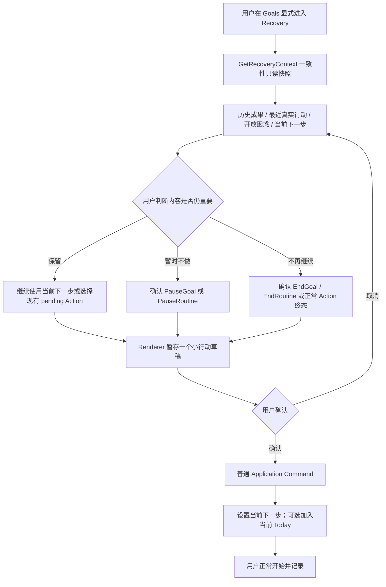
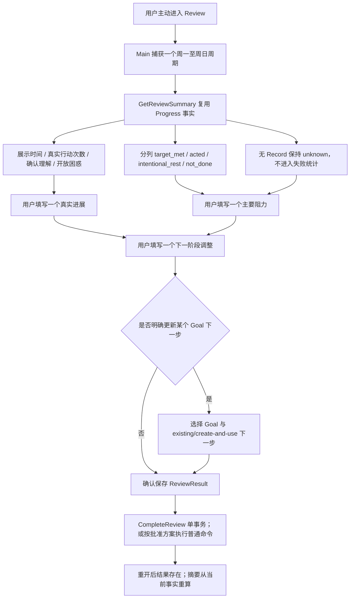
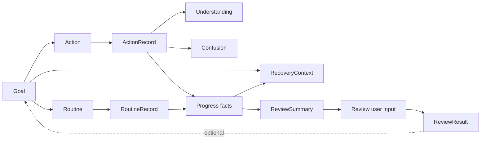

# MyTracer v0.1 S4/S5 恢复与复盘整体设计

> 文档状态：**项目所有者已于 2026-08-27 批准通过；不构成 T041～T052 实现授权。**
>
> 设计范围：S4 / E4-01～E4-02 与 S5 / E5-01～E5-02
>
> 核心验收：AC-05 中断后恢复、AC-06 最小复盘
>
> 审批事实：项目所有者已批准完整设计及 S45-Q01～Q07 的 A 方案；schema v3 / export v2 是获批设计结论，但实际 migration、任务合同、任务启动、Git/GitHub 和人工验收仍分别受后续精确授权门禁控制。

## 0. 文档用途与权限边界

本文把冻结产品语义、已批准工程决定、已验收 S1～S3 行为和 S4 前 Renderer foundation 收敛为 T041、T042、T051、T052 的整体设计输入。本文只描述 S4/S5 的阶段增量、共享边界、任务图、验证和审批门；它不创建任务合同、不改变任务状态，也不开始任何实现。

解释顺序保持为：

1. [`PRODUCT_REQUIREMENTS_V0.1.md`](../PRODUCT_REQUIREMENTS_V0.1.md)；
2. [`DECISIONS.md`](../DECISIONS.md)；
3. [`REQUIREMENTS_CHANGE_POLICY.md`](../REQUIREMENTS_CHANGE_POLICY.md)；
4. 总体架构、领域、数据、工程决定、实施计划、测试策略和需求追踪；
5. 已批准的 [`S1_CORE_LOOP_DESIGN_V0.1.md`](./S1_CORE_LOOP_DESIGN_V0.1.md)、[`S2_ROUTINE_INTENTION_DESIGN_V0.1.md`](./S2_ROUTINE_INTENTION_DESIGN_V0.1.md) 和 [`S3_DATA_CONTROL_EXPORT_DESIGN_V0.1.md`](./S3_DATA_CONTROL_EXPORT_DESIGN_V0.1.md)；
6. [`TASK_INDEX_V0.1.md`](../implementation/TASK_INDEX_V0.1.md)、[`TASK_TEMPLATE.md`](../implementation/TASK_TEMPLATE.md)、[`GITHUB_WORKFLOW_V0.1.md`](../implementation/GITHUB_WORKFLOW_V0.1.md) 和 T094 的已验收 Renderer ownership；
7. 当前 `src/` 中已验收的 Domain、Application、Repository、SQLite v2、IPC、Preload、Renderer 和 export v1 契约。

`user/` 不属于本文依据，也不得成为 T041～T052 的设计、实现、测试或验收依赖。

本文使用以下标记：

| 标记 | 含义 |
|---|---|
| **冻结/已批准** | 直接来自 FR、AC、D、ED 或已批准阶段设计，后续任务不得自行改变 |
| **当前实现事实** | 在本文基线 revision 上实际存在的接口、schema、UI ownership 或验证状态 |
| **批准设计** | 项目所有者已批准的 S4/S5 设计边界；可作为后续独立任务合同的设计依据，但不等于合同或实现授权 |
| **已批准选择** | 第 14 节记录的 S45-Q01～Q07 A 方案；替代选项仅保留为决策历史和影响说明 |
| **延期/非范围** | 不进入 S4/S5，不得成为接口、表、依赖、测试前置或完成条件 |

本批准设计不授权：

- 修改代码、依赖、配置、migration、任务合同、metadata、任务索引、验收证据或需求基线；
- 创建/激活 T041～T052，或创建 branch、worktree、commit、push、PR、Ready、merge、tag、release；
- 执行任何真实用户数据库 migration、删除、导出或人工验收；
- 提前实现 AI、S6/S7、提醒、自动返回检测、自动导入恢复或其他延期能力。

## 1. Stage information

- **Stage**：S4 + S5
- **Title**：恢复与复盘（Recovery and Review）
- **Status**：`approved`
- **Owner approval**：项目所有者于 `2026-08-27` 批准完整设计与 S45-Q01-A～S45-Q07-A
- **Target branch**：`dev`
- **Current design source**：`dev@27485d0ab69eb84041c784c9a407b68fc304152b`
- **Prior behavior revision**：`dev@2632ff0638fb02533100a1f9d0aea9f1323dbde3`
- **Prior behavior evidence**：T094 已完成 Renderer ownership 拆分；S4 前 foundation aggregate 事实由任务索引和 Evidence 账本记录

`27485d0...` 是当前文档/治理基线；最近改变产品运行代码的 revision 是 T094 集成后的 `2632ff0...`。后续任务若不再基于这两个事实，必须重新核对受影响接口、schema、任务状态和验收，而不能只更新文档中的 SHA。

## 2. Baseline manifest 与冲突核对

```yaml
baseline:
  product_requirements:
    file: docs/PRODUCT_REQUIREMENTS_V0.1.md
    version: v0.1
    last_updated: 2026-08-08
  decisions:
    file: docs/DECISIONS.md
    revision_or_date: 2026-08-07
  requirements_change_policy:
    file: docs/REQUIREMENTS_CHANGE_POLICY.md
    effective_date: 2026-08-07
  architecture_documents:
    - docs/architecture/ARCHITECTURE_V0.1.md
    - docs/architecture/DOMAIN_MODEL_V0.1.md
    - docs/architecture/DATA_DESIGN_V0.1.md
    - docs/architecture/ENGINEERING_DECISIONS_V0.1.md
    - docs/architecture/IMPLEMENTATION_PLAN_V0.1.md
    - docs/architecture/TEST_STRATEGY_V0.1.md
    - docs/architecture/REQUIREMENTS_TRACEABILITY_V0.1.md
    - docs/architecture/S1_CORE_LOOP_DESIGN_V0.1.md
    - docs/architecture/S2_ROUTINE_INTENTION_DESIGN_V0.1.md
    - docs/architecture/S3_DATA_CONTROL_EXPORT_DESIGN_V0.1.md
  implementation_documents:
    - docs/implementation/TASK_INDEX_V0.1.md
    - docs/implementation/TASK_TEMPLATE.md
    - docs/implementation/GITHUB_WORKFLOW_V0.1.md
    - docs/implementation/archive/GOVERNANCE_T090_T093_T804_ARCHIVE.md
  current_design_source: dev@27485d0ab69eb84041c784c9a407b68fc304152b
  prior_behavior_revision: dev@2632ff0638fb02533100a1f9d0aea9f1323dbde3
  current_schema_version: 2
  current_export_version: 1
```

### 2.1 可直接依赖的当前事实

- S1～S3 已提供 Goal、Action、Routine、两类 Record、Today、Progress、数据修正/删除、完整导出和 AI 非依赖回归。
- `ProgressService` 已按可选 Goal 与 LocalDate 范围，从一致性 SQLite snapshot 聚合 ActionRecord、RoutineRecord、有效 Understanding 和 open Confusion。
- Routine 的四种持久化 outcome 与缺行 `unknown` 已分离；没有 `unknown` 行，也没有把缺行补为 `not_done` 的后台行为。
- Goal pause/end、Routine pause/end、Action 生命周期、Record 历史、TodaySelection 和 LocalDate 已有批准语义；Recovery/Review 只能组合或显式调用这些普通能力。
- SQLite v2 已预建 `review_results`；Goal 永久删除时 ReviewResult `goal_id` 使用 `ON DELETE SET NULL`，并已进入删除影响和完整导出集合。
- Renderer 已按 Goals、Routines、Today、Progress、Data、Review 拆分 ownership；Review 当前仍是空壳。Recovery 必须在 Goals/Recovery feature 边界内接入，不重新设计 `App.tsx`、AppShell 或主导航。
- Preload 当前只暴露固定意图级方法；Main 注册服务、运行时校验和 sender/origin 校验是唯一 IPC 写入/查询入口。

### 2.2 未发现的阻塞冲突

未发现两条 MUST、两项已批准产品决定或已批准状态/日期/历史不变量无法同时满足的冲突。S4/S5 可以在不引入 AI、提醒、评分、复杂日历、导入或新用户一级概念的条件下完成设计。

### 2.3 需要显式隔离的两处张力

1. **T042 追踪误指**：任务索引和实施计划为 T042 写入 `D-013`；真实的“长期未推进不设阈值”工程决定是 `ED-013`。`D-013` 描述 AI 的温和、非评判式表达，不能被解释为长期未推进阈值。本文对 Recovery 的事实计算使用 `ED-013`，中性文案使用 FR-REC06、UX-04 和 D-002；不越权修改任务索引。T042 合同形成前应由项目所有者决定是否单独修正现有追踪文字。
2. **ReviewResult 数据契约漂移**：批准领域模型要求 `confirmedProgress/mainObstacle/nextAdjustment` 和周期边界；当前 SQLite/Repository/export v1 使用 `periodStartedOn/summary/adjustment/nextFocus`。当前没有 Review UI 或生产写命令，但该结构已属于 schema v1/v2 和 export v1。项目所有者已通过 S45-Q04-A 批准 schema v3 + export v2 兼容设计；实际 migration 仍须写入 T052 精确合同后另行授权执行。

上述两处是追踪/实现级张力，不改变 FR 或 AC。S45-Q04-A 已解除 T052 的设计结论阻塞，但没有授权修改数据；T042 合同仍须准确使用 ED-013 并报告现有追踪误指，不修改需求基线来适配实现。

## 3. Stage delta、目标与非范围

### 3.1 阶段目标与可观察结果

S4/S5 完成后，用户可以在同一应用、同一核心数据和相同 LocalDate 语义下完成：

```text
历史 Goal / Action / Routine / Record 已存在
  → 用户显式进入某个 Goal 的 Recovery
  → 查看此前进展、确认理解、开放困惑和当前下一步
  → 看到“距上次真实行动 N 天”或“尚无真实行动记录”的中性事实
  → 不补齐空白日、不产生失败/逾期/断签信息
  → 用户明确暂停/结束/清理过时内容
  → 用户确认一个可以重新开始的小 Action
  → 通过普通 Application Command 设置当前下一步并按需选入 Today
  → 继续产生正常 Record
  → 用户主动进入 Review
  → 查看周一至周日的事实摘要
  → 确认一个真实进展、一个主要阻力、一个下一周期调整
  → 可选、明确更新一个 Goal 的当前下一步
  → 关闭并重开后 ReviewResult 存在；事实摘要仍从当前 Record 重算
```

### 3.2 S4/S5 包含

| 能力 | 阶段处理 |
|---|---|
| Recovery 入口 | Goals 内显式进入，不新增主导航、不自动弹出 |
| RecoveryContext | Goal 中心的一致性只读上下文、历史事实、开放困惑、当前下一步和距上次真实行动天数 |
| Recovery 行动 | 用户确认后调用普通 Goal/Action/Today/Routine 命令，不建立 Recovery 专用数据写入口 |
| ReviewSummary | 周一至周日、复用 Progress 事实、四种显式 Routine outcome 分列，缺行继续为 unknown |
| ReviewResult | 保存三个用户输入和可空 Goal 关联；事实摘要不复制进结果 |
| 下一步调整 | 只有用户明确选择时才创建/选择 Action 或更新 Goal 当前下一步 |
| 持久性 | Recovery 无新增持久化；ReviewResult 重开和 Goal 删除 detach；采用已批准的 schema v3 / export v2 设计，但只在 T052 获精确 migration 权限后执行 |
| 边界 | Domain pure builder、Application Command/Query、窄 Repository、固定 IPC/Preload、feature-local Renderer |
| 验收 | AC-05、AC-06 自动化与项目所有者人工验收；既有 AC 受影响回归 |

### 3.3 明确非范围

- 自动判断“用户返回”、启动时弹窗、通知、提醒、后台督促或主动 Recovery；
- 固定或隐藏的停滞天数阈值、逾期、deadline、优先级、失败率、完成率或压力式 streak；
- 为 Recovery 保存 `stalled`、恢复队列、建议、dismiss、lastSeen、返回事件或自动状态；
- 为 Review 保存统计摘要、评分、掌握度、生产力分数、评价标签、人格判断或完整周计划；
- 自动 pause/end/complete/cancel/reschedule Goal、Action 或 Routine；
- Recovery/Review 修改、移动、补齐或重新归属历史 Record；
- AI Provider、AI 总结、AI 建议、AI 自动计划、长期记忆、对话历史或 AI 写权限；
- 自动导入恢复、回收站、自动备份、同步、账号、复杂日历、可配置周起止日或 S7 周期比较；
- 新用户一级概念、独立 Recovery 主视图、Review 内容管理模块或通用工作流平台；
- T061～T072 的实现或验收声明。

## 4. 完整用户流程与 UI ownership

### 4.1 Recovery：从识别到重新开始



Recovery 不是自动判断器。`daysSinceLastRealAction` 只是 `asOfLocalDate - lastRealActionOn` 的事实差值；系统不返回 `stalled=true`，不按天数自动排序为“失败”，也不改变 Goal 状态。用户负责判断内容是否仍重要。

Recovery 的已批准默认上下文为：当前下一步、最近一次真实 Record、该 Goal 下未撤销的确认 Understanding、全部 open Confusion 和指向完整 Progress 的入口。它不使用“最近 N 条”隐藏默认；若完整成果较多，Renderer 通过渐进披露展示，而不是截断或新建持久化摘要。

### 4.2 Recovery 与已有生命周期操作

- pause/end 使用既有 Goal/Routine 命令并保留全部历史。
- Goal pause/end 不自动 pause/end 关联 Routine；Routine 生命周期继续遵循 S2-Q07-A。
- 过时 Action 使用既有 complete/cancel/reschedule 语义；rescheduled 仍复用同一 Action ID，旧 Record 不移动。
- 永久删除不在 Recovery 中提供捷径。若用户明确需要删除，跳转既有 Data Control 影响预览、二次确认和事务流程。
- 创建小 Action、选择既有 pending/rescheduled Action、设置当前下一步和加入 Today 都必须由用户逐项确认；系统不能根据 `daysSinceLastRealAction`、困惑或旧状态自动执行。
- Recovery 完成不是 Record，也不增加 Progress 次数；只有之后保存的正常 ActionRecord/RoutineRecord 才成为真实行动事实。

### 4.3 Review：从事实到一个调整



Review 只要求三段简短用户输入，不要求复制时间、次数、理解或 Routine 统计。Review UI 不提供“分数”“达标率”“失败率”“连续天数”“掌握度”或自动结论字段。

### 4.4 Renderer ownership

- **Goals feature**：拥有 Recovery 入口、选中 Goal、只读上下文、恢复草稿、确认/取消和 mutation 后刷新；不拥有 SQL 或事实计算。
- **Review feature**：拥有周期标题、ReviewSummary 展示、三个输入草稿、可选 Goal/Action 选择、确认/取消、保存结果和错误文案。
- **AppShell/navigation**：保持现有六 section 和默认 Today；不增加 Recovery 主导航，不解释 Recovery/Review DTO。
- **Progress feature**：保持事实查询职责；Recovery/Review 可以链接进入或复用 Application 层纯聚合，不复制 Renderer 计算。
- **Data feature**：继续负责永久删除和导出；Recovery/Review 不复制删除确认或文件能力。

## 5. 领域关系、状态与不变量

### 5.1 对象关系与边界



| 概念 | S4/S5 职责 | 不得承担的职责 |
|---|---|---|
| Goal | Recovery 的上下文中心；ReviewResult 可选关联；当前下一步仍为同 Goal pending Action | 不保存停滞状态、Review 分数或自动选择 |
| Action | 当前/候选小行动；正常生命周期和 Today 入口 | 不因 Recovery/Review 自动转换；不承载 Review 文本 |
| Routine | 为 Progress/Review 提供事实；可由用户显式 pause/end | 不因 Goal Recovery 自动联动；不预生成 unknown |
| Record | 历史事实和统计唯一来源 | Recovery/Review 不修改、移动、补齐或评价 Record |
| Progress | 时间、真实行动次数、理解和开放困惑的规范事实聚合 | 不保存累计表，不根据缺行推断失败 |
| RecoveryContext | Goal + Progress + 当前 Action 的只读投影 | 不是实体、不落库、不写状态、不创建建议 |
| ReviewSummary | 一个周一至周日周期的只读事实投影 | 不复制进 ReviewResult，不保存评分或推断 |
| ReviewResult | 三个用户确认文本、周期和可空 Goal 关联 | 不复制统计、不保存 AI 草稿、不成为一级管理模块 |

### 5.2 长期未推进的事实定义

```text
lastRealActionOn(goalId)
  = max(
      ActionRecord.occurredOn where Action.goalId = goalId,
      RoutineRecord.occurredOn where Routine.goalId = goalId
        and outcome in [target_met, acted]
    )

daysSinceLastRealAction
  = lastRealActionOn is null
      ? null
      : LocalDateDifference(asOfLocalDate, lastRealActionOn)
```

约束：

- `intentional_rest`、`not_done` 和缺行 `unknown` 不是“真实行动”，不能刷新 `lastRealActionOn`。
- 0 分钟的有效 ActionRecord 或 `target_met/acted` RoutineRecord 仍是真实行动。
- 没有 Record 时不使用 Goal/Action/Routine 的 `createdAt` 或 `updatedAt` 代替真实行动日。
- `daysSinceLastRealAction` 只在 Query 时计算，不持久化、不驱动 mutation、不作为逾期或失败标签。
- S4 只在用户已显式选择的单个 Goal Recovery 上下文中展示该事实；不提供跨 Goal 的“长期未推进”列表、筛选、排序或自动标记，也不声明完成留在 S7 的 FR-P05。
- Goal/Routine 当前关联可按批准删除规则变为 null；被删除 Goal 不再有 Recovery 入口，detached Routine 的历史继续进入全局 Progress/Review，但不再属于已删除 Goal。

### 5.3 五种 Routine 语义在 Review 中的保持方式

| 语义 | ReviewSummary 表达 | 禁止表达 |
|---|---|---|
| `target_met` | 明确的“达到最低行动”事实数/明细 | 不提升为掌握、成功人格或 streak |
| `acted` | 明确的“有所行动”事实数/明细，并计入真实行动 | 不与 target_met 合并为达标 |
| `intentional_rest` | 明确的用户主动休息事实 | 不计失败、不解释为拖延 |
| `not_done` | 明确的用户确认未进行事实 | 不扩展为人格评价或自动原因 |
| `unknown` | 没有 Record 的缺失事实；不进入四种显式 outcome 数量 | 不持久化、不转换为 not_done、不生成失败率 |

由于 v0.1 不保存 schedule 历史，Review 不构建可追溯的历史“应计划日总数”或完成率。测试只需证明一个缺行计划日未被计入 `not_done` 或其他显式 outcome；不得用当前 schedule 冒充已变更配置前的历史计划事实。

### 5.4 ReviewResult 不变量

- `confirmedProgress`、`mainObstacle`、`nextAdjustment` 均为用户确认的非空轻量自然语言；不建立原因分类或评分枚举。
- 事实摘要不复制进 ReviewResult；修改或删除 Record 后，下一次 ReviewSummary 从剩余事实重算，但已保存的用户输入保持原文本。
- `relatedGoalId` 可空；Goal 永久删除时使用既有 `ON DELETE SET NULL` 语义保留 ReviewResult。
- 下一步更新是可选、独立的用户决定；没有选择时 Review 完成只写 ReviewResult。
- ReviewResult 不自动 pause/end Goal，不自动 create/complete/cancel/reschedule Action，不写 TodaySelection，除非用户在确认 DTO 中明确选择了批准的下一步动作。
- ReviewResult 不保存 AI 来源、对话、统计快照、评分、掌握度、失败率、连续天数或提醒状态。

## 6. LocalDate、跨日、重开与历史行为

### 6.1 Recovery 日期

- `GetRecoveryContext` 在 Query 开始读取一次 `ClockPort.snapshot()`，`asOfLocalDate` 使用该 snapshot 的本地日期。
- `lastRealActionOn` 使用 Record 的权威 `occurredOn`，不使用 UTC Instant、查询日或 entity updatedAt。
- 应用重开、刷新或跨日后重新 Query，`daysSinceLastRealAction` 可以随当前 LocalDate 变化；历史 Record 和 `lastRealActionOn` 不变化。
- Recovery 页面跨午夜后执行 `SelectActionForToday` 时，普通 Today Command 使用命令开始时的新当前 LocalDate；Renderer 成功后重新查询并明确显示实际日期。

### 6.2 Review 周期

- 周范围固定为周一至周日，使用 LocalDate 包含端点，不依赖数据库周编号、UTC 日期或系统 locale 周设置。
- Review 页面打开时 Main 捕获一个明确 `periodStartedOn` 和派生的 `periodEndedOn = periodStartedOn + 6`，并返回给 Renderer 展示。
- 若页面跨午夜或跨周保持打开，保存仍绑定页面展示的捕获周期；不能在保存时静默改为新一周。reload/navigation/窗口关闭后旧 context 失效，用户重新进入得到新周期。
- ReviewSummary 只读取 `occurredOn` 位于捕获周期内的 Record；补记/改日后重新 Query 会反映新的事实位置。
- 重开应用后同一周期的 ReviewResult 必须可读取；ReviewSummary 从 SQLite 当前事实重算，不能从旧 ReviewResult 恢复统计。
- 已批准使用用户进入时的当前所在周作为默认；具体周期必须明确显示且不能静默移动。

## 7. Application、Queries、Commands 与事务

以下名称是设计级接口，用于固定意图和边界；任务合同可以在语义不变时微调技术命名，但不能合并为任意 CRUD、raw SQL 或通用 IPC。

### 7.1 Queries

| Task | Query | 主要输入 | 输出与约束 |
|---|---|---|---|
| T041 | `GetRecoveryContext` | `goalId` | Goal 中心一致性 snapshot；历史事实、当前下一步、open Confusion、确认 Understanding、last real action；零写入 |
| T051 | `BeginReview` | 无可信日期；使用 Main Clock | 捕获 reviewContextId、period start/end、ReviewSummary 和已有 ReviewResult；只创建 sender-bound 内存 context，不写业务数据 |
| T051 | `GetReviewSummary` | 由 Main context 绑定的周期 | 可作为 BeginReview 内部 Application Query；不接受 Renderer 提交统计、星期或 arbitrary SQL filter |
| T052 | `GetReviewResult` | context 捕获的 period 或受校验的 period start | 返回该周期已保存的用户输入；不复制 Summary |

### 7.2 设计 DTO

```text
RecoveryContextDto
  asOfLocalDate
  goal
    id, name, status
  lastRealActionOn?
  daysSinceLastRealAction?
  currentNextAction?
  pendingActions[]
  latestRealRecord?
  confirmedUnderstandings[]
  openConfusions[]

ReviewSummaryDto
  periodStartedOn
  periodEndedOn
  totalDurationMinutes
  realActionCount
  actionRecords[]
  routineRecords[]
  understandings[]
  openConfusions[]
  routineOutcomeCounts
    targetMet
    acted
    intentionalRest
    notDone
  unknownPolicy = "absence-is-unknown-not-counted-as-not-done"

ReviewResultDto
  id
  periodStartedOn
  periodEndedOn              // 派生，不要求重复持久化
  confirmedProgress
  mainObstacle
  nextAdjustment
  relatedGoalId?
  createdAt
  updatedAt
```

Recovery/Review DTO 不返回 failure rate、streak、score、mastery、overdue、stalled boolean、AI 文本或人格标签。排序使用明确的 LocalDate、createdAt 和 ID，不依赖 SQLite 隐含行序。

### 7.3 Commands

| Task | Command | 事务结果 |
|---|---|---|
| T042 | 既有 `PauseGoal/EndGoal/PauseRoutine/EndRoutine` | 用户确认后按既有生命周期更新；历史和关联守恒 |
| T042 | 既有 Action transition Commands | 用户明确 complete/cancel/reschedule；保留旧 Record，遵循 current-next resolution |
| T042 | `CreateAndSetGoalCurrentNextAction`（设计名） | 在一个普通 Application 事务创建同 Goal pending Action 并设为当前下一步；不自动加入 Today |
| T042 | 既有 `SetGoalCurrentNextAction` / `SelectActionForToday` | 选择 existing Action；Today 仍由用户单独决定 |
| T052 | `CompleteReview`（设计名） | 保存/更新 ReviewResult；可选在同一事务执行用户确认的下一步 resolution；无选择时不修改 Goal/Action |

`CreateAndSetGoalCurrentNextAction` 是通用 Goal/Action Command，不是 Recovery 专用数据库入口。若项目所有者选择复用 `CreateAction` + `SetGoalCurrentNextAction` 两步方案，Renderer 必须准确报告部分成功并允许恢复；不得在前一步成功、后一步失败时谎报“全部失败”。该选择见第 14 节。

### 7.4 `CompleteReview` 的确认输入

```text
CompleteReviewInput
  reviewContextId
  confirmedProgress
  mainObstacle
  nextAdjustment
  relatedGoalId?
  nextStepChange?
    none
    use-existing(actionId)
    create-and-use(title, description?)
```

- `reviewContextId` 绑定 trusted sender、捕获周期和已有 ReviewResult 身份；伪造、替换、取消、已消费、跨 sender 或窗口关闭后的 token 拒绝且零写入。
- Main 不信任 Renderer 提交的 period、createdAt、updatedAt、统计、Goal 状态或 Action 状态。
- `nextStepChange` 必须满足 Goal active、同 Goal pending Action、ED-005、ED-006 和既有 Action 不变量；按 S45-Q06-A，任一部分失败时整个原子命令回滚。
- Review 文本与可选下一步 mutation 只有在最终确认后进入 Application；编辑、取消或返回产生零业务写入。

### 7.5 Repository ports

批准设计增加窄能力，不扩张基础 `RepositoryPort` 为通用查询器：

```text
RecoveryRepositoryPort
  queryRecoverySnapshot(goalId)

ReviewRepositoryPort
  queryReviewSummarySnapshot(periodStartedOn, periodEndedOn)
  findReviewResultByPeriod(periodStartedOn)
  saveReviewResult(reviewResult)
```

- Recovery/Review summary query 在单个 SQLite 只读 transaction 中取得相关事实，避免 Goal、Record、Understanding、Confusion 和 Routine facts 来自不同时点。
- Builder 保持纯领域/应用逻辑；Repository 只返回事实行，不解释停滞、评分、失败或用户调整。
- T041/T051 可以复用现有 Progress SQL 选择和领域计算，但不能通过调用 Renderer API、串行多次 IPC 或复制统计公式制造漂移。

## 8. IPC、Preload、Main 与 Renderer 安全边界

### 8.1 固定 API 设计

```text
window.myTracer.recovery
  getContext({ goalId })

window.myTracer.review
  begin({})
  cancel({ reviewContextId })
  complete({ reviewContextId, confirmedProgress, mainObstacle, nextAdjustment,
             relatedGoalId?, nextStepChange? })
```

若 `GetReviewResult` 不由 `begin` 合并返回，可增加一个精确 `review.getResult`；不得增加 `invoke(channel, payload)`、raw query、任意 LocalDate、SQL、数据库路径或 Repository 对象。

### 8.2 Main/Preload 约束

- Main 注册固定 channel，使用现有 `assertTrustedSender` 验证 sender/origin。
- 运行时验证 ID、精确 keys、string/non-empty/length、枚举和 nullability；TypeScript 类型不能替代验证。
- 错误至少区分 `validation`、`not-found`、`invalid-transition`、`invariant-violation`、`context-stale`/`context-invalid`、`conflict` 和 `persistence-failed`，且不泄露用户正文、SQL 或绝对路径。
- Preload 只复制并转发结构化 DTO；不暴露 `ipcRenderer`、Electron 对象、Node、文件、凭据或 Provider。
- review context 与既有 recording/delete context 一样在 navigation、reload、窗口关闭和应用退出时清除；不持久化、不进入导出或诊断正文。

### 8.3 Renderer 约束

- Renderer 不自行计算 days-since、周起止、真实行动次数、Routine outcome 统计或 unknown；只显示 Main 返回事实。
- 所有 Recovery/Review 建议或输入在确认前仅为 feature-local state。
- mutation 成功后重新调用受影响 Query；内存缓存不是事实来源。
- 不根据错误、空状态、天数或缺失日显示羞辱、恐吓、排名、逾期或“你失败了”。
- AI 未配置/失败状态不影响 Recovery 或 Review；这两个阶段不调用 Provider。

## 9. SQLite、migration、索引与 export 兼容

### 9.1 Recovery 与 ReviewSummary

- 不新增 `recovery_*`、`review_summaries`、`stagnation`、`suggestions`、`unknown_days` 或统计累计表。
- `daysSinceLastRealAction`、RecoveryContext 和 ReviewSummary 每次从已保存事实计算。
- T041/T042/T051 不需要 schemaVersion 变化；若实现发现必须新增 Recovery/summary 表或依赖，停止受影响任务并重新审批。

### 9.2 当前 `review_results` 事实

当前 v2 表为：

```text
review_results
  id
  period_started_on
  summary
  adjustment
  next_focus
  goal_id?
  created_at
  updated_at
```

当前 Repository 和 export v1 使用相同字段语义名称；已有 `review_results_by_goal_id` 索引，没有周期唯一约束。批准领域基线则要求：

```text
ReviewResult
  periodStart/periodEnd
  confirmedProgress
  mainObstacle
  nextAdjustment
  relatedGoalId?
```

不能仅因 UI 尚未实现就修改已发布的 `001_initial.sql` 或假定数据库永远为空。任何调整必须是顺序 migration，包含旧 fixture、重开、导出和更高未知版本测试。

### 9.3 已批准设计但尚未授权执行的 schema v3

项目所有者已批准 S45-Q04-A：通过事务性顺序 migration 重建 `review_results`，并配套 export v2。该批准固定设计语义，不授权在 T052 合同之外执行 migration：

```text
review_results
  id TEXT PRIMARY KEY
  period_started_on TEXT NOT NULL
  confirmed_progress TEXT NOT NULL CHECK(non-blank)
  main_obstacle TEXT NOT NULL CHECK(non-blank)
  next_adjustment TEXT NOT NULL CHECK(non-blank)
  goal_id TEXT REFERENCES goals(id) ON DELETE SET NULL
  created_at TEXT NOT NULL
  updated_at TEXT NOT NULL
```

`period_ended_on` 由固定周语义从 start + 6 推导，不重复保存。批准设计保留/增加：

- `review_results_by_goal_id(goal_id)`；
- `review_results_by_period_started_on(period_started_on)`；
- 按已批准的 S45-Q05-A，将周期索引升级为 UNIQUE，使每个 `period_started_on` 最多一个 ReviewResult，再次确认编辑同一稳定 ID。

已批准的旧行转换为：

```text
summary     -> confirmed_progress
adjustment  -> main_obstacle
next_focus  -> next_adjustment
```

该映射只用于无损保留三个旧文本，不声称旧名称曾精确表达新语义。若项目所有者不接受此解释，T052 必须停止；不能删除旧行、填充虚构阻力或把字段留空绕过新不变量。

### 9.4 已批准的 export 兼容设计

- export v1 已批准且严格校验旧 ReviewResult 字段；不能在 `exportVersion=1` 下静默改变 row shape。
- 配合已批准的 schema v3，增加可判别的 `MyTracerCoreExportV2`，ReviewResult 使用新语义字段；v1 validator 和历史 v1 文件语义保持不变。
- export v2 仍包含全部核心集合、enumValues、sourceDataVersion、LocalDate、可空 Goal 关联和敏感字段排除；不增加导入能力。
- 生成器按 exportVersion 构造/校验，不允许把 schemaVersion 当 exportVersion。
- S3 的原子交付、Main-only destination、临时 sibling、复验、失败不破坏旧文件等规则全部回归。
- migration/export 变更需要 T052 合同显式 `migration_change: true` 和项目所有者执行授权；本设计批准不授予该执行权限。

### 9.5 兼容与失败策略

- v2 → v3 migration 必须单事务完成；失败保留 v2 数据和 metadata version。
- 已有 zero-row 数据库和含合成旧 ReviewResult 的 v2 fixture 都必须验证文本、ID、Goal detach 和时间戳守恒。
- 比应用已知版本更高的数据库继续拒绝写入，不能降级覆盖。
- T052 完成后关闭并重开真实测试连接，证明 ReviewResult 可读；不复用内存对象冒充持久性。
- migration、E2E、删除和导出只使用每 case 唯一临时数据根；不得打开真实 Electron `userData` 数据库。

## 10. Task graph、共享面与实施顺序

### 10.1 任务关系

```yaml
tasks:
  T041:
    requires: [S1, T094]
    blocks: [T042]
    can_parallel: []
    prefer_after: []
    conflicts_with: [T051]
  T042:
    requires: [T041]
    blocks: [S4_ACCEPTANCE_GATE]
    can_parallel: []
    prefer_after: []
    conflicts_with: [T051, T052]
  T051:
    requires: [S2, S3]
    blocks: [T052]
    can_parallel: []
    prefer_after: [S4_ACCEPTANCE_GATE]
    conflicts_with: [T041, T042]
  T052:
    requires: [T051]
    entry_gates: [T052_CONTRACT_MIGRATION_AUTHORITY]
    blocks: [S4_S5_FINAL_GATE]
    can_parallel: []
    prefer_after: [S4_ACCEPTANCE_GATE]
    conflicts_with: [T042]
```

`S4_ACCEPTANCE_GATE` 和 `S4_S5_FINAL_GATE` 是人工阶段门，`T052_CONTRACT_MIGRATION_AUTHORITY` 是 T052 合同权限门；它们都不是新 Txxx，也不写入任务索引。

### 10.2 shared surfaces

| 共享面 | 任务 | 具体冲突依据 | 风险 | 集成策略 |
|---|---|---|---|---|
| Repository ports / SQLite query snapshot | T041、T051、T052 | `persistence.ts`、`sqlite-repository.ts`、Progress 事实选择、review_results | high | serial |
| Main composition / Preload API | T041～T052 | `main/index.ts`、`preload/index.ts`、MyTracerApi、IPC registration | high | serial |
| Goal/Action current-next invariants | T042、T052 | ED-005、Action replacement、Today user decision | high | serial + shared regression |
| Goals/Review Renderer feature | T041/T042、T051/T052 | feature-local state、mutation refresh、错误文案 | medium | 每阶段内部串行 |
| schema/export | T052 | migrations manifest、review_results、complete export validator | high | 独占 migration；owner gate |
| AC-05/AC-06 aggregate E2E | T042、T052 | 同一 DB、跨日/跨周、重开和历史守恒 | medium | 最终同 revision 聚合 |

T041 与 T051 逻辑上都是 read-only slice，但会同时扩展 Repository、Main、Preload 和 API contract；在当前单人项目及默认单业务任务 active 规则下，不推荐并行。任何未来并行授权都必须使用独立 worktree、冻结接口并证明不重叠上述 shared surfaces。

### 10.3 已批准的实施和审批顺序

```text
本设计 owner approval（已完成）
  → T041 独立合同、实现、验证、review、集成
  → T042 独立合同、实现、验证、review、集成
  → AC-05 自动化 + owner manual + S4 acceptance decision
  → 重新核对最新 dev，并把已批准的 Q04-A/Q05-A/Q06-A 写入 T052 精确合同
  → T051 独立合同、实现、验证、review、集成
  → T052 独立合同（含批准后的 migration/export 权限）、实现、验证、review、集成
  → AC-06 自动化 + owner manual
  → AC-05/AC-06 同一 stage_final_integration_revision 聚合
  → owner 决定后续 G4；不自动开始 S6/S7 或发布
```

S4 与 S5 采用连续串行顺序，因为它们共同形成“返回 → 重新开始 → 周期复盘”的产品闭环，并复用 Progress/LocalDate/当前下一步。但“连续”不是共享实现授权：S4 人工门、T052 migration 执行权限、每个合同、每次 merge 和最终阶段门都必须分别获得项目所有者授权。

## 11. T041～T052 范围、非范围与完成条件

### 11.1 T041 — RecoveryContext 查询

**可观察结果**

用户从 Goals 显式进入 Recovery，可以查看某 Goal 的此前真实行动、确认理解、开放困惑、当前下一步以及距上次真实行动的事实；查询不改变任何数据。

**范围/交付物**

- Recovery pure builder 和日期差值；
- Goal 中心一致性 Repository snapshot；
- `GetRecoveryContext` Application Query、contracts、Main IPC、Preload API；
- Goals feature 内最小只读 Recovery 入口和中性空/错状态；
- 单元、SQLite、IPC、E2E read-only 与重开测试。

**非范围**

- 任何 Recovery mutation、阈值、自动入口、提醒、AI、持久化 Recovery、Review；
- 修改 Goal/Action/Routine/Record；
- migration、依赖或 export 变化。

**依赖与完成条件**

- 基于最新授权 `dev`，T094 ownership 仍成立；
- null last action、0 分钟、多 Record、Routine target_met/acted、rest/not_done/unknown、跨日和 Goal 不存在分支正确；
- Query 前后完整 snapshot 相同；重复调用和重开结果只随事实/LocalDate合理变化；
- UI 不显示 stalled/overdue/failure/score/streak 字段；
- 不声明 AC-05 完成，只证明步骤 1～4 和 T042 的安全输入。

### 11.2 T042 — 清理过时内容并重新开始

**可观察结果**

用户从 T041 上下文确认哪些内容仍重要，显式 pause/end/transition 过时内容，确认一个小 Action 并设置当前下一步；可选加入 Today，历史 Record 保持逐字段不变。

**范围/交付物**

- Recovery Renderer 草稿、确认/取消、错误和 mutation 后 refresh；
- 复用普通 Goal/Routine/Action/Today Commands；
- 按已批准的 S45-Q06-A 实现原子 create-and-set；
- AC-05 自动化连续流程和项目所有者人工程序；
- 历史守恒、失败回滚、跨午夜 Today 选择和既有 AC 回归。

**非范围**

- Recovery 自动建议、AI、自动状态变更、硬删除捷径、自动补 Record；
- Review、migration、export 或 S7 长期未推进列表；
- 改变 Routine 独立生命周期。

**依赖与完成条件**

- T041 完成并集成；T042 合同纠正/解释 D-013 与 ED-013 追踪张力；
- 所有确认前核心 snapshot 不变；取消和命令失败零意外写入；
- pause/end/Action transition 保留历史，Goal/Routine 不自动联动；
- 完整 E2E-AC-05 在 FakeClock 前进多日、关闭重开和同一临时数据库上通过；
- 项目所有者未执行人工 AC-05 时状态保持 `pending`；
- T042 只形成 S4 acceptance candidate，不自动启动 T051。

### 11.3 T051 — 周期事实摘要

**可观察结果**

用户主动进入 Review，看到明确周一至周日周期的时间、真实行动次数、确认理解、开放困惑和分列 Routine 事实，无需重录统计。

**范围/交付物**

- 周边界、ReviewSummary pure builder、unknown absence policy；
- 一致性 Review Repository snapshot，复用 Progress 事实定义；
- `BeginReview/GetReviewSummary` Application、review context、IPC/Preload；
- Review feature 只读摘要、周期标题、空/错状态；
- 单元、SQLite、IPC、E2E summary 测试。

**非范围**

- 保存 ReviewResult、更新下一步、migration/export；
- 比较上周、趋势、评分、掌握度、完成率、提醒或 AI 周计划；
- 历史 schedule 重建或 unknown 持久化。

**依赖与完成条件**

- S2/S3 当前事实和 S4 acceptance gate 已复核；
- 按已批准的 S45-Q03-A 默认进入当前所在周；
- Summary 与同 filter Progress 事实一致，且不复制/另算相冲突公式；
- 四种显式 Routine outcome 分列；缺行不进入 not_done 或失败；
- Query/context 不写 SQLite、不持久化统计；跨周不静默移动；
- 不声明 AC-06 完成，只证明步骤 1 和 FR-RV01、FR-RV06。

### 11.4 T052 — ReviewResult 与下一阶段调整

**可观察结果**

用户确认并保存一个进展、一个主要阻力和一个调整；可选更新一个 Goal 当前下一步。重开后用户输入存在，事实摘要从当前 Record 重算。

**范围/交付物**

- ReviewResult domain/application validation、save/update/read；
- `CompleteReview`、可选 next-step resolution、事务/确认边界；
- Review Renderer 表单、取消、确认、重开与修改流程；
- 按已批准的 S45-Q04-A/S45-Q05-A 设计 schema migration、周期 UNIQUE 索引、Repository 和 export v2 兼容；
- AC-06 自动化、人工程序，以及 AC-05/AC-06 aggregate E2E。

**非范围**

- 多 Goal 详细报告、阻力 taxonomy、评分、提醒、AI 总结、自动周计划、S7 周期比较；
- 自动创建/修改数据、未确认草稿持久化、统计快照；
- 自动导入或把 export 当恢复。

**依赖与完成条件**

- T051 完成；已批准的 Q04-A schema/export、Q05-A multiplicity、Q06-A atomicity 写入 T052 合同；任务合同另行明确 migration 执行权限；
- ReviewResult 三字段、周期、Goal detach、重开和编辑语义通过单元/SQLite/IPC/E2E；
- 确认前零写入，非法 context/Goal/Action/文本和故障全部回滚或准确报告批准的分步结果；
- export v1/v2 或获批替代兼容策略均有正反 fixture；migration v2 → v3 守恒；
- 完整 E2E-AC-06 和项目所有者人工验收完成后才能声明 AC-06 相应结果；
- 不自动授权 G4、Ready、merge、main、tag、release、S6 或 S7。

## 12. 分层验证与 AC-05/AC-06 验收矩阵

### 12.1 自动化矩阵

| 行为/风险 | Domain/Application unit | SQLite/集成 | IPC/Preload | E2E | 人工 |
|---|---|---|---|---|---|
| last real action | ActionRecord + target_met/acted；0 分钟；null；LocalDate 差值 | Goal filter、Routine facts、一致 snapshot | 伪造 days/date 拒绝 | FakeClock 前进多日 | N 天文案中性、可解释 |
| Recovery read-only | Builder 无命令 | 查询前后全 snapshot 相同；重开 | exact DTO、trusted sender | 查看历史/困惑/下一步 | 返回先看到成果和可开始内容 |
| 生命周期清理 | 显式状态机；Routine 独立 | 单事务、失败回滚、Record逐字段守恒 | 未确认/非法 transition 拒绝 | pause/end/reschedule 分支 | 不把 pause/end 表达为失败 |
| 小行动恢复 | 同 Goal pending/current-next；Today 用户决定 | 原子 create/set；失败全回滚；重开 | 多余字段/跨 Goal/终态拒绝 | 确认后选择小 Action | 小行动确实更容易开始 |
| Review 周边界 | 周一/周日、跨月/年、context 捕获 | inclusive LocalDate filter | Renderer 无可信 period/statistics | Sunday→Monday 跨周 | 周期标题清楚 |
| Routine 五语义 | 四 outcome 分列；absence unknown | 无 unknown 行、无缺行补写 | 不接受 unknown 保存 | 包含四 outcome + 一个空白日 | rest/unknown/not_done 不混淆 |
| Review facts | 与 Progress 同一公式；无评价字段 | 同一 snapshot、修改后重算 | Summary DTO allowlist | UI 无需重录统计 | 摘要简短、事实性 |
| ReviewResult | 三字段、可空 Goal、next-step explicit | save/update/read、Goal SET NULL、重开 | context/token/文本/Action 校验 | 保存、修改、重开 | 一个进展/阻力/调整负担合理 |
| migration/export | 版本和旧行映射 pure validation | v2→v3、失败回滚、未知高版本、export v1/v2 | Renderer 无 path/schema 权限 | 最终文件解析 | 导出不被描述为可导入恢复 |
| 评价性推断排除 | 类型/字段扫描 | 无累计/评分表 | API shape 扫描 | 页面文本/role 断言 | 无 streak、score、mastery、失败施压 |

### 12.2 E2E-AC-05 连续程序

在同一 Windows 环境、FakeClock 和每 case 唯一临时 `userData` 上：

1. 创建 active Goal、pending current next Action、历史 ActionRecord、确认 Understanding、open Confusion 和关联 RoutineRecord；保存完整初始 snapshot。
2. 完全关闭应用和 SQLite 连接；FakeClock 前进多日；重新打开同一测试数据根。
3. 从 Goals 显式进入 Recovery，验证成果、上次真实行动、open Confusion、当前下一步和中性 N 天事实。
4. 验证中断期间没有自动 ActionRecord/RoutineRecord/TodaySelection/ReviewResult，空白日没有变成 `not_done`。
5. 显式 pause 一个过时 Goal 或 Routine；验证所有历史 Record 和关联事实保留，Routine 不因 Goal 命令自动变化。
6. 返回 active Goal，创建或选择一个小 Action，显式设为当前下一步，并由用户选择是否加入当前 Today。
7. 比较历史 Record 的 ID、occurredOn、outcome、分钟、子事实和 createdAt；Recovery 操作不得改写。
8. 关闭并重开，验证状态转换、新下一步、Today LocalDate 和历史事实持久一致。
9. 页面不得显示断签、失败率、大量逾期、评分、掌握度或人格评价。

### 12.3 E2E-AC-06 连续程序

1. 使用明确周一至周日周期准备 ActionRecord、Understanding、open Confusion，以及 `target_met/acted/intentional_rest/not_done` RoutineRecord；保留一个没有 Record 的计划观察日。
2. 用户主动进入 Review；验证周期边界和 Summary 与 Progress 同 filter 的时间、真实行动次数、理解和困惑一致。
3. 验证四种显式 Routine outcome 分列，空白日没有进入 `not_done`、失败或达标；没有 streak、score、mastery 或 failure rate。
4. 用户填写一个 confirmed progress、一个 main obstacle、一个 next adjustment；不手工重复统计。
5. 先取消，比较完整 snapshot 零变化；重新进入并确认保存。
6. 在一个分支不更新下一步；另一隔离分支明确选择 existing 或 create-and-use Action，验证只有确认分支改变 current next。
7. 完全关闭并重开；ReviewResult 仍存在，Summary 仍由当前 Record 重算而非复制值。
8. 修改或删除一个测试 Record 后重新进入 Review，验证 Summary 变化而已保存用户文本不被系统重写。
9. 若批准 migration/export v2，导出并解析 ReviewResult 新字段、版本、Goal null/detach 和敏感排除。

### 12.4 AC-05 → AC-06 聚合 E2E

在同一数据库且不重置状态：先完整执行 AC-05 恢复并保存随后的一次真实 Record，再进入 AC-06。ReviewSummary 必须包含恢复后产生的新事实，同时保留恢复前历史；Recovery 操作本身不计行动。该程序绑定最终 `stage_final_integration_revision`，不能由 T042 或 T052 较早 revision 的单独绿色结果代替。

### 12.5 既有 AC 回归

- AC-01：Goal → Action → Today → ActionRecord → Progress；current-next 和 Progress 公式未被 Recovery/Review 改写。
- AC-03：Routine 四 outcome + unknown、非计划日、Progress 事实保持。
- AC-04：intention 未发生零失败、零自动 Record、跨日不滚动。
- AC-07：重开、删除 detach、完整导出、AI disabled/not-configured/failure；T052 涉及 schema/export 时必须完整回归。
- AC-02 在 S6 前仍未实现；只做 SCOPE 扫描，不能因文案或“建议”字样声明 AI 能力。

### 12.6 稳定命令与额外验证

每个任务合同选择定向命令，并在 candidate revision 执行受影响回归。最低稳定命令为：

```powershell
npm.cmd run format:check
npm.cmd run lint
npm.cmd run typecheck
npm.cmd run test:unit
npm.cmd run test:integration
npm.cmd run test:e2e
npm.cmd run verify
```

阶段最终还应按实际合同/环境执行：

- `npm.cmd run governance:metadata:check`；
- evidence wrapper 绑定 task/base/source revision；
- Windows package、unpacked 和隔离 NSIS smoke；
- v2 → v3 migration/重开和 export v1/v2 契约（按已批准 Q04-A，且仅在 T052 获执行授权后）；
- Electron security/Preload API shape；
- 项目所有者人工 AC-05、AC-06。

`verify` 不替代 package、hosted CI、人工体验、migration compatibility 或 final-head 证据。

## 13. FR / AC / D / ED → Txxx → 测试追踪

缩写：`U` Domain/Application unit，`I` Repository/SQLite integration，`IPC` Main/Preload contract，`E2E` 端到端，`M` 项目所有者人工，`SCOPE` 范围扫描。

| 需求/决定 | Txxx | 测试层级 | 设计落点 |
|---|---|---|---|
| FR-REC01、FR-REC02、FR-REC03；D-002 | T041 | U、I、IPC、E2E-AC-05、M | 历史守恒、上下文查询、不补空白日 |
| FR-P03、FR-P04 回归；D-007、D-009、D-010 | T041 | U、I、E2E | 确认理解/open Confusion、事实非评价、unknown/rest 保持 |
| D-106；ED-012、ED-013、ED-017 | T041 | U、I、IPC、E2E | LocalDate、0 分钟真实行动、无阈值 N 天、跨日 |
| FR-REC04、FR-REC05、FR-REC06；FR-P04；AC-05 | T042 | U、I、IPC、E2E-AC-05、M | 显式清理、开放阻力、选择小行动、无压力返回体验 |
| FR-G03、FR-G04、FR-G05；FR-A01、FR-A03、FR-A06；FR-T04、FR-T05 | T042 | U、I、IPC、E2E | pause/end 历史、current-next、reschedule、Today 用户决定 |
| D-004；ED-005、ED-006、ED-007、ED-008、ED-013 | T042 | U、I、IPC、E2E、M | 用户选择、同 Goal pending、同 Action reschedule、删除边界、无停滞阈值 |
| FR-RV01、FR-RV06；AC-06 步骤 1/5 | T051 | U、I、IPC、E2E-AC-06、M | 周期事实摘要、不重录统计 |
| FR-P01、FR-P02、FR-P03、FR-P04、FR-P07、FR-P08；D-007、D-106、D-110 | T051 | U、I、E2E、M | 时间/次数/理解/阻力、无 streak/人格评价、主动进入、周一至周日 |
| FR-R04、FR-R05、FR-R06、FR-R07、FR-R08、FR-R09；D-008、D-009、D-010、D-107；ED-012、ED-016 | T051 回归 | U、I、IPC、E2E | 四 outcome + unknown、非计划日、真实行动计次 |
| FR-RV02、FR-RV03、FR-RV04、FR-RV05；D-105、D-110 | T052 | U、I、IPC、E2E-AC-06、M | 三个轻量输入、无分类体系、可选下一步、主动 Review |
| FR-G05；D-004；ED-005、ED-006 | T052 | U、I、IPC、E2E | 用户明确更新同 Goal pending current next |
| FR-D01、FR-D04；D-111；ED-008、ED-014、ED-018 | T052 条件回归 | U、I、E2E-AC-07、M | 批准后的 migration、重开、Goal detach、完整 export |
| ED-004、ED-019 | T041～T052 | I、IPC、E2E、SCOPE | Main-only SQLite、窄 Preload、sender/origin、安全 Renderer |
| AC-01、AC-03、AC-04、AC-07 | T041～T052 回归 | U、I、IPC、E2E、M（按受影响项） | S1～S3 既有行为不退化 |
| FR-P05、FR-P06 | S7 非范围 | SCOPE | 无跨 Goal 停滞识别、周期比较或趋势能力；单 Goal N 天事实不声明完成 FR-P05 |
| FR-RV07；FR-D07；FR-AI11、FR-AI12、FR-AI13 | 非范围 | SCOPE | 无 AI 周计划、自动导入、主动 AI、长期记忆 |

所有编号均来自现行 PRD、DECISIONS 或 ENGINEERING_DECISIONS。本文不创建新 FR/AC/D/ED。T042 的现有 `D-013` 引用漂移在第 2.3 节报告；长期未推进阈值依据明确写为 `ED-013`。

## 14. 已批准决定、替代选项、影响与可逆性

项目所有者于 2026-08-27 明确批准 S45-Q01～Q07 的 A 方案。本节保留未选方案、影响和可逆性作为决策历史；后续任务合同必须采用批准结论，不得自行切换选项。

### S45-Q01：长期未推进阈值与默认值

- **批准结论：A（2026-08-27）**。不设置阈值，不存在需固化的天数默认值。
- **选项 A（已批准，维持 ED-013）**：不设置阈值；只显示 `lastRealActionOn` 和可空“距上次真实行动 N 天”，用户自己判断。
- **选项 B**：用户可配置个人阈值；达到后显示中性候选，但不改变状态。
- **选项 C**：系统固定默认天数并自动标记“长期未推进”。
- **影响**：A 无 migration、配置、默认值或逾期压力，直接符合现行已批准 ED-013。B 增加配置、持久化、默认/空值/修改语义并改变已批准工程决定。C 把任意天数固化为系统判断，最容易违反非惩罚 Recovery。
- **可逆性**：A 最易在真实使用后扩展；B/C 一旦进入数据/UI/验收，撤回需 migration、配置兼容和文案调整。
- **审批边界**：B/C 需要先正式改变 ED-013；在此之前不可选入 T041/T042 实现。

### S45-Q02：Recovery 显式入口

- **批准结论：A（2026-08-27）**。Recovery 由用户从 Goals 显式进入。
- **选项 A（已批准）**：Goals 中每个 Goal 的显式 Recovery 子流程；Progress 可提供同一入口的链接。
- **选项 B**：只从 Progress 的长期事实进入 Recovery，Goals 不提供入口。
- **选项 C**：应用重开或检测久未使用时自动弹出 Recovery。
- **影响**：A 符合 T094 Goals/Recovery ownership，Goal 上下文清楚且不新增主导航。B 更集中于事实页，但用户寻找成本更高。C 属于自动返回识别/主动介入，PRD 已留到真实使用后决定。
- **可逆性**：A/B 为 Renderer 路由/入口选择，较易调整；C 会引入检测状态、默认时机和更多拒绝/抑制语义，较难回撤。
- **审批边界**：C 当前不可作为 v0.1 实现选项，除非先走需求变更流程。

### S45-Q03：Review 默认周期

- **批准结论：A（2026-08-27）**。默认周期为进入时的当前所在周，周一至周日。
- **选项 A（已批准）**：用户进入时使用当前所在周（周一至周日），允许在本周任意时点复盘。
- **选项 B**：始终使用最近一个已经结束的完整周。
- **选项 C**：首次即允许选择任意历史周。
- **影响**：A 最直接、无额外选择器，符合“用户主动进入”和轻量流程；未结束周的事实可能仍在增加。B 摘要稳定，但周中进入会跳过当前事实。C 更灵活，但增加历史列表、空周期和编辑/多结果规则，接近 S7/复杂周期浏览。
- **可逆性**：A/B 可通过 Query 默认和 UI 文案调整，但已保存 ReviewResult 的周期语义必须兼容；C 若产生多历史结果，回撤更复杂。
- **默认值**：已批准为当前所在周；页面必须明确显示 period start/end，页面跨周不静默移动。

### S45-Q04：ReviewResult schema 与 export v1 张力

- **批准结论：A（2026-08-27）**。采用第 9.3 节 schema v3、旧行无损文本映射和严格可判别的 export v2；保留 v1 validator。该结论不替代 T052 migration 执行授权。
- **选项 A（已批准）**：批准第 9.3 节 schema v3 语义列和旧行文本映射，同时增加严格可判别的 export v2，保留 v1 validator。
- **选项 B**：保留旧三列和 export v1 字段名，在 Application 层定义映射，不做 migration。
- **选项 C**：为旧表追加 `main_obstacle` 等列并同时保留旧列，避免立即升级 export。
- **选项 D**：T052 暂不持久化 ReviewResult，只做本次内存流程。
- **影响**：A 让数据、Domain 和 export 名称一致，兼容规则清楚，但需要 migration/export owner gate 和更多回归。B 无 migration，却会长期让 `adjustment/nextFocus` 与产品语义错位，维护风险高。C 产生双字段和双真相，需要长期兼容策略。D 不满足已批准领域持久化和重开设计，也削弱 FR-D01、AC-06 真实使用。
- **可逆性**：A 的数据迁移必须视为不可随意降级，但旧文本/ID 完整保留且历史 export v1 仍可验证；B 最易短期实施、最难长期消除语义债；C 最难清理；D 易撤回但不能作为完整 T052。
- **审批边界**：设计选择已批准；T052 合同仍必须显式声明 `migration_change: true` 并取得执行授权，实施者不得扩大 migration/export 范围。

### S45-Q05：每周期 ReviewResult 数量

- **批准结论：A（2026-08-27）**。每个 `periodStartedOn` 最多一个 ReviewResult，再次进入编辑同一稳定 ID。
- **选项 A（已批准）**：每个 `periodStartedOn` 最多一个 ReviewResult；再次进入时编辑同一结果，保持稳定 ID。
- **选项 B**：同一周期允许追加多个 ReviewResult，按 createdAt 展示历史。
- **选项 C**：同一周期可按 Goal 各保存一份 ReviewResult。
- **影响**：A 对应“最小周期复盘”和“一个调整”，UI、唯一约束和重开最简单。B 把 Review 向内容历史模块扩展，需要列表、选择和删除规则。C 让复盘从周期流程变为多 Goal 报告，增加记录负担。
- **可逆性**：A 未来可放宽唯一约束；B/C 回收到一个结果需要合并或丢弃数据，不易可逆。
- **持久化结论**：schema v3 增加周期 UNIQUE；替代方案 B/C 未获批准，不进入任务合同。

### S45-Q06：确认小行动和 Review 下一步的事务边界

- **批准结论：A（2026-08-27）**。create/use Action 与设置 current next 原子完成；ReviewResult 与可选 next-step resolution 也原子完成。
- **选项 A（已批准）**：提供普通原子 Application Command，在同一事务 create/use Action 并设置 current next；Review 保存与可选 next-step resolution 也原子完成。
- **选项 B**：Renderer 顺序调用既有 `CreateAction`、`SetGoalCurrentNextAction`、`SelectActionForToday`；ReviewResult 与下一步分别保存。
- **影响**：A 对一次用户确认提供全有或全无，避免创建孤立候选或“复盘已保存但下一步失败”的模糊结果；需要复用 current-next domain helper并扩大专用 Application 测试。B 最大化复用既有 API，但必须设计部分成功、重试和准确提示。
- **可逆性**：A 可以未来拆成多步 UI而不改数据；B 一旦用户产生部分结果，无法假装原子，需要长期保留恢复路径。
- **边界**：两个选项都必须保持 Today 为单独用户决定，不能因设置 current next 自动加入 Today。

### S45-Q07：S4 与 S5 的实施节奏

- **批准结论：A（2026-08-27）**。任务严格串行 `T041 → T042 → T051 → T052`；按本方案既定阶段门，T042 与 T051 之间仍须完成 S4 owner acceptance gate，任务顺序简写不构成跳过该门的授权。
- **选项 A（已批准）**：严格串行 `T041 → T042 → S4 owner gate → T051 → T052`。
- **选项 B**：T041 与 T051 的 read-only slice 并行，mutation tasks 后续串行。
- **选项 C**：四任务一次性合并为一个阶段 PR/合同。
- **影响**：A shared surface 冲突最少，AC-05 可在影响 S5 前获得人工反馈。B 缩短日历时间，但 Repository/Main/Preload/API 文件重叠且需要额外整合。C 违反聚焦任务合同和独立证据，diff、migration 和人工门过大。
- **可逆性**：A 可在未来经明确授权放宽；B/C 产生重叠历史后难以恢复清晰 task delivery revision。

## 15. 风险、停止条件与授权

### 15.1 风险处置选项

完整设计批准后，下表 A 方案成为本阶段的批准风险控制；替代方案仅保留为历史。任何改选若要求改变冻结语义、延期范围或数据权限，仍须重新审批，且风险控制不构成实现授权。

| ID / 风险 | 可选择方案 | 批准控制 | 影响 | 可逆性 |
|---|---|---|---|---|
| R01 / N 天被当成失败阈值 | A 无阈值，仅单 Goal 显示事实；B 用户阈值；C 固定阈值 | A；与 Q01 一致 | B/C 引入配置或系统判断，并可能违反 ED-013、FR-REC06 | A 易扩展；B/C 撤回需兼容配置、文案和可能的 migration |
| R02 / Query 写入或补行 | A 纯只读 snapshot；B 持久化 Recovery/summary cache；C 后台检测并写状态 | A | B/C 会制造新事实源，使 unknown/历史守恒不可证明 | A 无数据回滚；B/C 需删除或迁移派生数据，风险高 |
| R03 / Recovery 改写历史 Record | A Record 永不因恢复改变；B 仅用户另行记录真实新行动；C 直接修订旧 Record 模拟恢复 | A；B 只作为既有普通记录流程 | C 直接破坏 AC-05；B 会产生真实新事实但不属于 Recovery 自动效果 | A 完全可逆；B 是正常历史写入，不应自动撤销；C 难以可靠恢复原历史 |
| R04 / Goal pause 联动 Routine | A 保持 Routine 独立；B 用户另行确认普通 Routine 命令；C Goal 命令自动级联 | A，允许 B 的独立确认 | C 破坏 S2 已批准边界；B 增加一步但意图明确 | A/B 不改模型；C 一旦批量改变状态需逐项恢复且可能失去用户意图 |
| R05 / Review 复制 Progress 公式 | A 抽取/复用 pure facts builder；B 复用同一 Repository facts 后由 Review 组合；C 复制 SQL/公式 | 优先 A；若会越出任务允许文件则 B 并交叉断言 | C 会产生时间、计次和理解/困惑漂移；A 可能扩大重构面 | A/B 可局部调整；C 形成双真相后清理成本高 |
| R06 / unknown 合并为 not_done | A absence 保持 unknown 且无持久化行；B 仅显示无法可靠追溯的估算分母；C 自动写/计 not_done | A | B/C 制造失败率或虚假历史，违反 FR-R05、D-009 | A 无迁移；B 文案可撤但证据会漂移；C 需数据修复且可能不可完全还原 |
| R07 / 历史 schedule 不可重建 | A 不计算计划日分母；B 新增版本化 schedule history；C 用当前 schedule 回推过去 | A | B 是新增持久化概念和范围；C 产生错误历史 | A 易在未来扩展；B 需长期 migration；C 结果无法可信修复 |
| R08 / 页面跨周静默移动 | A sender-bound 捕获周期；B 保存时改用当下周期；C 增加显式历史周期选择 | A；C 仅在 Q03-C 另批后 | B 会把用户看到的摘要和保存周期分离；C 增加历史 UI | A 内存态易调整；B 可能产生错绑数据；C 回撤需保留已产生历史结果 |
| R09 / 旧 ReviewResult 字段误解释 | A schema v3 + export v2；B Application 映射旧列；C 双列；D 不持久化 | A；与 Q04 一致 | 各选项完整影响见 Q04；T052 未获 migration 执行权限时保持阻塞 | A migration 不可随意降级；B/C 形成语义债；D 易撤但不能完成持久化结果 |
| R10 / 同周期多结果未定义 | A 唯一并编辑；B 多结果历史；C 每 Goal 一份 | A；与 Q05 一致 | B/C 扩展列表、排序、删除和 export 规则 | A 可放宽；B/C 收敛会涉及数据合并/保留决定 |
| R11 / 多命令部分成功 | A 原子普通 Application Command；B 分步并准确报告；C Renderer 假设全成功 | A；与 Q06 一致 | B 增加恢复 UI；C 会隐藏真实数据改变 | A 可拆分；B 已产生的部分结果不可假装不存在；C 不可接受 |
| R12 / shared surfaces 并行冲突 | A 严格串行；B 只读任务并行后集成；C 单大合同/PR | A；与 Q07 一致 | B 增加接口冻结和整合成本；C 弱化证据、review 和 owner gate | A 可后续放宽；B/C 形成重叠历史后难以恢复清晰 revision |
| R13 / migration/export 触及真实数据 | A 临时根和合成 fixture；B 复制的专用人工数据根；C 直接真实 userData | A 自动化，B 仅经人工程序；C 禁止 | C 可损坏真实数据；只做 A 可能不足以覆盖人工体验 | A/B 可丢弃测试副本；C 可能不可逆 |
| R14 / 自动化代替人工体验 | A 自动化 + owner manual；B 仅自动化；C 仅人工 | A | B 不能证明非压力体验；C 缺少确定性回归 | A 证据最完整；B/C 可补测，但不能追溯性地假装先前已通过 |
| R15 / AI、提醒或 S7 混入 | A SCOPE 扫描并停止；B 预留接口但不调用；C 提前实现 | A | B 仍可能把未批准概念固化进契约；C 直接扩张范围 | A 无清理；B/C 需删除接口、数据和测试，可能影响兼容 |

### 15.2 已采用的设计假设及替代处理

这些假设不是产品事实。完整设计批准采用每项 A 方案作为合同准备时的处理方式；合同开始前仍须重验，若事实不成立则停止受影响合同并重新设计，而不是静默切换替代方案。

| ID / 假设 | 可选择方案 | 批准处理 | 影响 | 可逆性 |
|---|---|---|---|---|
| A01 / 合同开始时 `dev` 仍与本文基线兼容 | A 在每个合同前重核最新 dev；B 固定旧 SHA 实施；C 静默替换本文 SHA | A | B 可能遗漏已集成变化；C 破坏追踪 | A 只增加核验；B/C 发现漂移后需重做设计/合同 |
| A02 / 现有 Progress facts 可被 Recovery/Review 复用 | A 在允许面内共享 builder；B 复用 facts port 并交叉断言；C 复制公式 | A，越界时 B | A 可能扩大定向 diff；B 有组合层但可验证；C 双真相 | A/B 可互换；C 清理成本随版本增长 |
| A03 / 合法 v2 `review_results` 旧行可能存在 | A 按非空旧数据设计 migration；B 假设表为空；C 删除/忽略旧行 | A | B/C 会让真实历史不可解释，即使当前 UI 尚无 writer | A 保守且无需撤回；B/C 一旦丢失数据不可逆 |
| A04 / 周一至周日和 LocalDate 保持批准语义 | A 沿用 D-106；B 用户配置周起点；C 使用 UTC/locale 默认 | A | B 是新增设置；C 会导致跨设备/locale 漂移 | A 可未来扩展；B 需配置兼容；C 产生的错期结果难修复 |
| A05 / sender-bound 内存 context 足以保护确认周期 | A 复用 recording/delete context 模式；B 信任 Renderer period；C 持久化草稿/token | A | B 扩大 IPC 信任；C 新增导出/清理/过期语义 | A 无持久数据；B 可修接口但旧错误请求难追；C 需 migration/清理 |
| A06 / S4/S5 不需要新增依赖 | A 使用现有 TypeScript/SQLite/测试栈；B 发现真实缺口后单独申请；C 合同内隐式加入 | A；B 作为停止后升级路径 | B 延迟任务但权限清楚；C 违反依赖门 | A 无回退；B 可单独评估；C 可能造成 lockfile/API 兼容负担 |

### 15.3 Stop conditions

发现以下情况时停止受影响设计/合同/实现并报告：

- 需要改变 FR-REC、FR-RV、AC-05/AC-06、五种 Routine 语义、Goal/Action/Routine 状态、LocalDate、删除或历史守恒；
- 需要固定停滞阈值、自动返回识别、提醒、AI、评分、掌握度、完成率或延期能力；
- T052 合同未明确获得 migration/export 执行权限却需要改变 schema/export，或实现偏离已批准 Q04-A/Q05-A/Q06-A；
- 需要回写已执行的 `001_initial.sql`/`002`、删除旧 ReviewResult 文本或执行破坏性 migration；
- Renderer 必须获得 SQL、数据库/文件路径、凭据、Provider 或 arbitrary IPC 才能实现；
- 测试必须访问真实用户数据库、live Provider 或无法产生可靠重开/历史守恒证据；
- 最新授权 `dev` 改变了本文绑定的行为、schema、export、任务状态或 shared surfaces，且尚未重新复核；
- 无法在同一最终 revision 连续完成 AC-05/AC-06 或保留失败/partial/superseded evidence。

### 15.4 Required authorization

| Gate | 控制者 | 当前状态 |
|---|---|---|
| 完整 S4/S5 设计与 Q01～Q07 | 项目所有者 | `approved`（2026-08-27，均选择 A） |
| T041/T042/T051/T052 合同和启动 | 项目所有者 | 未授权 |
| dependency change | 项目所有者 | 批准设计不需要；新增/升级仍未授权 |
| schema v3 / export v2 设计 | 项目所有者 | `approved`（S45-Q04-A） |
| schema v3 / export v2 实施与 migration | 项目所有者，T052 精确合同 | 未授权 |
| branch/worktree/commit/push/Draft PR | 各 Txxx 合同与项目所有者 | 未授权 |
| Ready/merge dev/main/tag/release | 项目所有者针对确切目标 | 未授权 |
| AC-05/AC-06 人工验收和阶段门 | 项目所有者 | pending |
| S6/S7 或下一阶段启动 | 项目所有者独立决定 | 未授权 |

## 16. 阶段门与连续实施结论

### 16.1 S4 entry gate

- 本文及适用于 T041/T042 的决定已获项目所有者批准；
- T041 独立合同绑定最新授权 dev、允许文件、排除、验证和 Git/GitHub 权限；
- T094/Renderer ownership、S1/S3 数据行为和稳定命令仍成立；
- 无未处理 MUST/架构冲突、依赖变化或 migration 需要。

### 16.2 S4 acceptance gate

- T041、T042 分别形成真实 task delivery revision，并经 owner-approved merge 进入最新 dev；
- Integration Freshness 为 `fresh` 或 `refreshed-and-passed`；
- AC-05 自动化在同一 S4 final integration revision 通过，历史 Record 守恒、无补行、重开和跨日证据齐全；
- 项目所有者人工确认返回体验先显示成果和可开始内容，无断签/逾期/失败施压；
- 所有失败、限制、人工 pending 和 superseded 证据保留；
- 项目所有者明确决定是否允许激活 T051。S4 通过不自动开始 S5。

### 16.3 S5 entry gate

- S4 acceptance 结果已记录，或项目所有者明确批准在其 pending 状态下开始 S5；
- 已批准的 Q03-A～Q06-A 写入相应合同；T052 的 migration/export 执行权限写入精确合同；
- 最新 dev 的 Progress、schemaVersion、exportVersion 和 Review placeholder 重新核对；
- T051/T052 各自独立合同批准，不复用 S4 的实现权限。

### 16.4 S4/S5 final gate

- T041～T052 task delivery 与 dev integration revision 均可追踪；
- 最终审计绑定一个最新授权 `stage_final_integration_revision`；
- AC-05 → AC-06 aggregate E2E 在同一 DB、同一 revision、不重置状态下通过；
- AC-01、AC-03、AC-04、AC-07 受影响回归和 `npm.cmd run verify` 通过；
- Windows package/unpacked/NSIS smoke、重开、安全边界及批准后的 migration/export 验证通过；
- 项目所有者分别完成并签署 AC-05、AC-06 人工结果；任何 partial/fail 如实保留；
- complete diff 独立 review 无未处理高风险问题；
- 文档 closeout、final-head CI、Ready、merge、`dev -> main`、tag、release 和 G4 仍由项目所有者分别决定。

### 16.5 连续实施结论

**已批准 S4 与 S5 连续、串行实施，并保留明确的 S4 人工验收和 T052 migration 执行权限门。**

理由：Recovery 为用户重新形成当前下一步，Review 随后用同一事实确认阻力和一个调整，产品闭环连续；两者共享 Progress、LocalDate、current-next、Main/Preload 和最终 E2E。先完成 S4 可以用真实人工反馈校正 Recovery 文案和下一步选择，再进入持久化/导出风险更高的 T052。连续实施不表示一次性授权、并行写共享面、跳过任务合同或自动开始下一阶段。

## 17. 批准设计交付核对

- [x] T041～T052 范围、非范围、依赖、交付物和完成条件明确，无重复实现责任；
- [x] AC-05、AC-06 各有独立连续程序，并有 AC-05 → AC-06 同数据库聚合程序；
- [x] Recovery 不改写历史，不补空白日，不自动改变 Goal/Action/Routine 状态；
- [x] Review 只汇总事实与用户输入，不生成评分、掌握度、streak 或推断失败；
- [x] unknown、not_done、intentional_rest、acted、target_met 保持区分；
- [x] LocalDate、跨日/跨周、重开、补记/改日和历史数据行为具有明确设计；
- [x] Commands、Queries、IPC、事务、Renderer、SQLite、migration、索引和 export 边界已说明；
- [x] 所有引用的 FR/AC/D/ED 编号来自现行基线；T042 的追踪误指已报告；
- [x] Q01～Q07 均记录项目所有者批准的 A 方案；风险和假设保留替代选项、影响、可逆性和重新审批边界；
- [x] S4/S5 连续实施建议与两阶段 owner gate 已明确；
- [x] AI、S6/S7、延期能力和完整单任务 Prompt 未进入本文；
- [x] 本文状态为 `approved`，但不改变 TASK_INDEX、任务合同、需求基线或既有证据；
- [x] 本文批准也不会构成 T041～T052 实现、Git/GitHub、合并或发布授权。

本设计已由项目所有者批准，可作为后续独立任务合同的设计依据。下一步仍须按批准顺序为 T041 建立并批准精确合同；本文不创建任务合同、不激活 T041，也不授权实现、migration、Git/GitHub、合并或发布。
