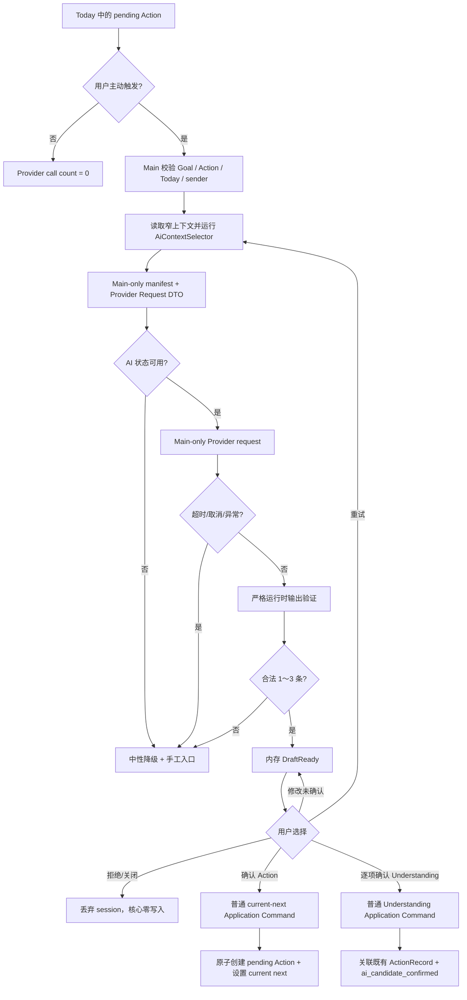
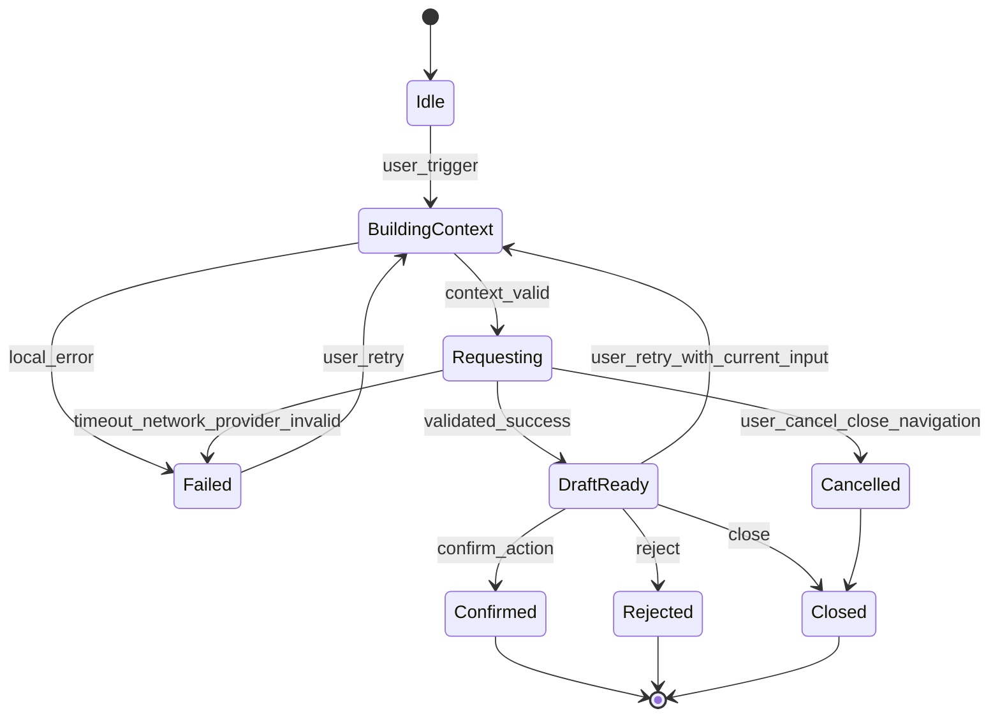

# MyTracer v0.1 S6 AI 启动帮助整体设计

> 文档状态：**提案版，等待项目所有者批准；不构成 T061～T063 实现授权。**
>
> 设计范围：S6 / E6-01～E6-03 / T061～T063
>
> 核心验收：AC-02 难以开始时获得帮助
>
> 设计权限：项目所有者已授权编写本提案；Provider、模型、SDK、依赖、凭据入口、文本预算、超时、真实 Provider 测试、任务合同、任务启动和任何 Git/GitHub 写操作仍未批准。

## 0. 文档用途与权限边界

本文把冻结的 AI 产品语义、已批准的工程边界、已集成的 S1～S5 行为和当前代码事实收敛为 T061、T062、T063 的整体设计输入。本文只描述 S6 的阶段增量、信任边界、接口候选、任务图、验证和审批门；它不创建任务合同、不改变任务状态，也不实现任何 AI 功能。

解释顺序保持为：

1. [`PRODUCT_REQUIREMENTS_V0.1.md`](../PRODUCT_REQUIREMENTS_V0.1.md)；
2. [`DECISIONS.md`](../DECISIONS.md)；
3. [`REQUIREMENTS_CHANGE_POLICY.md`](../REQUIREMENTS_CHANGE_POLICY.md)；
4. [`ARCHITECTURE_V0.1.md`](./ARCHITECTURE_V0.1.md)、[`DOMAIN_MODEL_V0.1.md`](./DOMAIN_MODEL_V0.1.md)、[`DATA_DESIGN_V0.1.md`](./DATA_DESIGN_V0.1.md)、[`AI_BOUNDARY_V0.1.md`](./AI_BOUNDARY_V0.1.md) 和 [`ENGINEERING_DECISIONS_V0.1.md`](./ENGINEERING_DECISIONS_V0.1.md)；
5. [`IMPLEMENTATION_PLAN_V0.1.md`](./IMPLEMENTATION_PLAN_V0.1.md)、[`TEST_STRATEGY_V0.1.md`](./TEST_STRATEGY_V0.1.md) 和 [`REQUIREMENTS_TRACEABILITY_V0.1.md`](./REQUIREMENTS_TRACEABILITY_V0.1.md)；
6. 已批准的 S1～S5 阶段设计，特别是 [`S4_S5_RECOVERY_REVIEW_DESIGN_V0.1.md`](./S4_S5_RECOVERY_REVIEW_DESIGN_V0.1.md)；
7. [`TASK_INDEX_V0.1.md`](../implementation/TASK_INDEX_V0.1.md)、[`TASK_TEMPLATE.md`](../implementation/TASK_TEMPLATE.md) 和 [`GITHUB_WORKFLOW_V0.1.md`](../implementation/GITHUB_WORKFLOW_V0.1.md)；
8. 本文基线 revision 上实际存在的 Domain、Application、SQLite、IPC、Preload、Renderer、fake AI、safeStorage 空适配器和 export v2 契约。

`user/` 不属于本文依据，也不得成为 T061～T063 的设计、实现、测试或验收依赖。

本文使用以下标记：

| 标记 | 含义 |
|---|---|
| **冻结/已批准** | 直接来自 FR、AC、D、ED 或现行最终架构基线，后续任务不得自行改变 |
| **当前实现事实** | 在本文基线 revision 上实际存在的接口、schema、UI ownership 或测试基础设施 |
| **提案设计** | 本文等待项目所有者审批的 S6 设计；未批准前不能进入任务合同作为既定结论 |
| **待审批选择** | 第 15 节的 S6-Q01～Q05；推荐不等于批准 |
| **延期/非范围** | 不进入 S6，不得成为接口、表、依赖、测试前置或完成条件 |

本文不授权：

- 修改代码、依赖、配置、schema、migration、任务合同、metadata、任务索引、验收证据、需求或决定；
- 创建、激活或执行 T061～T063；
- 创建 branch/worktree/commit，执行 push、Draft PR、Ready、merge、tag 或 release；
- 写入或迁移真实用户数据库，配置真实密钥，调用真实或付费 Provider；
- 建设通用 Agent 平台、长期记忆、自动计划、主动监督、跨 Goal 分析或任何延期能力。

## 1. Stage information

- **Stage**：S6
- **Title**：AI 启动帮助（AI Start Help）
- **Status**：`draft`
- **Owner approval**：项目所有者已授权编写提案；完整设计尚未批准
- **Target branch**：`dev`
- **Current design source**：`dev@1d02fd7a0a7b0bf29a5e39720d5818c9d68fdbc2`
- **Prior behavior revision**：`dev@84b596e12e54db098857004497a4d1964dcdc23c`
- **Current schema version**：3
- **Current export version**：2
- **Current S6 task state**：T061/T062/T063 均为 `pending`

`1d02fd7...` 是当前文档和治理基线；最近改变产品运行行为的 revision 是 T052 集成后的 `84b596e...`。若设计审批或任何任务合同基于不同 revision，必须重新核对代码、schema、export、任务状态、依赖和共享面，不能只替换本文 SHA。

## 2. Baseline manifest 与冲突核对

```yaml
baseline:
  product_requirements:
    file: docs/PRODUCT_REQUIREMENTS_V0.1.md
    version: v0.1
  decisions:
    file: docs/DECISIONS.md
    revision_or_date: 2026-08-07
  requirements_change_policy:
    file: docs/REQUIREMENTS_CHANGE_POLICY.md
    effective_date: 2026-08-07
  architecture_documents:
    - docs/architecture/ARCHITECTURE_V0.1.md
    - docs/architecture/DOMAIN_MODEL_V0.1.md
    - docs/architecture/DATA_DESIGN_V0.1.md
    - docs/architecture/AI_BOUNDARY_V0.1.md
    - docs/architecture/ENGINEERING_DECISIONS_V0.1.md
    - docs/architecture/IMPLEMENTATION_PLAN_V0.1.md
    - docs/architecture/TEST_STRATEGY_V0.1.md
    - docs/architecture/REQUIREMENTS_TRACEABILITY_V0.1.md
    - docs/architecture/S1_CORE_LOOP_DESIGN_V0.1.md
    - docs/architecture/S2_ROUTINE_INTENTION_DESIGN_V0.1.md
    - docs/architecture/S3_DATA_CONTROL_EXPORT_DESIGN_V0.1.md
    - docs/architecture/S4_S5_RECOVERY_REVIEW_DESIGN_V0.1.md
  implementation_documents:
    - docs/implementation/TASK_INDEX_V0.1.md
    - docs/implementation/TASK_TEMPLATE.md
    - docs/implementation/GITHUB_WORKFLOW_V0.1.md
  current_design_source: dev@1d02fd7a0a7b0bf29a5e39720d5818c9d68fdbc2
  prior_behavior_revision: dev@84b596e12e54db098857004497a4d1964dcdc23c
  schema_version: 3
  export_version: 2
```

### 2.1 可直接依赖的当前事实

- S1～S5 已提供 Goal、Action、Routine、两类 Record、Today、Progress、数据修正/删除、完整导出、Recovery 和 Review。
- `GoalService.createAndSetGoalCurrentNextAction` 已在同一事务创建关联当前 Goal 的 pending Action 并设置 `currentNextActionId`；该语义可以作为 AI 建议确认后的普通 Application Command 基础。
- Understanding 已作为 ActionRecord 子事实持久化，schema 支持 `source = manual | ai_candidate_confirmed`，并进入 Progress、Recovery、Review 和 export v2。
- 当前没有独立创建 `ai_candidate_confirmed` Understanding 的普通 Application Command；T063 必须补齐窄命令设计，但不需要 schema 或 export 变化。
- 当前生产 AI 配置只有 `not-configured` 空边界；safeStorage 空适配器不读取或保存密钥。
- 当前 fake provider 已支持 success、timeout、cancellation、authentication failure、parse failure、late response 和 fabricated fact 脚本，可作为 T062 扩展基础，但它不是生产 Provider 实现。
- Main 是 SQLite、Application、export、configuration 和未来 AI 网络请求的唯一可信宿主；Preload 和 Renderer 已保持窄 API、sender/origin 校验、sandbox、无 Node integration。
- 当前 `ai-data-capability` 测试已证明 disabled、not-configured、failure 下核心数据能力不依赖 AI；S6 必须扩展该证据而不能替换或弱化它。

### 2.2 冲突核对结论

截至本文基线，未发现以下内容之间存在无法同时满足的冲突：

- FR-AI01～FR-AI10、FR-C02/C03 和 AC-02；
- D-004、D-012～D-015、D-104、D-108、D-109；
- ED-004、ED-005、ED-010、ED-011、ED-014、ED-015、ED-019；
- 当前 Goal current-next、Understanding、历史 Record、SQLite、export 和 Electron 安全不变量。

S6 可以在不新增核心表、不改变 schema v3、不升级 export v2、不赋予 Provider 写权限且不保存 AI 会话的条件下完成设计。

### 2.3 必须显式保留的工程张力

1. **凭据入口与 Renderer 隔离**：ED-010 已批准打包使用 safeStorage，但首个凭据如何进入 Main 尚未批准。若严格要求 Renderer/Preload 从不接触明文密钥，则普通 Renderer 密钥输入框不可作为静默默认。第 15.2 节给出方案；未批准前 T062 保持阻塞。
2. **Understanding 归属**：当前 Understanding 必须关联既有 ActionRecord；AI 不得为保存候选而虚构 ActionRecord。本文提议仅允许用户把候选逐项确认到本次 manifest 中已有的相关 ActionRecord；没有合格 Record 时只能保留临时候选或丢弃，不能落库。
3. **Provider/预算依赖门**：T061 可以用注入预算和纯选择器完成独立证明；T062 只有在首个 Provider、模型、SDK/HTTP 方式、环境变量、生产预算和超时策略获批后才能形成生产适配器合同。

这些张力不改变冻结产品语义，但会改变 T062/T063 的工程合同和 UI。完整 S6 设计审批必须明确接受本文处理方式或给出替代选择；实施者不得自行决定。

## 3. Stage delta、目标与非范围

### 3.1 阶段目标与可观察结果

S6 完成后，用户可以在某个 Today Action 上主动请求温和启动帮助，并在 AI 完全可选、输出临时、确认写入受控的条件下完成 AC-02：

```text
用户打开一个关联 active Goal 的 pending Today Action
  → 用户主动点击“我现在不想开始”
  → Main 验证触发上下文并构建最小 manifest
  → Main 生成 Provider-facing 最小请求 DTO
  → Main-only Provider 请求
  → Main 运行时验证并规范化为 1～3 条临时建议
  → Renderer 展示温和建议和可选 Understanding 候选
  → 用户接受、修改、拒绝、关闭或重试
  → 未确认分支丢弃/保留内存草稿，核心数据零写入
  → 用户确认建议后调用普通 Application Command
  → 原子创建关联当前 Goal 的 pending Action并设为 current next
  → 用户逐项确认的 Understanding 才写入既有 ActionRecord
  → 原 Action、历史 Record 和 Today 选择保持不变
```

### 3.2 S6 包含

| 能力 | 阶段处理 |
|---|---|
| 主动触发 | 只从 Today Action 的明确用户操作进入；无启动弹窗、后台调用或自动触发 |
| 最小上下文 | 当前 Goal、打开的 Action、可选 current next、本次输入、最多 5 条同 Goal 直接相关 ActionRecord |
| 隔离证明 | pure selector、内部 manifest、唯一标记、Provider call count、完整快照前后对比 |
| Provider | Main-only 可替换 port、单一启动帮助能力、取消/超时/错误分类、严格输出验证 |
| 配置与凭据 | Main-only 配置状态、safeStorage 密文、独立 userData 配置文件、SQLite/export/log 隔离 |
| 临时会话 | sender-bound 内存 session、generation、AbortController、retry input、late response ignore |
| 建议确认 | 接受/修改/拒绝；确认后普通 current-next 命令；原 Action/Record 不改变 |
| Understanding | 可选候选、逐项编辑和确认、关联 manifest 中已有 ActionRecord、来源固定为 `ai_candidate_confirmed` |
| 降级 | disabled/not-configured/timeout/cancel/error/invalid response 下手工核心路径继续可用 |
| 验收 | AC-02 连续 E2E、AI 隔离/零写入、AC-01/03/04/05/06/07 受影响回归和人工体验 |

### 3.3 明确非范围

- AI 自动生成整日或整周计划、自动排程、截止日期、优先级或任务依赖；
- AI 主动弹出、后台监督、通知、提醒、定期轮询或自动识别用户停滞；
- 跨 Goal 上下文、全库语义搜索、向量库、embedding、RAG、自动画像或长期记忆；
- 保存对话历史、prompt、response、草稿、session、重试历史或 Provider 原始正文；
- Provider 直接创建、修改、完成、取消、重新安排或删除任何 Goal、Action、Routine、Record；
- Provider 获得 RepositoryPort、UnitOfWorkPort、SQLite、文件系统、export、credential、Diagnostics 或任意 Application Command；
- 自动确认 Understanding、从时间/次数/对话推断掌握度、概念图谱或教学平台；
- 为 Understanding 候选创建虚假 ActionRecord、修改历史 Record、跨 Record 重新归属事实；
- 新核心表、AI 专用 SQLite 表、schema v4、export v3 或导出 AI 临时数据；
- Provider 路由平台、多模型编排、tool calling、通用 Agent runtime、插件系统或自治工作流；
- 自动重试导致多次付费请求、默认 live Provider CI、真实 key fixture 或真实用户数据测试；
- S7、延期 FR、发布或 7～14 天真实使用结论。

## 4. 完整流程与信任边界

### 4.1 端到端流程



### 4.2 信任边界

```text
Untrusted Renderer input / Provider output
          │
          ▼ narrow typed IPC + runtime validation
Electron Main Application boundary
  ├─ sender/origin validation
  ├─ context selector + internal manifest
  ├─ session store + timeout/cancellation
  ├─ Provider adapter + output validator
  └─ confirmation orchestration
          │
          ├─ Provider Port → network only, no Repository/Command
          │
          └─ ordinary Application Commands → UnitOfWork → SQLite
```

核心规则：

- Provider 只能接收已完成最小化的请求 DTO，不能接收 Repository、完整 snapshot、manifest、凭据或命令函数。
- Provider 响应始终是不可信输入；TypeScript 类型、SDK schema 或厂商“structured output”都不能替代 Main 运行时验证。
- Renderer 只能表达用户意图、展示 DTO 和持有受控表单文本；它不能把 Provider 输出解释成已发生事实。
- 确认编排器不能直接写 Repository；它只能调用普通 Application Command。
- UnitOfWork 只覆盖一次核心命令，不跨 Provider 请求或用户交互保持数据库事务。
- session、manifest、AbortController 和 validated draft 全部是 Main 内存状态；关闭流程或应用后消失。

## 5. T061 — 最小上下文选择器和隔离证明

### 5.1 触发前置与本地失败

远程请求只允许在以下条件全部满足时开始：

1. IPC sender/origin 是当前受信任窗口；
2. 用户通过明确按钮事件触发，不存在启动、导航、query 或 effect 自动调用；
3. `actionId` 指向当前本地日 Today 中的 Action；
4. Action 为 `pending` 且关联一个 `active` Goal；
5. Goal/Action 关系、current-next 引用和数据版本有效；
6. 本次输入通过本地非空和长度校验；
7. mandatory context 能在注入的字符预算中完整容纳。

任一条件失败都返回本地错误，不创建 Provider 请求，不递增 Provider call count，不修改核心数据。无 Goal 的独立 Action 可以继续使用普通手工路径，但 v0.1 不向 Provider 发送无 Goal 请求。

### 5.2 窄读取边界

选择器的输入不是完整导出、完整数据库 snapshot 或任意 Repository。Application Query 只读取：

- 指定 Goal；
- 指定 Action；
- Goal 的 `currentNextActionId` 及其 Action（若存在且与打开 Action 不同）；
- 同一 Goal 下 Action 所关联的 ActionRecord 候选；
- 候选 ActionRecord 的未撤销 Understanding 和仍为 open 的 Confusion。

不读取或不交给选择器：

- 其他 Goal 及其 Action、Routine、Record、ReviewResult；
- RoutineRecord；
- 删除或撤销的 Understanding、resolved Confusion；
- Today 中其他 Action；
-完整 Progress、Recovery、Review 或 export snapshot；
- note、技术审计、diagnostics、日志、绝对路径、环境变量或 credential store；
- AI 草稿、旧 session 或任何 Provider 原始正文。

T061 合同必须优先增加一个窄 Repository query/snapshot，而不是把 `readCompleteCoreSnapshot()` 传给 selector 后再过滤。完整快照即使最终过滤正确，也不能作为隔离证明的默认实现。

### 5.3 Provider-facing DTO

Provider-facing DTO 不发送持久化数据库 ID。持久化 ID 只保留在 Main manifest 中；Provider 使用本次随机 `requestId` 和结构位置理解关系。

```text
StartHelpRequestDto
  requestId
  locale
  userInput
  goal
    name
    description?
  action
    title
    description?
  currentNextAction?
    title
    description?
  recentRelevantRecords[]       // 0..5
    occurredOn
    outcome
    durationMinutes
    confirmedUnderstandings[]
    openConfusions[]
    nextStepCandidate?
```

约束：

- `goal` 和 `action` 必须存在；`currentNextAction` 仅在存在且合法时发送。
- 若打开 Action 本身是 current next，不重复发送第二份。
- 只发送用户已确认且未撤销的 Understanding；`source` 不需要发送给 Provider。
- 只发送仍开放的 Confusion；不发送 resolution 历史。
- `nextStepCandidate` 只是历史 ActionRecord 中已有用户文本，不表示已应用为 Goal current next。
- 不发送 note、createdAt、updatedAt、数据库 ID、Today commitment、完整 Action 列表或完整 Goal 历史。
- DTO 是可结构化克隆的 plain data；Provider 适配器可以进一步改名或缩小，不能增加字段或读取更多数据。

### 5.4 Record 相关性、排序与最多 5 条

`directly related ActionRecord` 定义为：其 Action 当前仍通过 `goalId` 关联本次 Goal。RoutineRecord 和其他 Goal 的 ActionRecord 不属于候选。即使其他 Goal 文本看起来相似，也不得进入候选。

候选稳定排序：

```text
occurredOn DESC
  → createdAt DESC
  → id ASC
```

排序必须显式执行，`id ASC` 只作稳定 tie-breaker，不从 UUID 推导时间。排序后最多取前 5 条；不得为凑足数量加入其他 Goal、RoutineRecord 或更宽查询结果。预算不足时从最旧候选开始整条排除，仍不得替换为第 6 条或其他 Goal 数据。

### 5.5 字符预算和确定性截断

生产总预算属于 S6-Q03 待审批项。T061 使用注入的 `ContextBudget` 并在测试中覆盖不同预算；不得把 Provider token window 直接写入 Domain。

字符计数规则：

- 对 trim/换行规范化后的用户文本按 Unicode code point 计数；
- 统计实际发送的全部文本值，不把数据库 ID 或 manifest 计入；
- JSON 键名和固定枚举的传输开销由 Provider 适配器另作容量检查，但不能借此扩大文本预算；
- 不在 UTF-16 surrogate pair 中间截断。

预算优先级：

1. mandatory：本次输入、Goal name、打开 Action title；
2. 当前下一步 title（若不同）；
3. Goal、Action、current-next description；
4. 最近 Record，从新到旧；每条先保留 occurredOn/outcome/duration，再保留 Understanding、Confusion、next step 文本；
5. 最后一个可容纳的可选文本可以在 code point 边界截断，并在 manifest 标记；更低优先级字段排除。

mandatory 文本不允许静默截断。若 mandatory text 超过预算，返回 `context-too-large`，提示用户缩短本次输入；Provider 调用次数必须为零。可选文本截断或排除不会引入省略字段之外的新总结文本，避免选择器自行编造内容。

### 5.6 内部 manifest

选择器返回：

```text
SelectedStartHelpContext
  requestDto
  manifest
    requestId
    goalId
    actionId
    currentNextActionId?
    selectedRecordIds[]
    eligibleUnderstandingTargetRecordIds[]
    fieldEntries[]
      sourceType
      sourceId
      requestPath
      originalCharacters
      sentCharacters
      truncated
      exclusionReason?
    excludedCounts
      otherGoals
      unrelatedRecords
      overFiveLimit
      overBudget
    totalTextCharacters
    budget
```

manifest 的用途仅为：

- 自动测试证明请求 DTO 的来源和排除；
- 在 Main 内把 Understanding 确认目标限制为本次已有 ActionRecord；
- 对迟到响应、stale session 和 generation 做本地校验。

manifest 不发送给 Provider、不返回完整给 Renderer、不写日志、不进 SQLite、不进导出、不跨应用重开保留。Diagnostics 只可记录 request/correlation ID、字符计数、选中条数和错误分类，不记录字段正文或 source ID。

### 5.7 唯一标记隔离证明

自动化 fixture 至少包含：

- 当前 Goal/Action/Record 中允许发送的唯一标记；
- 第二个 Goal 的 name/description/Action/Record/Understanding/Confusion 唯一标记；
- RoutineRecord 唯一标记；
- credential store、环境变量模拟值和配置密文唯一标记；
- Diagnostics/日志正文唯一标记；
- 完整 snapshot 中额外集合的唯一标记。

测试序列化最终 Provider call request 并断言：

- 允许标记只在对应字段出现一次；
- 所有禁止标记完全不存在；
- request DTO 与 manifest 的 included request paths 一致；
- Provider adapter 不能通过第二次 Repository/config/diagnostic 读取扩张请求；
- 应用启动、打开 Today、查询 status、切换 Action、未点击触发、关闭未开始流程时 call count 均为 0。

## 6. T062 — 可替换 Provider、超时和失败降级

### 6.1 Provider Port

```text
AiStartHelpProvider
  capabilities() -> ProviderCapabilities
  requestStartHelp(request, options) -> Promise<unknown>

ProviderCapabilities
  configured
  available
  providerLabel?
  modelLabel?

ProviderRequestOptions
  signal: AbortSignal
  requestId
```

`Promise<unknown>` 是有意的信任边界：Provider adapter/SDK 返回值必须先通过 Main 的 `validateStartHelpResponse` 才能成为 `StartHelpDraft`。若实现语言需要类型化 vendor DTO，该类型只能存在于基础设施适配器内部，不能令 Application 跳过运行时验证。

Provider Port 只服务 Start Help，不支持通用 chat、tools、agents、memory、embedding 或任意 prompt API。Domain/Application 测试不引用厂商、模型名或 SDK 类型。

### 6.2 运行时响应 DTO 与验证

合法响应规范化为：

```text
StartHelpDraft
  requestId
  acknowledgement
  clarifyingQuestion?
  suggestions[]                 // 1..3
    candidateId                 // Main 生成，不信任 Provider ID
    text
  understandingCandidates[]?   // 0..N，受响应总长度和字段上限约束
    candidateId                 // Main 生成
    text
  safetyNotes[]?
  providerRequestId?
```

验证规则：

- 顶层和嵌套对象使用严格 allowlist；未知字段拒绝，不透传给 Renderer。
- `acknowledgement`、suggestion text 和 candidate text 必须是非空、trim 后的纯文本。
- suggestions 必须恰好 1～3 条；0 条或超过 3 条均为 `invalid-response`。v0.1 不静默截取第 4 条以后内容。
- 所有字符串和数组有由 T062 合同固定的长度上限；超限、非字符串、嵌套 HTML/object 或枚举外值拒绝。
- Renderer 只以文本节点显示，不使用 `dangerouslySetInnerHTML`，不执行 Markdown HTML、链接脚本或 Provider 指令。
- Main 生成本地 candidate IDs；Provider request ID 只作可选诊断关联，不成为业务 ID。
- Provider 声称“已完成”“已掌握”、虚构历史或要求直接写入时，系统不得把声明变成 Record/Understanding；是否显示安全的纯文本候选仍受 allowlist、文案和人工体验验收。
- `safetyNotes` 只用于中性提示，不获得额外权限，也不自动改变核心数据。

### 6.3 取消、deadline 与迟到响应

- Main 为每次请求创建 `AbortController` 和 generation ID。
- deadline 由 Main 控制；Provider SDK timeout 只能作为第二道保护，不能替代 Main deadline。
- 用户取消、关闭流程、重试、同 sender 新请求、导航、窗口销毁、AI 被关闭或应用退出都会 abort 当前 generation。
- Provider 忽略 abort 时，旧 generation 的响应即使后来成功也必须丢弃，不能覆盖新 session、显示为当前草稿或触发任何命令。
- timeout 归类为 `timeout`，用户取消归类为 `cancelled`；二者核心数据均不变。
- 不跨用户交互保持 SQLite transaction、数据库 cursor 或 Repository object。

### 6.4 错误分类和 Renderer 边界

| Error code | 来源 | 可重试 | Renderer 结果 | 核心数据 |
|---|---|---:|---|---|
| `disabled` | 用户关闭 AI | 否，需启用 | AI 已关闭，保留手工入口 | 不变 |
| `not-configured` | 无 Provider/credential | 否，需配置 | AI 尚未配置 | 不变 |
| `credential-unavailable` | safeStorage 不可用/解密失败 | 否 | 配置不可用，不泄露细节 | 不变 |
| `context-not-found` | Goal/Action/Record 不存在或不合法 | 否 | 刷新当前内容 | 不变 |
| `context-too-large` | mandatory 超预算 | 是，修改输入 | 缩短本次输入 | 不变 |
| `stale-context` | 请求后 Goal/current-next 已改变 | 是，重新请求 | 上下文已变化 | 不变 |
| `timeout` | Main deadline | 是 | 请求超时，可主动重试 | 不变 |
| `cancelled` | 用户/导航/新 generation | 是 | 不显示为故障 | 不变 |
| `network` | 网络失败 | 是 | 当前无法连接 | 不变 |
| `authentication` | Provider 拒绝凭据 | 否，需配置 | 配置需要处理 | 不变 |
| `quota` / `rate-limited` | Provider 配额/限流 | 稍后重试 | 中性说明 | 不变 |
| `provider-unavailable` | Provider 5xx/不可用 | 是 | 稍后重试 | 不变 |
| `invalid-response` | schema/长度/字段非法 | 是 | 无可确认建议 | 不变 |
| `internal` | 未分类安全失败 | 视情况 | 通用中性错误 | 不变 |

Renderer 不能获得 exception stack、SDK error body、完整 Provider response、credential、环境变量、路径或内部配置。Diagnostics 只记录固定 code、severity、category、correlation ID、duration 和 provider category；不记录 user input、context、prompt、response 或 key。

### 6.5 Main、Preload、Renderer 和网络所有权

| Layer | 允许 | 禁止 |
|---|---|---|
| Renderer | 用户触发、输入阻力文本、展示状态/草稿、编辑/确认/拒绝、手工核心入口 | Node、SDK、fetch 任意 Provider、key、配置密文、Repository、SQLite、任意 channel |
| Preload | 固定 `aiStartHelp` 方法和普通 Command/Query 转发 | `ipcRenderer` 暴露、任意 URL/channel、key getter、SDK、文件路径 |
| Main Application | 选择上下文、session、验证、错误映射、普通命令编排 | 持久化草稿、绕过 Domain/UnitOfWork、记录正文 |
| Provider adapter | 厂商认证、请求格式、取消、错误映射、最小响应转换 | Repository、SQLite、export、Diagnostics 正文、读取其他 Goal、调用命令 |
| Credential adapter | Main-only 读取/解密/加密批准凭据 | SQLite、export、Renderer getter、普通日志 |

Electron security 继续使用 ED-019：`nodeIntegration: false`、`contextIsolation: true`、Renderer sandbox、限制性 CSP、本地内容、禁止任意导航/新窗口、每个 IPC sender/origin 校验。T062 不能为 Provider 增加 Renderer `connect-src` 任意网络权限。

### 6.6 配置、safeStorage 与核心数据隔离

提案配置模型：

```text
AiConfigurationState
  disabled
  not-configured
  configured-available
  configured-unavailable

AiConfigurationFile          // userData 下独立文件
  version
  enabled
  providerId
  modelId
  encryptedCredential
```

约束：

- 配置文件不在 SQLite 中，不属于 Goal/Action/Routine/Record，不进入 export v2。
- `encryptedCredential` 只能由 Main 的 safeStorage adapter 处理；Preload/Renderer 不返回或读取密文/明文。
- 开发环境变量覆盖和打包配置的确切优先级由 T062 合同在 S6-Q02 批准后固定；不得同时无提示使用多个 credential source。
- safeStorage 不可用、解密失败、配置文件非法或 Provider 未批准时，AI 视为未配置/不可用；应用启动和基础能力继续。
- 配置写入采用独立文件的临时写入、验证和原子替换，失败不影响 SQLite。不得把截断配置文件报告为成功。
- 删除/关闭 AI 配置只影响 AI 配置，不删除、修改或隐藏任何核心数据。
- 配置文件、环境变量值和 key 不进入 fixture、截图、evidence JSON、普通日志或 copied worktree。

### 6.7 fake provider 与真实 Provider 边界

- `FakeAiProvider` 是所有正常 unit、integration、IPC、E2E、package smoke 和 CI 的默认适配器。
- fake 必须支持 success、timeout、cancel、authentication、quota/rate-limit、network、invalid response、late response、fabricated fact、rest suggestion 和 ordinary internal failure。
- fake 记录 deep-cloned request 和 call count，帮助证明 DTO/manifest 隔离；不访问网络或真实 credential。
- 真实 Provider 契约测试若获批，只能使用独立、显式、非默认命令和专用测试 credential；不得成为 `test`、`verify`、普通 PR required check 或核心应用可用性的前置。
- 未批准 Provider/SDK 前不得新增依赖、网络域、环境变量或生产 adapter；fake 通过不等于真实 Provider 已验收。

## 7. T063 — 建议接受、修改、拒绝和确认命令

### 7.1 内存会话状态机



Understanding 候选的逐项确认是 `DraftReady` 内的子状态：每项为 `unconfirmed | editing | confirmed | failed`。确认某项不会自动确认其他项，也不会自动接受 Action 建议。接受 Action 建议后 session 进入 `Confirmed`；尚未确认的 Understanding 候选被丢弃，UI 必须在必要时提示用户先处理候选。

### 7.2 Main session store

```text
StartHelpSession
  sessionId
  senderId
  generation
  state
  requestId
  goalId
  actionId
  expectedGoalUpdatedAt
  expectedCurrentNextActionId
  userInput
  manifest
  validatedDraft?
  confirmedUnderstandingCandidateIds[]
  abortController?
```

规则：

- 每个 sender 同时最多一个 active session；新 session 取消并清除旧 session。
- session ID 是不可预测的内存 token，且必须与 sender 绑定；另一个 sender 不能读取、取消或确认。
- Renderer 只获得必要的 session ID、状态、草稿和本地可选确认目标摘要，不获得 manifest、source IDs 集合或 Provider 原始正文。
- retry 保留本次用户输入，但重新读取 Goal/Action/Record 并生成新 requestId/generation；不把旧对话或响应加入新请求。
- navigation、destroyed、window close、AI disabled 和 app quit 清理 session；应用重开后没有旧 session。
- 不设置跨会话 TTL、恢复表或草稿表；v0.1 关闭即丢弃。

### 7.3 Action 建议确认

用户接受或修改建议时，Renderer 发送 session/candidate ID 和最终文本。Main 必须：

1. 校验 trusted sender、session、generation、`DraftReady` 和 candidate；
2. 规范化最终用户文本，拒绝空白或超长；
3. 重新验证 Goal 仍为 active、打开 Action 仍属于该 Goal；
4. 验证 Goal 的 current-next/updatedAt 仍与 session 预期一致；若不同返回 `stale-context`，核心零写入；
5. 调用普通 `CreateAndSetGoalCurrentNextAction` Application Command；
6. 在一个 UnitOfWork transaction 中创建新 pending Action 并设置 `Goal.currentNextActionId`；
7. 成功后把 session 标为 `Confirmed` 并返回普通 Action/Goal DTO。

普通命令的兼容扩展可以接受 expected current-next/revision precondition，但该 precondition 必须在同一事务检查；Renderer 顺序执行 `CreateAction` 再 `SetCurrentNextAction` 不可接受，因为可能产生部分成功。

确认结果必须满足：

- 只保存用户最终确认文本，不保存 Provider 原始文本和 edit history；
- 新 Action 关联当前 Goal，status 为 `pending`；
- 新 Action 原子成为 current next；
- 不自动建立 TodaySelection；是否加入 Today 仍是后续独立用户命令；
- 原 Action 不自动 complete/cancel/reschedule/delete；
- 原 Action 的 TodaySelection 不改变；
- 历史 Record、Understanding、Confusion、Recovery 和 ReviewResult 不改写；
- 命令失败时 transaction 回滚，session 留在可重试状态并明确显示“未保存”。

### 7.4 Understanding 候选逐项确认

Understanding 只能作为自然语言候选。Provider 不提供可信目标 Record ID，Main 也不从时间、对话或模型输出自动选择归属。

提案确认流程：

1. Main 从本次 manifest 的 `eligibleUnderstandingTargetRecordIds` 生成仅供 UI 选择的本地目标摘要，包括 opaque target ref、Action title、occurredOn；数据库 ID 不发送给 Provider。
2. 用户对每个候选分别编辑最终文本、选择一个本地目标并点击确认。
3. AI session 编排器验证 candidate、target ref、sender 和目标仍存在，且目标仍属于本次 Goal。
4. 编排器调用普通 `AddConfirmedUnderstandingToActionRecord` Application Command；该命令只接收已解析的 ActionRecord ID、最终文本和固定内部来源 `ai_candidate_confirmed`。
5. 普通命令在单事务插入 Understanding；它不创建/修改 ActionRecord，不改变 duration/outcome/occurredOn。
6. 成功后仅该 candidate 标为 confirmed；其他 candidate 保持临时。

无合格 ActionRecord 时：

- 可以展示候选和“需要已有真实行动记录才能保存”的中性说明；
- 不提供可执行确认目标；
- 不创建 0 分钟、partial、stopped 或其他伪造 Record；
- 关闭/接受 Action 后未确认候选丢弃。

后续修改或撤销已确认 Understanding 继续使用现有普通数据控制命令，不依赖 Provider 可用性。AI 来源不表示掌握度，Progress/Recovery/Review 只把它当作用户确认的自然语言事实。

### 7.5 接受、修改、拒绝、关闭和重试

| 用户操作 | session 结果 | Provider 调用 | 核心写入 |
|---|---|---:|---:|
| 查看/编辑草稿但未确认 | `DraftReady` | 不新增 | 0 |
| 拒绝 | `Rejected` 后清除 | 不新增 | 0 |
| 关闭流程 | abort/`Closed` | 正在请求则取消 | 0 |
| timeout 后不重试 | `Failed` | 1 | 0 |
| retry | 新 generation，重新构建上下文 | 每次明确点击 +1 | 0，直到确认 |
| 迟到旧响应 | 丢弃 | 已存在旧调用 | 0 |
| 接受原建议 | `Confirmed` | 不新增 | 1 个原子 current-next 命令 |
| 修改后确认 | `Confirmed` | 不新增 | 仅最终编辑文本 |
| 逐项确认 Understanding | 保持 `DraftReady` | 不新增 | 每个明确确认 1 条 Understanding |
| 普通命令失败 | candidate `failed`/session 可重试 | 不新增 | transaction 回滚 |

Reject、close 和未确认不能调用普通写命令。测试不能只通过 spy 证明“没有调用”；还必须比较 SQLite/core snapshot 前后相等。

## 8. Application、Commands、Queries、Ports 与事务

### 8.1 Queries

| Query | 责任 | 写入 |
|---|---|---:|
| `GetAiStartHelpStatus` | 返回 disabled/not-configured/available/unavailable 和中性配置提示 | 0 |
| `ReadStartHelpContext` | 按 Goal/Action 窄读取 current-next 和相关 ActionRecord facts | 0 |
| `GetStartHelpSessionView` | sender-bound 返回当前 session 的可展示状态 | 0 |

`ReadStartHelpContext` 是 Main/Application 内部 Query，不需要直接暴露给 Renderer。Query 不创建 session、不调用 Provider、不补齐数据、不更新 timestamps。

### 8.2 AI 会话 Commands

| Command | 责任 | 核心写入 |
|---|---|---:|
| `StartAiStartHelp` | 校验主动触发、构建 context、创建 session、调用 Provider | 0 |
| `CancelAiStartHelp` | abort 当前 generation并清理或标记 cancelled | 0 |
| `RetryAiStartHelp` | 从当前数据重建 context 并创建新 generation | 0 |
| `RejectAiStartHelp` | 丢弃 draft/session | 0 |
| `CloseAiStartHelp` | 关闭并清理 session | 0 |
| `ConfirmStartHelpSuggestion` | 校验 session 后编排普通 current-next Command | 仅普通命令结果 |
| `ConfirmStartHelpUnderstanding` | 校验 candidate/target 后编排普通 Understanding Command | 仅普通命令结果 |

这些 AI session Commands 不是 Provider 写入口。只有两个 confirm 编排器可以调用下列普通 Application Commands；它们自身不能持有 RepositoryPort。

### 8.3 普通核心 Commands

```text
CreateAndSetGoalCurrentNextAction
  goalId
  title
  description?
  expectedCurrentNextActionId?
  expectedGoalUpdatedAt?

AddConfirmedUnderstandingToActionRecord
  actionRecordId
  text
  source = ai_candidate_confirmed   // Main 内部固定，Renderer/Provider 不可选择
```

第一个命令复用当前已存在语义并增加可选并发前置条件；第二个命令补齐现有 schema 已支持但 Application 尚未公开的确认路径。两者都是普通领域写入，必须能在 AI disabled/not-configured 后继续查询、修改、撤销和导出其结果。

### 8.4 Ports

| Port | 新增/扩展 | 禁止 |
|---|---|---|
| `StartHelpContextQueryPort` | 窄读取 Goal/Action/current-next/ActionRecord facts | complete snapshot、其他 Goal、写入 |
| `AiStartHelpProvider` | 最小请求、AbortSignal、unknown response | Repository、Commands、配置枚举、任意工具 |
| `AiConfigurationPort` | tagged state、approved provider/model、enabled status | 返回 key/密文 |
| `CredentialStorePort` | Main-only read/write/delete credential、protection state | Renderer getter、SQLite/export |
| `DiagnosticsPort` | 固定脱敏 code/时长/关联 ID | 用户正文、prompt/response/key/path |
| `UnitOfWorkPort` | 两个普通确认命令的原子写入 | 跨网络/用户交互事务 |

### 8.5 事务与失败边界

- 构建 context 是只读短操作；Provider request 和用户等待不在事务中。
- Action 确认的“检查 stale precondition → 创建 Action → 更新 Goal current next”在同一事务。
- 单个 Understanding 确认的“验证 ActionRecord → 插入 Understanding”在同一事务。
- 多个 Understanding 候选不是一个批量事务；用户逐项确认，每项有独立真实结果和错误状态。
- session 内存状态不与 SQLite 做双写事务。核心写成功后即为事实；若 UI response 丢失，重开后以核心 Query 为准，不能重复创建来假装原命令未发生。
- Main session 在同一 candidate 上使用 confirming/confirmed guard，防止双击和并发 IPC 重复写入。
- 应用崩溃或关闭时未确认草稿丢失；已提交的普通命令按 SQLite 事务结果保留。

## 9. IPC、Preload 与 Renderer API

### 9.1 提案 API

```text
window.myTracer.aiStartHelp
  getStatus()
  start({ actionId, userInput })
  cancel({ sessionId })
  retry({ sessionId, userInput })
  reject({ sessionId })
  close({ sessionId })
  confirmSuggestion({ sessionId, candidateId, finalText })
  confirmUnderstanding({ sessionId, candidateId, targetRef, finalText })
```

Preload 不暴露 Provider、SDK、URL、headers、model 参数、API key、manifest、raw prompt、raw response、AbortController、`ipcRenderer` 或任意 channel。Provider/model 不能由每次 Renderer 请求任意覆盖。

### 9.2 IPC 运行时校验

每个 handler 必须：

- 先执行 `assertTrustedSender`/origin 校验，再解释参数；
- 精确检查参数数量、对象键、UUID/token 格式、字符串长度和枚举；
- 拒绝 prototype pollution、额外字段、函数、Buffer、Electron 对象和不可结构化数据；
- 通过 sender ID 解析 session，不能信任 Renderer 提交的 goalId、recordId、providerId 或 modelId；
- 把异常映射为封闭 `AiStartHelpResult<T>`，不把 stack/SDK body 泄露给 Renderer；
- remove/register 固定 handler，避免重载或测试中重复注册。

### 9.3 Renderer ownership

S6 入口位于 Today Action 详情，不新增主导航或通用 Chat 页面。Renderer 负责：

- 明确按钮和可选本次输入；
- loading/cancel/error/draft 状态；
- 1～3 条建议的选择、编辑、接受和拒绝；
- Understanding 候选逐项编辑、目标摘要选择和确认；
- 未配置、关闭、超时或失败时继续显示手工编辑 Action/current-next/Record 的入口；
- 对未保存、已保存、stale context 和关闭丢弃给出准确中性文案。

Renderer 不负责：

- 选择数据库记录、拼接完整 prompt、统计 token、调用 Provider、保存草稿；
- 根据响应文字自动决定命令、goalId、actionRecordId、TodaySelection 或 Action 状态；
- 把休息建议改写为拖延、失败或不自律；
- 在 React effect、页面 mount、定时器或后台状态恢复中调用 start/retry。

## 10. 数据、历史、export 和兼容性

### 10.1 核心数据变化

S6 不增加 AI 核心数据类型。只有用户确认后的两类既有事实进入 SQLite：

- 新 pending Action，关联当前 Goal，并成为 current next；
- 新 Understanding，关联既有 ActionRecord，`source = ai_candidate_confirmed`。

AI session、manifest、input、request、response、draft、error body、provider request ID、retry history 和 credential 不属于核心数据。

### 10.2 schema 与 migration

- schema 保持 v3；
- 不修改已执行的 `001`～`003` migration；
- 不增加表、列、索引、trigger 或 AI cache；
- 现有 `understandings.source` 已支持 `ai_candidate_confirmed`；
- 若实现发现必须新增 AI/会话表、把 Understanding 脱离 ActionRecord 或改变外键，停止 T063 并提交架构/需求评估，不得静默创建 schema v4。

### 10.3 export

- export 保持 v2；
- 用户确认的新 Action 和 Understanding 按现有完整核心数据契约导出；
- credential、配置密文、AI input、prompt、request/response、draft、manifest、session、diagnostics 和缓存必须排除；
- disabled/not-configured/failed Provider 不影响导出；
- export validator 的 forbidden technical fields 和 `understandingSource` 枚举继续生效。

### 10.4 历史守恒

- 原 Action 的 status、TodaySelection、Record 和 timestamps 不因 AI 建议改变；
- 创建新 current next 不代表原 Action 完成、取消或重新安排；
- AI 不能补写中断期间 Record、改变 occurredOn、duration/outcome 或移动 Understanding；
- Recovery 在下次查询时自然看到新的 current next 和已确认 Understanding，但不保存 AI session；
- Review/Progress 只统计正常核心事实，不统计 Provider 调用、建议数、接受率或 AI “成功率”；
- LocalDate 和跨午夜规则保持现状；S6 本身不创建 Record，因此不能借 AI 绕过发生日确认。

## 11. Task graph、共享面与实施顺序

### 11.1 任务关系

```yaml
tasks:
  T061:
    slice: E6-01
    requires: [S1, S3]
    blocks: [T062]
    can_parallel: []
    prefer_after: [S4_S5_FINAL_GATE]
    conflicts_with: [T062, T063]
  T062:
    slice: E6-02
    requires: [T061, S6_PROVIDER_ENGINEERING_DECISIONS]
    blocks: [T063]
    can_parallel: []
    prefer_after: []
    conflicts_with: [T061, T063]
  T063:
    slice: E6-03
    requires: [T062]
    blocks: [S6_FINAL_GATE]
    can_parallel: []
    prefer_after: []
    conflicts_with: [T061, T062]
```

`S6_PROVIDER_ENGINEERING_DECISIONS` 和 `S6_FINAL_GATE` 是审批门，不是新 Txxx，也不写入任务索引。

### 11.2 shared surfaces

| 共享面 | 任务 | 冲突依据 | 风险 | 集成策略 |
|---|---|---|---|---|
| contracts / `MyTracerApi` | T061～T063 | AI DTO、Result、Preload 类型必须逐步兼容 | high | serial |
| Main composition / IPC security | T061～T063 | service 装配、session cleanup、sender/origin handler | high | serial |
| persistence query surface | T061、T063 | 窄 context query、Understanding target validation | high | serial |
| AI configuration / safeStorage | T062、T063 | status、credential、disabled flow、startup | high | serial |
| Today Renderer | T062、T063 | unavailable UI、session/draft/confirm state | high | serial |
| Goal current-next invariant | T063 | expected precondition、原子 Action+Goal 写入 | high | 独立 command review |
| ActionRecord/Understanding invariant | T061、T063 | manifest target、existing record FK、source | high | serial + SQLite regression |
| fake provider/test harness | T061～T063 | call capture、failure scripts、E2E control | medium | each task extends; no parallel edits |
| AC-02 aggregate E2E | T061～T063 | 同一 DB/session、隔离、失败、确认 | high | final same revision |

三个任务虽然可以概念上分层，但会重复修改 contracts、Main、Preload、Today 和 fake provider。当前单业务任务 active 规则下必须严格串行；不建议通过独立 worktree 并行产生相互猜测的 API。

### 11.3 提案实施和审批顺序

```text
项目所有者批准本设计及 S6-Q01～Q05
  → T061 独立合同、实现、验证、review、集成
  → 重新核对最新 dev 与 Provider 工程决定
  → T062 独立合同（含依赖/网络/credential 精确权限）
  → T062 实现、fake/contract/降级验证、review、集成
  → T063 独立合同、实现、验证、review、集成
  → AC-02 continuous E2E + AC-01/03/04/05/06/07 affected regression
  → Windows package/security/reopen/export 检查
  → 项目所有者人工 AC-02
  → 同一 stage_final_integration_revision 的 S6 final gate
  → 项目所有者决定后续任务；不自动开始 S7 或发布
```

每个 Txxx 必须有独立合同、task delivery revision、candidate/final-head CI 和 owner-controlled merge。设计审批不等于任务批准，T061 完成不自动启动 T062，T062 完成不自动启动 T063。

## 12. T061～T063 范围、非范围、交付物和完成条件

### 12.1 T061 — AI 最小上下文选择器和隔离证明

**可观察结果**

在纯测试和 Main/Application 边界中，用户主动触发可以生成满足上限、排序和预算的最小请求；未触发或上下文非法时 Provider 调用为零，其他 Goal/credential/log/full DB 唯一标记不进入请求。

**范围/交付物**

- 窄 context query snapshot；
- pure `AiContextSelector`、`ContextBudget`、Provider-facing DTO 和 internal manifest；
- ActionRecord 相关性、排序、最多 5 条、字符预算和截断；
- fake call capture 和唯一标记 fixture；
- unit、SQLite/query integration 和隔离测试；
- 不需要生产 Provider、SDK、网络或 UI 草稿。

**非范围**

- Provider adapter、credential、safeStorage 写入、超时或网络；
- Renderer AI 完整流程、接受/修改/拒绝；
- 任何核心写入或 Understanding 确认；
- RoutineRecord、跨 Goal、full snapshot 或长期记忆。

**依赖/开始条件**

- 最新授权 dev 仍满足 S1/S3 Goal/Action/ActionRecord/Understanding 和 query 事实；
- 本设计已获项目所有者批准并写入 T061 精确合同；
- 不需要新增依赖、migration、网络或真实 key；
- 合同明确允许文件、测试和 Git/GitHub 权限。

**完成条件**

1. 所有允许/禁止字段、排序、5 条上限、预算和 manifest 具有确定性单元证据；
2. mandatory 超预算、无 Goal、stale/missing Action 均为 local failure 和 0 provider calls；
3. unique-marker 测试证明其他 Goal、RoutineRecord、credential、log 和 full snapshot 不发送；
4. selector/query 不写 SQLite，不使用完整 export snapshot；
5. targeted tests、affected regression、完整 diff review 和证据按合同完成；
6. 不声明 Provider、UI、AC-02 或 S6 完成。

### 12.2 T062 — 可替换 Provider、超时和失败降级

**可观察结果**

在已批准 Provider 工程决定下，Main 可以通过可替换 port 请求结构化 Start Help，并在 disabled/not-configured/credential failure/timeout/cancel/network/provider/invalid response 下中性降级；基础功能始终可用。

**范围/交付物**

- `AiStartHelpProvider`、runtime validator、error taxonomy、timeout/cancel/generation；
- expanded fake provider 和 adapter contract suite；
- approved Provider adapter、SDK/HTTP dependency、environment/configuration、safeStorage credential adapter；
- Main session request lifecycle、status Query、start/cancel/retry/close IPC/Preload；
- 最小 unavailable/requesting/error Renderer 状态，完整确认 UI 可留给 T063；
- credential/export/log isolation 和 AI data capability regression。

**非范围**

- 未批准厂商、模型、SDK、网络域、key 名或超时；
- 多 Provider 路由、fallback 模型、tool use、通用 chat/agent；
- 核心数据写入、建议确认或 Understanding 保存；
- live Provider 进入 default test/verify/CI；
- schema/export 变化。

**依赖/开始条件**

- T061 已集成且 manifest/request contract 稳定；
- 项目所有者批准 S6-Q01～Q05 的确切方案；
- T062 合同明确 `dependency_change`、network、Provider、credential/config file 和外部操作权限；
- 依赖版本、lockfile 范围、环境变量、生产预算和 timeout 固定；
- 无真实 key 进入 repo/worktree/CI。

**完成条件**

1. fake 和已批准 adapter 通过同一 Start Help contract；
2. 0/>3 suggestions、未知字段、超长/非法响应均不能成为 draft；
3. cancel、timeout、late response、new generation 和 sender cleanup 可重复验证；
4. Main-only network/credential，Renderer/Preload 无 SDK、key getter 或任意 network/channel；
5. disabled/not-configured/failure 下 CRUD、Progress、Recovery、Review、delete、export 和 restart 继续工作；
6. package/unpacked 环境中 safeStorage 不可用时应用仍启动；
7. 不声明建议确认、Understanding 或完整 AC-02 完成。

### 12.3 T063 — AI 建议接受/修改/拒绝和确认命令

**可观察结果**

用户在 Today Action 完成 AC-02：主动触发后可以接受、修改、拒绝、关闭和重试；只有明确确认通过普通命令创建新 current next 或逐项保存 Understanding，所有未确认分支零核心写入。

**范围/交付物**

- 完整 Renderer DraftReady/Failed/Cancelled/Confirmed/Rejected/Closed 状态；
- `ConfirmStartHelpSuggestion` 和 `ConfirmStartHelpUnderstanding` 编排；
- ordinary current-next command 的 stale precondition 和原子性；
- ordinary `AddConfirmedUnderstandingToActionRecord` command；
- per-candidate Understanding target、确认、失败和 source；
- unit、SQLite、IPC、E2E-AC-02、reopen/export/affected AC regression；
- 项目所有者人工 AC-02 程序和阶段 gate 输入。

**非范围**

- 自动 TodaySelection、原 Action 状态变化或历史 Record 编辑；
- 无 Record 时创建 Understanding 或虚假 Record；
- 保存对话/草稿、接受率统计、模型评价或长期记忆；
- schema/export 升级、概念图谱、掌握度或 S7。

**依赖/开始条件**

- T062 已集成，Provider/fake/session/error API 稳定；
- 最新 dev 的 current-next、Understanding、Progress/Recovery/Review/export v2 契约重新核对；
- T063 合同固定 ordinary command、transaction、allowed files、manual acceptance 和 Git/GitHub 权限；
- 无 migration 或新依赖；若需要，停止并另行审批。

**完成条件**

1. 接受、修改、拒绝、关闭、取消、timeout、not-configured、invalid response 和 retry 全部分支有真实结果；
2. 确认前和所有未确认分支 SQLite/core snapshot 严格相等；
3. Action 确认只保存最终文本，原子创建 pending Action/current next，不改变原 Action/Today/history；
4. Understanding 逐项确认、正确关联 existing ActionRecord、source 正确，未确认项不落库；
5. command failure/stale context 回滚且 UI 准确显示未保存；
6. AC-02 continuous E2E、AC-01/03/04/05/06/07 affected regression、`npm.cmd run verify` 和 Windows package/security 通过；
7. 项目所有者人工 AC-02 仍明确记录为 pending，直到实际执行。

## 13. 分层验证与 AC-02 验收矩阵

### 13.1 自动化矩阵

| 风险/场景 | Unit | Adapter contract | Integration/SQLite | IPC | E2E | Package/security |
|---|---:|---:|---:|---:|---:|---:|
| 未主动触发 call count = 0 | ✓ | ✓ fake | ✓ | ✓ | ✓ | ✓ startup |
| 当前 Goal/Action/current-next 字段 | ✓ | — | ✓ narrow query | ✓ | ✓ | — |
| 最多 5 条、排序、预算、截断 | ✓ | ✓ request capture | ✓ | — | ✓ marker | — |
| 其他 Goal/credential/log/full DB 隔离 | ✓ | ✓ | ✓ | ✓ | ✓ | ✓ export/log scan |
| 1～3 suggestions 合法输出 | ✓ | ✓ | — | ✓ | ✓ | — |
| 0/>3/unknown/overlong invalid response | ✓ | ✓ | — | ✓ | ✓ | — |
| disabled/not-configured/credential unavailable | ✓ | ✓ | ✓ | ✓ | ✓ | ✓ |
| timeout/cancel/network/auth/quota/provider failure | ✓ | ✓ | ✓ snapshot | ✓ | ✓ | selected smoke |
| late response/new generation ignored | ✓ | ✓ | — | ✓ | ✓ | — |
| reject/close/未确认零写入 | ✓ spy+state | — | ✓ snapshot | ✓ | ✓ | — |
| 修改后只保存最终文本 | ✓ | — | ✓ | ✓ | ✓ | — |
| Action + current next 原子写入/回滚 | ✓ | — | ✓ failure injection | ✓ | ✓ | restart |
| 原 Action/Today/history 不变 | ✓ | — | ✓ | ✓ | ✓ | restart/export |
| Understanding 逐项确认/target/source | ✓ | — | ✓ FK/source | ✓ | ✓ | export |
| 无 ActionRecord 不虚构 Record | ✓ | — | ✓ snapshot | ✓ | ✓ | — |
| Provider 不得 Repository/write | architecture/static | contract | integration spy | IPC surface | E2E snapshot | bundle scan |
| AI unavailable 基础功能继续 | ✓ | ✓ | ✓ | ✓ | ✓ AC-07 | ✓ |

### 13.2 E2E-AC-02 连续程序

同一个隔离数据库、同一个最终 revision，不重置状态：

1. 创建“系统学习 React”Goal、current-next、额外 pending Action、多个 ActionRecord、确认 Understanding 和 open Confusion；创建第二 Goal、Routine、ReviewResult 及各类禁止唯一标记。
2. 将一个 pending Action 选入 Today，打开详情；在未点击 AI 前执行 status/Today/query/navigation，断言 Provider call count 为 0。
3. 主动触发，fake 捕获 request；校验只含当前 Goal/Action/current-next、本次输入和最多 5 条合法 ActionRecord，禁止标记不存在。
4. fake 返回温和 1～3 条建议和候选 Understanding；比较触发前后完整 core snapshot，相等。
5. 编辑建议但不确认，关闭流程；snapshot 相等，重开应用后无草稿/session。
6. 再次主动触发并拒绝；snapshot 相等。
7. 再次主动触发，修改建议后确认；验证只保存最终文本，新 pending Action 关联 Goal 并成为 current next，原 Action/Today/Record 不变。
8. 准备另一 session，逐项确认一个 Understanding、修改后确认另一个、拒绝第三个；验证只有两条进入所选 existing ActionRecord，source 为 `ai_candidate_confirmed`。
9. 模拟目标 Record 在确认前删除或 Goal/current-next 改变；确认返回 not-found/stale，核心零额外写入。
10. 模拟 timeout、cancel、close、invalid response、auth/network/provider failure；每次核心 snapshot 相等，手工 Action/Record/Progress/Recovery/Review/export 仍可用。
11. 模拟 timeout 后主动 retry，释放旧 late response；只显示新 generation 的 draft，旧响应无写入。
12. 完全关闭并重开；确认后的 Action/Understanding 存在，未确认 AI 状态不存在；export v2 包含确认核心事实且不含 credential/draft/session/prompt/response。

### 13.3 AC-02 分支验收

| 分支 | 必须观察 |
|---|---|
| 接受 | 新 pending Action/current next 原子成功；原数据不变 |
| 修改 | 只保存用户最终文本，无 Provider 原文/edit history |
| 拒绝 | session 丢弃，核心 snapshot 不变 |
| timeout | 非阻塞错误、可手动 retry，核心功能继续 |
| 关闭 | 请求取消或 draft 丢弃，重开无会话 |
| 未配置/关闭 | Provider call count 0，手工路径完整可用 |
| 取消 | 不显示故障压力，迟到响应忽略 |
| invalid response | 无可确认建议，不透传原始内容 |
| retry | 每次明确触发，重新读取最小上下文，不携带旧对话 |
| Understanding | 每项独立确认；无现有 Record 时不能落库 |

### 13.4 既有 AC 受影响回归

- **AC-01**：Goal → Action → Today → ActionRecord → Progress 继续成立；AI 创建 current next 不改变时间、次数或理解公式。
- **AC-03**：Routine 的 target_met、acted、intentional_rest、not_done 和缺行 unknown 保持区分；RoutineRecord 不进入 S6 context。
- **AC-04**：intention 未发生仍为零失败、零自动 Record；AI 不自动改变 commitment 或选入 Today。
- **AC-05**：Recovery 自然显示确认后的 current next/Understanding；中断历史不补行、不改写，AI 不可用不阻塞恢复。
- **AC-06**：Review 只读取核心事实；不统计建议、调用或接受率，不把 AI 文本当掌握度。
- **AC-07**：重开、删除、完整 export v2、AI disabled/not-configured/failure 重复；credential/AI 临时数据排除。

### 13.5 项目所有者人工 AC-02

在隔离 Windows 数据根和 fake/获批 Provider 环境中：

1. 打开一个真实可理解的 Today Action，确认 AI 不主动出现或调用。
2. 主动点击“我现在不想开始”，输入一句当前阻力。
3. 判断回应是否使用了必要上下文、具体、温和、足够小，不羞辱、不制造焦虑、不把合理休息写成拖延。
4. 分别体验拒绝、关闭和 timeout，确认可立即返回手工编辑/记录，不被流程卡住。
5. 修改一条建议后确认，检查只保存最终文本，原 Action 未自动完成/取消，Today 未被暗中改变。
6. 对 Understanding 候选逐项确认和拒绝，确认 UI 清楚表达“候选”而非“已经掌握”。
7. 在无历史 ActionRecord 情况下触发，确认系统不虚构 Record/Understanding。
8. 关闭 AI 或移除测试配置，重复核心管理、Recovery、Review 和 export。
9. 完全关闭重开，确认只有用户确认的核心结果保留。

人工结果只能记录为 pass/fail/partial/pending，并附观察。自动测试或 Agent 判断不能代替项目所有者签署。

### 13.6 稳定命令与证据

每个任务合同按影响范围选择针对性命令，S6 final gate 至少要求：

```powershell
npm.cmd run format:check
npm.cmd run lint
npm.cmd run typecheck
npm.cmd run test:unit
npm.cmd run test:integration
npm.cmd run test:e2e
npm.cmd run verify
```

还需按合同执行 Windows unpacked/package/NSIS smoke、credential/config isolation、export inspection 和 bundle/security scan。V2 evidence 使用 explicit-argv capture wrapper，artifact 只能记录脱敏元数据；不得记录 stdout/stderr、用户输入、AI request/response、key、路径或环境变量正文。

## 14. FR / AC / D / ED → Txxx → 测试追踪

测试层级：`U` unit、`C` adapter contract、`I` integration/SQLite、`IPC`、`E2E`、`M` manual、`SCOPE` 范围扫描。

### 14.1 FR 与 AC

| ID | Txxx | 设计落点 | 测试层级 |
|---|---|---|---|
| FR-AI01 | T061/T063 | §5.1、§7.5、§9.3 | U、C call count、IPC、E2E、SCOPE |
| FR-AI02 | T062/T063 | §6.2、§9.3、§13.5 | U、C、E2E、M |
| FR-AI03 | T061/T062 | §5.2～5.5、§6.2 | U、C、I、E2E、M |
| FR-AI04 | T062 | §6.2 | U、C、IPC、E2E |
| FR-AI05 | T063 | §7.3～7.5 | U、I、IPC、E2E-AC-02、M |
| FR-AI06 | T063 | §7.3～7.5、§8.5 | U、I snapshot/rollback、IPC、E2E |
| FR-AI07 | T062/T063 | §6.2、§9.3、§13.5 | fake rest script、E2E、M |
| FR-AI08 | T061/T063 | §5.7、§6.2、§7.4 | U、C fabricated fact、I、E2E |
| FR-AI09 | T062/T063 | §6.4～6.7、§13.4 | U、C、I failure matrix、E2E-AC-07、package |
| FR-AI10 | T061 | §5.2～5.7 | U、I manifest、C request capture、E2E marker |
| FR-C02 | T063 | §7.4、§8.3 | U、I FK/source、IPC、E2E-AC-02、M |
| FR-C03 | T062/T063 | §6.2、§7.4、§10.4 | U、C fabricated mastery、I、E2E、M |
| AC-02 | T061～T063 | §4、§13.2～13.5 | U、C、I、IPC、continuous E2E、M |

### 14.2 D

| ID | Txxx | 保持方式 | 测试/检查 |
|---|---|---|---|
| D-004 | T063 | current next 和 Today 仍由用户确认；Provider 仅给候选 | U、I、E2E |
| D-012 | T061/T063 | 只由明确按钮触发，mount/query/startup 零调用 | call count、IPC、E2E |
| D-013 | T062/T063 | 温和、非评判、休息非拖延 | fake contract、M |
| D-014 | T063 | 未确认零写入，确认后普通命令 | U、I snapshot、E2E |
| D-015 | T062 | AI 失败不阻塞核心能力 | I failure matrix、E2E-AC-07、package |
| D-104 | T063 | Understanding 为用户确认的自然语言，不表示掌握度 | U、I、M |
| D-108 | T061 | 当前 Goal/Action/相关近期 Record/本次输入最小化 | U、I manifest、marker |
| D-109 | T062/T063 | session 仅内存，重开无对话，只有确认结果存在 | I reopen、E2E、export |

### 14.3 ED

| ID | Txxx | 保持方式 | 测试/检查 |
|---|---|---|---|
| ED-004 | T061～T063 | Main 承载 Application/AI/SQLite；Preload 窄 API；Renderer UI-only | static/import、IPC、bundle |
| ED-005 | T063 | pending Action 与同 Goal current next 原子关联 | U、I transaction、E2E |
| ED-010 | T062 | Main-only request；safeStorage；key 与 SQLite/export/log 隔离 | C、I、export/package/security |
| ED-011 | T061～T063 | 可替换 Provider、5 Record、1～3建议、内存输入、确认写入 | U、C、I、E2E |
| ED-014 | T062/T063 | export v2 排除 credential/AI 草稿，包含确认核心事实 | I export、E2E |
| ED-015 | T061 | LocalDate/createdAt/ID 显式稳定排序 | U、I |
| ED-019 | T062/T063 | sandbox/context isolation/CSP/sender origin/narrow preload | IPC、E2E、package/bundle scan |

## 15. 待项目所有者审批的工程决定

本节所有推荐均为提案，不是批准结论。项目所有者应对每项选择一个方案或提供替代方案，并把确切值写入设计批准记录和 T062 合同。未批准时不得由实现 Agent 选择默认值。

### 15.1 S6-Q01：首个 Provider、模型和 SDK

| 选项 | 内容 | 影响 | 风险 | 可逆性 |
|---|---|---|---|---|
| A（推荐） | 选择一个云 Provider、其官方 JavaScript SDK，以及一个低延迟/低成本/支持结构化输出的文本模型；确切 vendor/model/package/version 在 T062 合同固定 | 最容易使用官方取消、认证和结构化响应；新增一个批准依赖和网络域 | SDK 体积、版本/模型下线、厂商锁定、付费与隐私 | Provider Port 隔离后可替换；已发布配置需兼容 provider/model 标识 |
| B | 选择一个云 Provider，使用 Node 内置 HTTPS/fetch 直接调用，无 SDK | 少一个依赖，request/response/error mapping 全部自维护 | API 变化、流式/取消/错误细节易漂移，安全 review 面更大 | adapter 可替换；自写协议债需删除 |
| C | 首阶段只保留 fake，不接真实 Provider | T061/T063 边界可验证，但无法完成真实 S6 日常使用和 T062 生产交付 | AC-02 只能证明 fake 产品流程，无法证明真实配置/网络 | 易升级，但 S6 final gate 必须保持 pending |
| D | 本地模型/runtime | 无云请求 | 新 runtime、模型分发、硬件、打包、更新和大依赖，超出当前轻量边界 | 难回撤，安装/配置兼容成本高 |

**推荐理由**：A 用一个具体、窄适配器完成 v0.1 Start Help，不建设通用兼容层。推荐不指定厂商或模型 ID；项目所有者必须在批准时记录完整三元组和版本范围。若所选模型不能稳定满足结构化输出、取消和预算，重新评估而非放宽验证或上下文。

### 15.2 S6-Q02：环境变量名与凭据配置入口

| 选项 | 内容 | 影响 | 风险 | 可逆性 |
|---|---|---|---|---|
| A（推荐） | 环境变量使用 `MYTRACER_<PROVIDER>_API_KEY`；Main-only 读取。打包首次配置由用户在外部设置一次环境变量，Renderer 只发送“导入并持久化”无密钥意图，Main 读取后 safeStorage 加密并原子保存配置 | 严格满足 Renderer/Preload 不接触明文 key；复用已批准 safeStorage | 首次配置 UX 较技术化；环境继承/清除说明必须准确，Main 不得记录值 | 未来可换成更友好 Main-owned入口；旧密文可继续读取或显式迁移 |
| B | Renderer 专用 password input，经固定单向 IPC 立即交 Main 加密，永不回读 | 日常体验最直接 | Renderer/Preload 短暂接触明文，违背本文严格隔离解释；DevTools/内存/错误处理面扩大 | 可移除 UI，但已存在的用户预期和安全说明需调整 |
| C | 独立 Main/helper 或 OS credential manager 配置工具 | Renderer 完全不接触 key，UX 可优化 | 新进程/工具/依赖、打包和权限面扩大，不属于当前批准架构 | helper 移除和配置迁移成本高 |
| D | 只支持每次运行环境变量，不持久化 safeStorage | 实现最小 | 打包日常使用差，未完成 ED-010 的批准打包配置路径 | 易升级，但不能作为完整 T062 |

**推荐理由**：A 是满足“Main-only key”与 safeStorage 的最小方案。批准时必须把 `<PROVIDER>` 展开为确切名称，固定环境覆盖/密文优先级、导入成功后提示和删除凭据流程。不得在日志或 evidence 中显示变量值。

### 15.3 S6-Q03：总文本预算

| 选项 | 内容 | 影响 | 风险 | 可逆性 |
|---|---|---|---|---|
| A | 4,000 Unicode code points | 最小泄露面和成本 | 较长中英文上下文更易截断，建议相关性可能下降 | 纯配置可提高，manifest 算法兼容 |
| B（推荐） | 8,000 Unicode code points | 可容纳 Goal/Action/最多 5 Record 的有限文本，同时保持明确上限 | 仍需 Provider token 二次校验；长字段可能截断 | 纯配置可调，既有核心数据不变 |
| C | 12,000 Unicode code points | 截断较少 | 数据暴露和付费成本更高，可能超过小模型经济窗口 | 可下调，但用户可能感知建议变化 |

**推荐理由**：B 是当前最多 5 条 Record 设计的保守中间值。批准值只约束文本内容，Provider adapter 仍必须检查实际请求 token/byte 上限；不得以模型窗口更大为由突破批准预算。

### 15.4 S6-Q04：超时和重试

| 选项 | 内容 | 影响 | 风险 | 可逆性 |
|---|---|---|---|---|
| A（推荐） | Main deadline 20 秒；无自动重试；失败后保留本次输入，由用户明确点击 retry | 每次付费调用都由用户触发，状态清晰 | 短时网络抖动需要多一次点击 | timeout 配置易调，核心数据无迁移 |
| B | 10 秒；无自动重试 | 快速降级 | 慢响应更常失败，可能降低可用性 | 易调 |
| C | 20～30 秒；对 network/5xx 自动重试一次 | 抖动下成功率可能更高 | 重复付费、取消/幂等/迟到响应更复杂，违反“一次明确触发对应一次请求”的直觉 | 可关闭，但证据和成本预期需更新 |

**推荐理由**：A 最符合主动触发和可控成本。authentication、quota、invalid response 不得自动重试；任何 retry 都重新读取当前上下文并生成新 generation。

### 15.5 S6-Q05：真实 Provider 契约测试

| 选项 | 内容 | 影响 | 风险 | 可逆性 |
|---|---|---|---|---|
| A（推荐） | 建立独立、显式、非默认 `test:ai-contract`；只在人工授权环境运行，不进入 `verify`/普通 CI|required check | 可发现真实 API/模型/SDK 漂移，同时保持核心测试离线 | 需要专用 key、费用、网络和脱敏证据纪律 | 可暂停/替换，不影响 fake suite |
| B | 不建自动 live contract，只做项目所有者手工 smoke | 最小工程面 | 漂移发现晚、结果可重复性弱 | 以后可增加 |
| C | 完全不测试真实 Provider | 无 key/费用 | 生产适配器行为没有真实证据，T062/S6 不能完整声称通过 | 易增加，但当前 gate 保持 pending |
| D | 把 live contract 加入普通 CI | 持续反馈 | key 暴露、付费、外部不稳定导致核心 gate 阻塞，违反现行测试策略 | 移除容易，但历史 CI 和 secret 风险不可忽略 |

**推荐理由**：A 将外部不确定性与核心离线验证隔离。测试必须使用合成文本、专用 credential、固定低调用量、无真实用户数据，并只记录脱敏 metadata；失败不允许被改写为核心测试成功。

## 16. 风险、停止条件与授权

### 16.1 主要风险与控制

| 风险 | 控制 | 残余风险 |
|---|---|---|
| 无关上下文泄露 | 窄 query、pure selector、manifest、unique markers、无 full snapshot | 实现新增字段时必须重新审计 |
| key/prompt/response 进入日志或导出 | Main-only credential、固定 diagnostics、export scan、forbidden fields | SDK 默认日志需显式关闭/检查 |
| Provider 输出被当事实 | unknown response、strict validator、candidate-only UI、普通确认命令 | 文案仍需人工体验验收 |
| 未确认产生写入 | session state、confirm-only command、snapshot comparison | IPC/双击竞态需 integration 测试 |
| 多命令部分成功 | 原子 current-next command、单项 Understanding transaction | UI response 丢失后以重开事实为准 |
| stale context 覆盖用户新选择 | expected current-next/updatedAt precondition | 用户需重新请求，增加一次操作 |
| late response 覆盖新 session | sender-bound generation + abort + ignore | Provider 仍可能产生费用 |
| AI 不可用阻塞应用 | configuration peripheral、failure matrix、手工入口 | Provider-specific startup import 必须审计 |
| Understanding 无合法归属 | 只允许 manifest existing ActionRecord；无 target 不保存 | 部分候选不能保存，需清晰文案 |
| SDK/模型漂移 | 单 adapter、optional live contract、version approval | 外部 API 仍不稳定 |
| S6 扩成通用 Agent | fixed Start Help Port、SCOPE scan、无 tool/memory/router | 未来需求必须重新审批 |
| 自动化接触真实数据/key | temp roots、fake default、live test opt-in | 人工操作仍需严格环境说明 |

### 16.2 Stop conditions

发现以下情况时停止受影响设计/合同/实现并报告：

- 需要改变 FR-AI01～AI10、FR-C02/C03、AC-02 或 D-012～D-015/D-108/D-109；
- 需要主动触发、跨 Goal 上下文、长期记忆、自动计划、后台监督、tool calling 或其他延期能力；
- 需要让 Provider、Renderer 或 Preload 获得 Repository、SQLite、credential getter、任意 network/channel 或核心写权限；
- 需要未批准 Provider、模型、SDK/依赖、网络域、环境变量、预算、timeout 或 credential 入口；
- 需要新增/修改 schema、migration、export version，或把 Understanding 脱离 ActionRecord；
- 需要为 AI 候选虚构 Record、自动改变原 Action/Today、重写历史或推断掌握度；
- 测试必须访问真实用户数据库、真实 key、真实用户正文，或 live Provider 成为普通 `verify` 前置；
- 最新授权 dev 改变了 current-next、Understanding、safeStorage、Main/Preload/Renderer、安全设置、schema/export 或 shared surfaces，且尚未重新设计；
- 无法证明未触发零调用、确认前零写入、AI 失败核心可用或同一最终 revision 的连续 AC-02；
- 无法保留 failed/partial/skipped/platform-limited/superseded evidence。

### 16.3 Required authorization

| Gate | 控制者 | 当前状态 |
|---|---|---|
| 完整 S6 设计及 S6-Q01～Q05 | 项目所有者 | `pending` |
| T061 合同和启动 | 项目所有者 | 未授权 |
| Provider/model/SDK/依赖/network | 项目所有者 + T062 精确合同 | 未授权 |
| credential/env/config file/文本预算/timeout | 项目所有者 + T062 精确合同 | 未授权 |
| optional live Provider contract test | 项目所有者 | 未授权 |
| T062/T063 合同和启动 | 项目所有者 | 未授权 |
| schema/export change | 项目所有者 | 本设计不需要；若出现则停止 |
| branch/worktree/commit/push/Draft PR | 各 Txxx 合同与项目所有者 | 未授权 |
| Ready/merge dev/main/tag/release | 项目所有者针对确切目标 | 未授权 |
| AC-02 人工验收和 S6 final gate | 项目所有者 | `pending` |
| S7/下一阶段 | 项目所有者独立决定 | 未授权 |

## 17. S6 阶段门

### 17.1 Entry gate

- 本文及 S6-Q01～Q05 已由项目所有者明确批准；
- T061 独立合同绑定最新授权 dev、允许文件、排除、验证和 Git/GitHub 权限；
- S1/S3 current-next、ActionRecord/Understanding、S4/S5 Recovery/Review 和 export v2 基线仍成立；
- 无 MUST/架构冲突、未批准依赖、migration 或权限扩张；
- fake provider、temporary roots 和 Windows validation 环境可用。

### 17.2 T061 → T062 gate

- T061 task delivery revision 和 dev integration revision 可追踪；
- manifest/marker/call-count/预算证据通过且绑定最新 dev；
- Provider-facing DTO 冻结，没有其他 Goal、credential、log 或 full snapshot；
- S6-Q01～Q05 的确切批准值写入 T062 合同；
- dependency/network/credential 权限明确；T061 通过不自动激活 T062。

### 17.3 T062 → T063 gate

- T062 task delivery 和 dev integration revision 可追踪；
- fake/approved adapter contract、timeout/cancel/late/error matrix 通过；
- disabled/not-configured/failure 核心能力、package startup、safeStorage/export/log isolation 通过；
- Renderer/Preload/Main/security 边界独立 review 无未处理高风险问题；
- T063 合同固定确认命令、stale precondition、Understanding target 和 AC-02 程序；T062 通过不自动激活 T063。

### 17.4 S6 final gate

- T061～T063 各自的 task delivery revision、dev integration revision、candidate/final-head CI 和证据可追踪；
- Integration Freshness 均为 `fresh` 或 `refreshed-and-passed`；
- 最终审计绑定一个最新授权 `stage_final_integration_revision`；
- §13.2 continuous E2E 在同一 DB、同一 revision、不重置核心状态下通过；
- AC-02 接受、修改、拒绝、timeout、关闭、未配置、取消、invalid response、retry、Understanding 分支全部有真实结果；
- 上下文隔离、确认前零写入、Provider 永无 Repository/write、AI 完全不可用核心应用继续具有自动化证据；
- AC-01/03/04/05/06/07 affected regression 和 `npm.cmd run verify` 通过；
- Windows unpacked/package/NSIS smoke、reopen、export v2、safeStorage degradation、Electron security 和 bundle scan 通过；
- 项目所有者完成并签署人工 AC-02；任何 partial/fail/pending 如实保留；
- complete diff 独立 review 无未处理高风险问题，依赖/lockfile/网络域与批准完全一致；
- docs closeout、final-head CI、Ready、merge、`dev -> main`、tag、release、G4 和 S7 仍由项目所有者分别决定。

阶段通过不会自动授权发布或下一阶段。较早 T061/T062/T063 绿色 revision 不能替代最终 aggregate revision。

## 18. 提案交付核对

- [x] 文档状态明确为提案，等待项目所有者批准，不构成 T061～T063 实现授权；
- [x] 基线绑定 current design source、prior behavior revision、schema v3 和 export v2；
- [x] 完整流程覆盖主动触发、最小上下文、Provider、临时建议、接受/修改/拒绝和普通命令确认；
- [x] T061 的允许字段、相关性、排序、5 条上限、预算、manifest、唯一标记和零调用明确；
- [x] T062 的 Provider Port、DTO、runtime validation、取消、timeout、错误分类、Main-only network/credential 和降级明确；
- [x] T063 的状态机、Action 原子确认、Understanding 逐项确认、未确认零写入和历史守恒明确；
- [x] Provider 永远不能直接调用 Repository、UnitOfWork 或写数据库；
- [x] Commands、Queries、Ports、IPC、Preload、Renderer、事务、session 和错误边界明确；
- [x] 无 schema/migration/export version 变化，credential/AI 临时数据与 SQLite/export/log 隔离；
- [x] T061～T063 范围、非范围、依赖、交付物、完成条件、共享面和严格串行顺序明确；
- [x] unit、contract、integration、IPC、E2E、package、安全和人工验收矩阵覆盖 AC-02 及 AC-01/03/04/05/06/07 回归；
- [x] 自动测试默认 fake provider，不调用真实付费服务；
- [x] FR-AI01～AI10、FR-C02/C03、AC-02 和相关 D/ED 均映射到 Txxx 与测试层级；
- [x] Provider/model/SDK、环境变量/凭据入口、预算、timeout/retry 和 live contract test 均有选项、推荐、影响、风险和可逆性，未写成批准事实；
- [x] 通用 Agent、长期记忆、自动计划、主动监督、跨 Goal 分析和延期能力保持非范围；
- [x] 未发现 MUST、批准决定或现有不变量冲突；凭据入口和 Understanding 归属张力已显式报告；
- [x] 设计批准、任务合同、依赖、Git/GitHub、人工验收、merge/tag/release 和下一阶段门保持由项目所有者控制。

本提案等待项目所有者决定 S6-Q01～Q05 并批准完整设计。即使获得批准，它也只可作为后续 T061～T063 独立任务合同的设计依据，不会自动创建合同、激活任务、安装依赖、配置 Provider、执行实现或推进发布。
