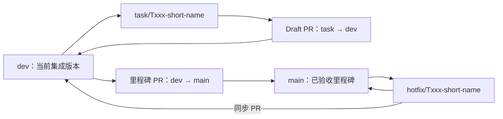

# MyTracer v0.1 GitHub 工作流

> 文档状态：已批准的开发工作流基线  
> 批准范围：GW-001～GW-010  
> 配置快照：截至 2026-08-23，远端、Actions 与 `dev`/`main` active rulesets 已配置；PR template 和 `main` 里程碑 PR 专用增强 CI 尚未落地
> 适用对象：项目所有者、Codex 和其他经授权 Agent

## 1. 目标

本流程用于：

- 隔离每个 Agent 任务，避免直接污染集成分支；
- 让代码、测试、评审和验收证据绑定到明确 PR；
- 保留项目所有者对产品语义、合并、里程碑和发布的控制；
- 使 `dev` 可以持续集成，`main` 始终代表已验收里程碑；
- 支持 Codex worktree，但不要求为了并行而并行。

GitHub 官方将 GitHub Flow 定义为轻量分支工作流：独立分支承载一组相关变更，通过 PR 评审和检查后合并，再删除任务分支。MyTracer 在此基础上增加 `dev` 集成门，以适配 v0.1 的阶段验收。参考：[GitHub Flow](https://docs.github.com/en/get-started/using-github/github-flow)。

## 2. GW-001 分支模型



### `main`

- 已由项目所有者验收的里程碑和发布来源。
- 常规功能分支不得直接以 `main` 为 base。
- 只接受 `dev -> main` 里程碑 PR，或从 `main` 创建的紧急 hotfix PR。
- tag 和 release 只从 `main` 创建。

### `dev`

- v0.1 当前集成线。
- 只包含已经完成任务级验证并经项目所有者批准合并的工作。
- 本地主检出应尽量保持干净，用于集成检查、Electron 前台运行和人工体验验收。

### 短期分支

- `task/Txxx-short-name`：正常实现任务。
- `fix/Txxx-short-name`：基于 `dev` 的缺陷修复。
- `docs/Txxx-short-name`：独立文档任务。
- `hotfix/Txxx-short-name`：基于 `main` 的紧急发布修复。

合并后删除短期远端分支；保留的事实位于 PR、commit、证据和长期分支中。

## 3. GW-002 Codex worktree

每个任务优先使用独立 Codex worktree 或普通任务分支：

```text
最新授权的 origin/dev
  → 独立 worktree
  → 实现和本地验证
  → 创建 task/Txxx-short-name
  → commit
  → push
  → Draft PR to dev
```

Codex 桌面版 worktree 可让多个任务使用独立检出；默认可能以 detached HEAD 开始，需要在发布前创建正式分支。同一分支不能同时被多个 worktree checkout。参考：[OpenAI Docs：Worktrees](https://learn.chatgpt.com/docs/environments/git-worktrees)。

约束：

- 不同时并行修改同一 migration、同一领域不变量或大面积重叠文件。
- 测试只使用临时 SQLite 数据库和临时数据根。
- 不通过 `.worktreeinclude` 或其他机制批量传播真实 AI key。
- Electron 只能在本地主环境可靠验证时，使用 Handoff 或经批准的手工迁移流程回到 Local。
- worktree 中的 `node_modules`、构建输出和临时数据库不得作为可交付证据。

## 4. GW-003 分支和提交命名

分支使用任务而非执行者作为主标识：

```text
task/T001-electron-shell
task/T003-sqlite-migrations
fix/T034-cross-midnight-date
docs/T090-agent-workflow
```

不使用 `temp1`、`test-final`、`new-fix` 等无法追踪的名称。

任务分支可以有多个有意义的本地提交。每个提交应表达一个可理解、可撤销的变化，不要求为每个微小修改单独提交，也不把整个阶段压成无法审查的单一开发提交。

PR 标题将作为 task PR 的 squash commit 标题，格式为：

```text
T001: initialize the Electron application shell
T011: implement the Goal lifecycle
T034: fix cross-midnight record assignment
```

代码、commit、分支和 PR 技术标题使用英文；面向项目所有者的说明和报告可以使用中文。

## 5. GW-004 Draft PR 生命周期

第一个有意义提交完成并获得发布授权后，创建：

```text
base: dev
head: task/Txxx-short-name
state: Draft
```

Draft PR 用于展示进行中工作和提前运行 CI，不表示已经完成或请求最终验收。GitHub Draft PR 在 Ready 前不能合并。参考：[GitHub Pull Requests](https://docs.github.com/en/pull-requests/reference/pull-requests)。

PR 正文至少包含：

```markdown
## Task
Txxx

## Goal
目标结果

## Requirements
FR-* / AC-* / D-* / ED-* / GW-*

## Scope
实际允许和修改的范围

## Exclusions
明确没有实施的内容

## Changes
实现摘要

## Verification
本地命令、环境和结果

## Evidence
Evidence ID、CI、截图或产物

## Risks and gaps
风险、未验证项和后续工作

## Dependency changes
无 / 已批准依赖
```

### Draft 转 Ready 条件

- 任务合同范围已经完成；
- 针对性测试和受影响回归实际通过；
- 最终 diff 已自查，没有意外或无关修改；
- 没有未批准依赖、延期功能或静默语义变化；
- 文档和需求追踪与实现一致；
- 已知缺口明确列出；
- 分支基于保护规则要求的最新 `dev`；
- Implementation Candidate 的完整 diff 已检查；
- Integration Freshness 状态为 `fresh` 或 `refreshed-and-passed`；
- affected regression 和 candidate required checks 已针对对应 revision 运行；
- 独立 Codex review 针对最终 candidate，且没有未处理的重大问题；
- docs closeout 后的 final-head required checks 已针对最新 PR head 运行；
- 项目所有者已授权标记 Ready，或亲自执行该操作。

### Early、Candidate 和 Final-head CI

- **early hosted CI**：Draft PR 创建后尽早运行，用于发现平台、依赖、Windows runner、Electron、打包和 CI 问题；结果只能标记为反馈或中间验证。
- **candidate hosted CI**：Implementation Candidate 完成完整 diff 检查、独立 review、Integration Freshness Gate 和 affected regression 后运行，是任务交付证据的一部分。
- **final-head CI**：owner-approved docs closeout commit 形成新的 PR head 后重新运行；较早 candidate CI 不能替代它。

顺序固定为：

```text
candidate CI green
  → owner confirms exact docs closeout scope
  → docs closeout commit
  → final-head CI
  → Task Delivery Revision
```

Draft PR、early CI 和中间 revision 都不表示任务完成。

## 5.1 Integration Freshness Gate

任务进入最终可合入 `dev` 状态前，必须比较任务验证基线与最新授权 `dev`：

| 状态 | 含义 |
|---|---|
| `fresh` | 验证基线就是最新授权 `dev` |
| `refreshed-and-passed` | 任务曾基于旧基线，普通 merge 刷新后 affected regression 和 candidate CI 通过 |
| `blocked` | 最新基线不可用、刷新不安全或冲突未解决 |
| `not-required` | 合同明确任务不进入当前 `dev` 集成 |

stale base 必须按以下顺序处理：获取最新授权 `dev`、以普通 merge 刷新任务分支、解决冲突、运行 affected regression、必要时重新 review、运行 candidate CI。不得 force-push 改写已发布任务历史。

Evidence 至少记录：

```yaml
integration_freshness:
  original_base_revision: abc123
  latest_authorized_dev_revision: def456
  verified_against_revision: def456
  status: refreshed-and-passed
  refresh_method: merge-dev-into-task-branch
```

`task_delivery_revision` 证明任务自身合同，`dev_integration_revision` 证明任务实际进入 `dev`，`stage_final_integration_revision` 只证明阶段最终集成 revision；三者不能互相替代。

如果刷新发现需求、架构、合同范围、权限、依赖、migration、测试能力或证据问题，停止受影响工作并使用 [`ESCALATION_PROPOSAL_TEMPLATE.md`](ESCALATION_PROPOSAL_TEMPLATE.md)。

## 6. GW-005/GW-006 合并策略

### 任务 PR：Squash and merge 到 `dev`

- 把一个任务收敛为 `dev` 上的一个提交。
- PR 仍保留开发提交、讨论和检查历史。
- squash commit 标题使用 PR 标题。
- 合并动作必须由项目所有者明确批准。

### 里程碑 PR：Merge commit 从 `dev` 到 `main`

- 保持 `dev` 是 `main` 的祖先，避免长期分支因 squash/rebase 产生反复比较和回灌问题。
- `main` 不启用“Require linear history”。
- 里程碑 PR 必须通过完整门禁和人工验收。
- merge commit、tag 和 release 均由项目所有者批准。

GitHub 支持 merge commit、squash 和 rebase 等不同合并方式；MyTracer 对两类 PR 采用不同策略是为了同时保持任务历史清晰和长期分支祖先关系。参考：[GitHub merge methods](https://docs.github.com/en/repositories/configuring-branches-and-merges-in-your-repository/configuring-pull-request-merges/about-merge-methods-on-github)。

## 7. GW-007 分支保护目标

`dev` 和 `main` 的目标规则如下；实际配置差异见第 15 节：

| 规则 | `dev` | `main` |
|---|---:|---:|
| 必须通过 PR | 是 | 是 |
| 必须通过 required checks | 是 | 是 |
| 必须解决所有讨论 | 是 | 是 |
| 禁止 force push | 是 | 是 |
| 禁止删除 | 是 | 是 |
| 要求分支基于最新目标分支 | 是 | 是 |
| 要求他人批准 | 否 | 否 |
| 允许管理员常规绕过 | 否 | 否 |
| 要求线性历史 | 否 | 否 |

当前是单人项目，不设置“一名他人批准”，避免 PR 作者无法批准自己的 PR而永久阻塞。项目所有者亲自执行 merge 是产品与发布批准，但仍必须满足 PR、检查和讨论门禁。

两个长期分支均不启用 GitHub 的线性历史限制。历史整洁度由“任务 PR squash、里程碑与回流 PR merge commit”的合并策略保证，同时保留 hotfix 从 `main` 回流 `dev` 的自然祖先关系。

GitHub 保护规则可以要求 PR、状态检查、讨论解决、禁止强推和删除；具体可用性受仓库类型和订阅方案影响。参考：[GitHub protected branches](https://docs.github.com/en/repositories/configuring-branches-and-merges-in-your-repository/managing-protected-branches/about-protected-branches)。

当前保护通过 repository rulesets 实现，而非 classic branch protection API；报告必须引用实时 ruleset 查询，不能把 classic endpoint 的 404 误写为“分支无保护”。

## 8. GW-008 CI 门禁

### Task PR 到 `dev`

S0 必须建立一个名称稳定、所有相关 PR 都会报告的 required gate。初始目标阶段：

```text
clean install
  → format check
  → lint
  → TypeScript typecheck
  → domain/application unit tests
  → SQLite and adapter integration tests
  → application build
```

随着基础设施完成，加入：

- Main/Preload IPC 契约测试；
- Electron E2E smoke；
- migration、重开和导出测试；
- Windows `better-sqlite3` 原生模块加载验证。

### `dev -> main` 里程碑 PR

在 task gate 基础上增加：

- 完整 E2E；
- Windows build/package；
- packaged/unpacked app 启动冒烟；
- SQLite migration 和重开；
- 完整 JSON 导出契约；
- Electron 安全设置；
- 对应 AC 自动化路径；
- 人工验收状态检查和已知缺口确认。

### CI 设计约束

- Windows runner 是必需验证环境；其他平台只能作为额外快速反馈，不得替代 Windows 证据。
- required job 名称在 workflows 间保持唯一。
- required workflow 不使用会导致整个 workflow 不运行的路径过滤；若需要条件，必须保证最终 gate 总是报告明确状态。
- required check 必须对应 PR 最新 revision。
- AI 自动化测试使用 fake provider，不向普通 PR 暴露真实 provider key。
- 只有验证逻辑确实依赖 Git 历史时才使用完整 checkout 历史，并记录原因。
- 精确 command、Node/Electron 版本和 workflow 文件需在依赖批准和 T002 执行时固定。
当前 `.github/workflows/verify.yml` 监听 `pull_request` 到 `dev`、`push` 到 `dev` 和手工触发，稳定 job 名为 `Windows required gate`。它没有监听 `main` PR/push，也不执行 package/NSIS smoke；里程碑增强门禁仍依赖同内容树的既有 required check 与另行记录的本地 Windows package 证据，不等于已落地独立 `main` workflow。


### V2 Batch 3 evidence artifact

采用 Batch 3 的任务应先运行 `npm.cmd run governance:metadata:check`，再用 `npm.cmd run evidence:verify` 包装现有 `npm.cmd run verify`。包装器必须保持原验证命令的退出码，并只在 ignored `.tmp/evidence/*.json` 生成脱敏事实 artifact。

Windows required job 可以使用以下固定上传约束：

```yaml
- name: Upload verification evidence
  if: always()
  uses: actions/upload-artifact@v4.6.2
  with:
    path: .tmp/evidence/*.json
    if-no-files-found: warn
    retention-days: 7
```

上传步骤不得写入 repository contents、Secrets、任务账本或长期文档。Artifact 不是 acceptance；Agent 仍须区分 early、candidate、final-head 和 post-merge CI，并把实际 artifact/run/head revision 绑定到 Evidence。

GitHub required checks 必须成功后才允许合并；被路径过滤跳过的 required workflow 可能长期 Pending。参考：[GitHub status checks](https://docs.github.com/en/pull-requests/reference/status-checks) 和 [required checks troubleshooting](https://docs.github.com/en/pull-requests/how-tos/merge-and-close-pull-requests/troubleshooting-required-status-checks)。

## 9. GW-009 Agent Git 权限

| 操作 | 默认规则 |
|---|---|
| 只读检查状态、历史、diff | 任务相关时允许 |
| 创建本地 worktree/任务分支 | 活跃任务明确授权 Git 工作流后允许 |
| 创建本地提交 | 活跃任务明确授权后允许 |
| 推送任务分支 | 任务明确授权“发布 Draft PR”后允许 |
| 创建/更新 Draft PR 到 `dev` | 同上 |
| 标记 Ready | 默认由项目所有者确认或执行 |
| 合并到 `dev` | 每次必须项目所有者明确授权 |
| 创建或合并 `dev -> main` | 每次必须项目所有者明确授权 |
| tag / GitHub Release | 每次必须项目所有者明确授权 |
| force push | 默认禁止；必须针对确切分支单独授权 |
| 修改 branch protection、Actions secrets、部署设置 | 必须针对确切目标单独授权 |

“实现任务”本身只授权范围内的本地文件修改和非破坏性验证，不自动授权外部 GitHub 写入。推荐在任务合同中一次性勾选允许的 branch、commit、push 和 Draft PR 操作，以减少重复确认；merge、tag 和 release 不提供站立授权。

## 10. GW-010 Code Review

### 本地独立 review

在 Ready 前使用 Codex review 检查：

- 未提交变更；或
- 相对 `dev` 的完整分支 diff；或
- 指定 commit。

Codex 的 `/review` 可以读取选择的 diff 并报告按优先级排序的问题，默认不修改工作树。参考：[OpenAI Docs：Code review](https://learn.chatgpt.com/docs/code-review)。

### GitHub Codex Review

若未来连接 Codex cloud，可在 PR 使用 `@codex review` 或自动 review。Review Rules 取自适用的 `AGENTS.md`，但 AI review 不替代测试、分支保护或项目所有者批准。参考：[OpenAI Docs：GitHub PR review](https://learn.chatgpt.com/docs/third-party/github)。

### 初始不采用 Codex GitHub Action 作为 required gate

原因：

- 需要额外 API key 和 Actions secret 管理；
- AI 结果不具备确定性；
- MyTracer 的初始门禁应由可重复命令组成；
- Windows Codex Action 有额外安全取舍。

以后只有在本地 review 流程稳定、成本和权限获得批准后，才评估只读 PR review action。参考：[OpenAI Docs：Codex GitHub Action](https://learn.chatgpt.com/docs/github-action)。

## 11. 里程碑、tag 和 release

建议的 `dev -> main` 节点：

| 节点 | 最低范围 | tag 候选 |
|---|---|---|
| G2 工程就绪 | T001～T004 | `v0.1.0-alpha.1` |
| 核心闭环可试用 | T011～T014 | `v0.1.0-alpha.2` |
| 数据安全可试用 | T031～T033 | `v0.1.0-beta.1` |
| G4 Demo 就绪 | AC-01～AC-07 | `v0.1.0-rc.1` 或 `v0.1.0` |

是否在每个候选节点推进 `main` 由项目所有者决定。任务或阶段通过不会自动创建 tag。

Release PR 必须列出：

- 包含的任务和需求；
- source `dev` revision；
- required CI run；
- Windows 打包产物；
- AC 自动化和人工验收状态；
- 数据迁移与恢复说明；
- 已知限制、未完成 SHOULD 和延期项扫描；
- 建议 tag，但不自动发布。

## 12. Hotfix

只有已发布或已验收 `main` 出现阻断问题时使用：

```text
main
  → hotfix/Txxx-name
  → PR to main
  → full affected verification
  → owner-approved merge and patch tag
  → immediate synchronization PR from main to dev
```

不得只修 `main` 而让 `dev` 保留缺陷。若 hotfix 会改变冻结语义，仍需先走需求变更流程。
`main -> dev` 的同步 PR 使用 merge commit，不适用普通任务 PR 的 squash 规则。

## 13. GitHub Issues 和 Projects

- v0.1 实施任务状态以 [`TASK_INDEX_V0.1.md`](TASK_INDEX_V0.1.md) 为唯一账本。
- 不为每个已规划任务重复创建 GitHub Issue。
- Issue 适合记录运行中发现的缺陷、阻塞、需求变更提案或外部可协作问题。
- PR 通过 Task ID 关联任务索引；若存在 Issue，再额外关联 Issue。
- 当前不引入 GitHub Projects，除非任务数量或协作者数量使文档索引不再有效。

## 14. 启用顺序

1. [x] GitHub 远端、`dev` 和 `main` 已建立；default branch 为 `main`。
2. [x] 依赖、工具链和精确验证命令已批准并锁定。
3. [x] T002 建立确定性 Windows CI workflow，T091 增加脱敏 evidence artifact。
4. [x] stable check `Windows required gate` 已实际运行并纳入 rulesets。
5. [partial] `Dev-Rule` / `Main-Rule` 已 active 且无 bypass actor；`main` 要求最新目标分支，`dev` 当前未启用 strict update，仍与第 7 节目标存在差异。
6. [ ] PR template 尚不存在。
7. [x] 多个任务已完成 Draft PR、candidate/final-head CI 和 owner merge 演练。
8. [ ] GitHub Codex Review/Action 等扩展未采用；没有独立需求时不启用。

以上是 2026-08-23 的只读配置快照，不替代实时 GitHub 查询，也不自动授权任何配置写入。

## 15. 当前结论

- GW-001～GW-010 是 MyTracer v0.1 的批准流程；实时配置是其部分实现，差异不得靠文档假定消失。
- 仓库为 private、default branch 为 `main`；Verification Actions 已持续运行，PR #29 final head run `32630998007` 与 `dev@eec0939...` push run `32631739929` 成功。
- active `Dev-Rule` / `Main-Rule` 均要求 PR、讨论解决、`Windows required gate`，禁止删除和 non-fast-forward，且没有 bypass actor；`main` strict、`dev` non-strict。classic branch protection API 返回 404 是因为当前采用 rulesets，不代表无保护。
- PR template 不存在；Verification 不监听 `main` PR/push；GitHub Milestones 列表为空。这三项均是事实或配置缺口，不在纯文档 T804 中修改。
- 项目已通过 PR #5/#14/#22/#30 四次将 `dev` 里程碑合入 `main`，并发布 `v0.1.0-alpha.1`、`alpha.2`、`alpha.3` 和 `beta.1` prereleases。
- 任何 ruleset、workflow、template、merge、tag 或 release 后续写入仍须独立授权和验证。
